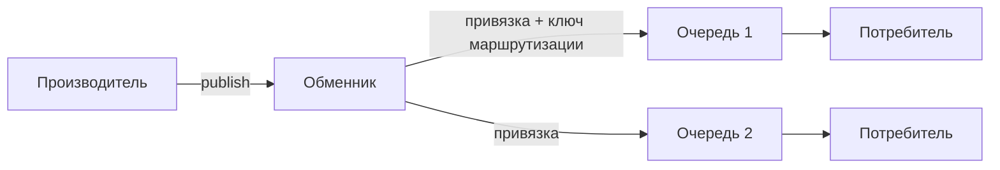

# Обмен сообщениями и модель AMQP: основы

🌐 **Русский** · [English](basics.en.md)

**Уровни:** [overview](overview.ru.md) · **1. Основы** · [2. Продвинутый](advanced.ru.md) · [3. Эксперт](expert.ru.md) · [4. Квиз](quiz.ru.md)

**Пререквизиты:** основы [Python](../../../python/overview.ru.md) · **Время:** ~1,5 ч

## Как проверялся код

Все примеры запускались на **настоящем брокере**: RabbitMQ 4.4.1 (Erlang 29.1.2) в Docker (`rabbitmq:4-management`) и Python с `pika` 1.5.0. Выводы скопированы из этих запусков. Код, не запускавшийся на брокере, помечен.

pika 1.5.0 объявляет `BlockingConnection` устаревшим; замена — `pika.Connection`, которое запускает собственный цикл ввода-вывода в фоновом потоке и даёт блокирующий потокобезопасный API. Примеры используют его.

## Зачем нужен брокер

Когда сервис A вызывает сервис B напрямую, оба должны быть живы одновременно, а A ждёт B. **Брокер сообщений** (message broker) стоит между ними: A отдаёт сообщение брокеру и идёт дальше; B забирает его, когда готов. Вы получаете:

- **Развязку по времени:** B может быть недоступен или медлителен; сообщения ждут в очереди.
- **Сглаживание всплесков:** очередь поглощает пик, который B обрабатывает в своём темпе.
- **Рассылку:** одно событие может дойти до многих потребителей, неизвестных производителю.
- **Логику повторов и маршрутизации** в одном месте, а не в каждом сервисе.

Цена — ещё один компонент, согласованность в конечном счёте (eventual consistency) и необходимость думать о дубликатах и потерях (модуль 05 ([дорожная карта](../../overview.ru.md))).

## Модель AMQP



- **Производитель** (producer) публикует сообщение в **обменник** (exchange), а не прямо в очередь.
- Обменник маршрутизирует его по своему **типу** и **привязкам** (bindings: правила, связывающие обменник с очередью, обычно с ключом привязки), используя **ключ маршрутизации** (routing key) сообщения.
- **Очередь** (queue) хранит сообщения, пока их не заберёт **потребитель** (consumer).
- Сообщение — это тело (байты) плюс свойства (тип содержимого, заголовки, режим доставки, …).

Модель одинакова для любого клиента AMQP 0-9-1. **Обменник по умолчанию** (безымянный, `""`) создаёт ощущение записи прямо в очередь: он маршрутизирует по имени очереди.

## Соединение и канал

**Соединение** (connection) — одно долгоживущее TCP-подключение к брокеру. **Канал** (channel) — лёгкое виртуальное соединение внутри него; почти все операции выполняются на канале. Открыть TCP-соединение дорого, канал дёшев, поэтому приложения держат одно соединение и открывают из него каналы.

```python
import pika

conn = pika.Connection(pika.ConnectionParameters("localhost"))
ch = conn.channel()
print("channel", ch.channel_number)
```

```text
channel 1
```

## Первое сообщение

```python
q = ch.queue_declare(queue="hello", durable=True)
print("declare:", q.method.queue, q.method.message_count, q.method.consumer_count)
ch.basic_publish(exchange="", routing_key="hello", body=b"Hello, RabbitMQ!")
```

```text
declare: hello 0 0
```

`queue_declare` идемпотентен: создаёт очередь, если её нет, и ничего не делает, если она есть с теми же аргументами. В ответе — имя очереди, число готовых сообщений и потребителей. Публикация в обменник по умолчанию с `routing_key="hello"` кладёт сообщение в очередь `hello`.

## Получение: get и consume

Два способа получать:

- **`basic_get`** — опрашивает одно сообщение (`(None, None, None)`, если очередь пуста). Просто, но неэффективно.
- **`basic_consume`** — подписка; брокер **присылает** сообщения в обработчик.

```python
method, props, body = ch.basic_get("hello", auto_ack=False)
print("get:", body, method.delivery_tag, method.redelivered, repr(method.exchange), repr(method.routing_key))
ch.basic_ack(method.delivery_tag)
print("empty get:", ch.basic_get("hello"))
```

```text
get: b'Hello, RabbitMQ!' 1 False '' 'hello'
empty get: (None, None, None)
```

Режим push с обработчиком (обработчик выполняется в рабочем потоке соединения):

```python
import queue
got = queue.Queue()

def on_message(ch_, method, props, body):
    got.put(body)
    ch_.basic_ack(method.delivery_tag)

tag = ch.basic_consume("hello", on_message)
print("consumed:", [got.get(timeout=5), got.get(timeout=5)])
ch.basic_cancel(tag)
```

```text
consumed: [b'one', b'two']
```

(`one` и `two` были опубликованы заранее.)

## Подтверждения

Отдав сообщение, брокер ждёт **подтверждения** (acknowledgement) от потребителя — `basic_ack`. До этого сообщение считается неподтверждённым. Если потребитель умер или его канал закрылся без подтверждения, брокер **вернёт сообщение в очередь** и пометит его `redelivered`. Это и делает возможной обработку «минимум один раз» (at-least-once). `auto_ack=True` пропускает ожидание: брокер считает сообщение доставленным сразу, и сбой потребителя его теряет. Подробности — в [модуле 03](../03-queues-and-delivery/overview.ru.md).

## Ошибки закрывают каналы

Недопустимая операция не вызывает вежливого исключения посреди вызова: брокер отвечает ошибкой и **закрывает канал**:

```python
ch3 = conn.channel()
try:
    ch3.queue_declare(queue="nobody", passive=True)   # passive: only check existence
except pika.exceptions.ChannelClosedByBroker as e:
    print("passive declare of missing queue:", e.reply_code, e.reply_text)
print("conn open:", conn.is_open, "channel closed:", ch3.is_closed)
```

```text
passive declare of missing queue: 404 NOT_FOUND - no queue 'nobody' in vhost '/'
conn open: True channel closed: True
```

Соединение живо; канал мёртв и его нужно заменить. Поэтому не делите один канал между несвязанными задачами и не используйте пассивное объявление как небрежную проверку «есть ли такое» на нужном вам канале.

Публикация в несуществующее имя очереди через обменник по умолчанию **не** падает: сообщение молча отбрасывается (случай «немаршрутизируемого» сообщения, см. [модуль 02](../02-exchanges-and-routing/overview.ru.md)).

## Очереди должны быть durable или exclusive

> RabbitMQ 4.4 отказывается создавать очередь, которая не durable и не exclusive.

```python
c0 = pika.Connection(pika.ConnectionParameters("localhost"))
try:
    c0.channel().queue_declare("tmp-nd")
except pika.exceptions.ConnectionClosedByBroker as e:
    print("transient queue:", e.reply_code, e.reply_text.splitlines()[0])
```

```text
transient queue: 541 INTERNAL_ERROR - Feature `transient_nonexcl_queues` is deprecated.
```

Брокер закрыл **всё соединение**, а не только канал. Многие старые учебники объявляют `queue_declare("hello")` без `durable=True`; на этой версии такой код падает. Используйте `durable=True` (переживает перезапуск) или `exclusive=True` (личная для одного соединения, удаляется вместе с ним).

## Заглянуть внутрь брокера

- Management UI: `http://localhost:15672` (`guest`/`guest`).
- CLI внутри контейнера: `docker exec rabbit rabbitmqctl list_queues name messages`.
- HTTP API, например `GET /api/overview`; в запуске он сообщил `4.4.1` и Erlang `29.1.2`.

Счётчики сообщений сразу после публикации могут отставать: публикация асинхронна, а процесс очереди обновляет счётчик чуть позже. В тесте из трёх подряд публикаций счётчики, прочитанные сразу, дали `1 1 2`, а через секунду — `3`.

## Типичные ошибки новичков

- ❌ Объявлять transient-очередь на 4.4 → ✅ `durable=True` или `exclusive=True`.
- ❌ Читать `message_count` сразу после публикации и верить ему → ✅ подождать или использовать confirms (модуль 05 ([дорожная карта](../../overview.ru.md))).
- ❌ `auto_ack=True` для работы, которую нельзя терять → ✅ подтверждать после обработки.
- ❌ Один общий канал на всё → ✅ соединение на процесс, каналы на задачу или поток.
- ❌ Отправлять в несуществующую очередь и ждать ошибки → ✅ сначала объявить её или использовать `mandatory` ([модуль 02](../02-exchanges-and-routing/overview.ru.md)).
- ❌ Оставлять `guest/guest` в продакшене → ✅ собственные пользователи (модуль 11 ([дорожная карта](../../overview.ru.md))).

## Связанные материалы

- Дальше: [продвинутая теория](advanced.ru.md) — свойства, параметры соединения, ошибки при публикации
- Следующий модуль: [02 · Обменники и маршрутизация](../02-exchanges-and-routing/overview.ru.md)
- Параллели: [очереди Python asyncio](../../../python/overview.ru.md), [фоновые задачи в C#](../../../csharp/recipes/background-jobs/overview.ru.md)

## Источники

- [AMQP 0-9-1 Model Explained](https://www.rabbitmq.com/tutorials/amqp-concepts)
- [Queues](https://www.rabbitmq.com/docs/queues)
- [Consumer Acknowledgements and Publisher Confirms](https://www.rabbitmq.com/docs/confirms)
- [pika: thread-safe connection](https://pika.github.io/pika/latest/modules/adapters/thread_safe/)
