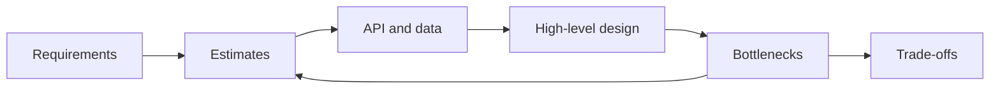

# Design process and estimation: expert

🌐 [Русский](expert.ru.md) · **English**

**Levels:** [overview](overview.en.md) · [1. Basics](basics.en.md) · [2. Advanced](advanced.en.md) · **3. Expert** · [4. Quiz](quiz.en.md)

## Under the hood

The calculations rest on three models.

- **Little's law** `L = λW` holds on average for any stable system, whatever the arrival distribution.
- **Queues.** As the utilization of a resource approaches 100%, waiting time grows non-linearly. That is why capacity is planned with headroom: the target utilization is well below 100%.
- **Probabilities.** The availability formulas assume independent failures. A shared dependency (DNS, configuration, one release for all replicas) breaks that assumption.



### Queueing theory: why you cannot run at 100%

The M/M/1 model is a random stream of requests, random (exponential) service time and one server. The mean response time is `S / (1 - ρ)`, where `S` is the service time and `ρ` the utilization.

```csharp
public static double MeanResponse(double serviceTime, double utilization)
{
    ArgumentOutOfRangeException.ThrowIfNegative(utilization);
    ArgumentOutOfRangeException.ThrowIfGreaterThanOrEqual(utilization, 1);
    return serviceTime / (1 - utilization);
}
```

| Utilization | Mean response time with S = 10 ms |
|---|---|
| 50% | 20 ms |
| 80% | 50 ms |
| 90% | 100 ms |
| 99% | 1000 ms |

The last percent of utilization is the most expensive: going from 90% to 99% makes the response time ten times longer.

### Many servers and one queue

The Erlang C formula gives the probability that a request has to wait when `c` servers share a queue. At the same 80% utilization a large pool waits far less.

| Servers | Load | Probability of waiting | Mean wait with S = 10 ms |
|---|---|---|---|
| 1 | 0.8 | 0.8 | 40 ms |
| 10 | 8 | 0.409 | 2.05 ms |

Two conclusions: a shared queue is better than ten separate ones, and a small pool needs a larger relative headroom. File: [Ex04_Queueing.cs](code/Examples/Ex04_Queueing.cs). Real traffic need not follow the model's assumptions (bursts, a long tail of service times), so this is a guide, not a forecast.

### MTBF and MTTR

Reliability depends on how often the system fails (MTBF or MTTF) and how fast it recovers (MTTR). In a steady-state model availability is `MTBF / (MTBF + MTTR)`.

```csharp
public static double Availability(TimeSpan meanTimeBetweenFailures, TimeSpan meanTimeToRepair) =>
    meanTimeBetweenFailures / (meanTimeBetweenFailures + meanTimeToRepair);
```

One failure in 30 days with an hour to recover gives 99.861%, with 5 minutes 99.988%. Shortening recovery is often cheaper than making failures rarer.

## Reference

| Requirements question | What it affects |
|---|---|
| How many users and what peak | number of instances, sharding |
| Read-to-write ratio | cache, read replicas, denormalization |
| Object size and retention | store type and volume |
| Acceptable latency (p50, p99) | geography, synchronous calls |
| Acceptable data staleness | consistency model, cache |
| RPO and RTO | backups, replication |
| Regulatory requirements | storage region, audit, deletion |
| Budget and team size | managed services, complexity |

| Formula | Meaning |
|---|---|
| `QPS = per_day / 86400` | average load |
| `L = λW` | requests in progress |
| `A = A1 · A2 · …` | serial dependencies |
| `A = 1 - (1-A1)(1-A2)…` | independent replicas |
| `budget = 1 - SLO` | error budget |
| `burn = error_ratio / (1 - SLO)` | consumption speed |
| `P(slow) = 1 - (1-p)^n` | tail with fan-out |

| Recovery requirement | What it means |
|---|---|
| RPO (recovery point objective) | how much data, measured in time, may be lost |
| RTO (recovery time objective) | how quickly service must be restored |

| Operation (order of magnitude, Google's table) | Time |
|---|---|
| L1 cache reference | 1 ns |
| L2 cache reference | 4 ns |
| mutex lock and unlock | 17 ns |
| main memory reference | 100 ns |
| compress 1 KB (Zippy) | 2 µs |
| random 4 KB read from SSD | 20 µs |
| round trip within a datacenter | 500 µs |
| sequential 1 MB read from SSD | 1 ms |
| disk seek | 10 ms |
| round trip between continents | 150 ms |

The numbers are approximate and depend on hardware. The ratios matter: memory is faster than the network, a network inside a datacenter is incomparably faster than an intercontinental one, and ten sequential round trips across an ocean already take a second and a half.

| Cost item | How to estimate |
|---|---|
| Compute | instances × price × hours, with failure headroom |
| Storage | volume × replication × retention × price |
| Egress | peak and average volume × price per GB |
| Managed service requests | number of operations × price |
| Observability | volume of logs, metrics and traces |
| People | on-call and maintenance |

Take prices from your provider's calculator on the date of the estimate and record them next to the assumptions.

| Load test kind | Question |
|---|---|
| Load | do we hold the expected peak? |
| Stress | where and how does it break? |
| Spike | do we survive a sharp burst? |
| Soak | are there leaks over a long run? |

| Load model | How requests are produced |
|---|---|
| Closed | the next request after the previous response |
| Open | on a schedule, regardless of responses |

## Gotchas

### int overflow in an estimate

```csharp
int users = 10_000_000, perUser = 20, bytes = 500;
Console.WriteLine(users * perUser * bytes);
Console.WriteLine((long)users * perUser * bytes);
```

Result: `1215752192`, then `100000000000`. `int` arithmetic is unchecked by default and overflows silently. Use `long` or `double` for volumes.

### The average of two p99 values is not a p99

```csharp
var fast = Enumerable.Repeat(10.0, 990).ToArray();
var slow = Enumerable.Repeat(1000.0, 10).ToArray();
double averaged = (P(fast, 99) + P(slow, 99)) / 2;   // P is the nearest-rank percentile
double real = P(fast.Concat(slow), 99);
```

Result: `averaged` = 505, `real` = 10. Percentiles can neither be added nor averaged: a server with a small share of traffic gets the same weight in an "average p99" as the main one.

### A closed load model hides a stall

A simulation: 1000 requests every 10 ms, 1 ms of processing, and in the middle the server freezes for a second.

```csharp
// Closed model: the next request is sent only after the previous one has finished.
double sent = Math.Max(now, i * interval);
double finished = Finish(sent, service, stallAt, stall);
latencies.Add(finished - sent);
```

| Model | Requests slower than 100 ms | p99 |
|---|---|---|
| closed | 1 | 1 ms |
| open | 101 | 911 ms |

During the stall a closed generator simply sends nothing and does not notice that users would have waited. This is called coordinated omission. Use an open model (in k6, the executors with a constant or ramping arrival rate). File: [Ex05_LoadModels.cs](code/Examples/Ex05_LoadModels.cs).

## Trade-offs and alternatives

| Choice | Pro | Con |
|---|---|---|
| More "nines" | less downtime | many times more expensive, slower releases |
| Synchronous call | simplicity, immediate result | availabilities multiply |
| Asynchronous queue | decoupling and peak smoothing | delay and eventual consistency |
| Detailed estimate | fewer surprises | rests on assumptions, goes stale quickly |

Estimates do not replace load testing: they tell you *what* to test.

## Interview questions

**1. Where do you start with "design X"?**

<details><summary>Answer</summary>

By clarifying functional and non-functional requirements and the scope, then estimating the load.

</details>

**2. What is the difference between an SLO and an SLA?**

<details><summary>Answer</summary>

An SLO is an internal target for an indicator. An SLA is a contract with consequences for a breach.

</details>

**3. Three 99.9% services are called in sequence. What is the availability?**

<details><summary>Answer</summary>

About 99.70% (`0.999^3`), if failures are independent and all three are required.

</details>

**4. Do two 99% replicas always give 99.99%?**

<details><summary>Answer</summary>

No. Only with independent failures and instant failover. A shared dependency or a slow failover makes the result worse.

</details>

**5. Why not look at the average latency?**

<details><summary>Answer</summary>

It mixes fast and slow requests and hides the tail. Look at p50, p95, p99.

</details>

**6. How do you estimate the number of concurrently running requests?**

<details><summary>Answer</summary>

With Little's law: RPS × latency in seconds.

</details>

**7. What is an error budget and what is it for?**

<details><summary>Answer</summary>

`1 - SLO`. It is a shared criterion for choosing between release speed and reliability.

</details>

**8. A system makes 30 parallel calls, each slow in 1% of cases. How many requests will be slow?**

<details><summary>Answer</summary>

About 26%: `1 - 0.99^30`, assuming the calls are independent.

</details>

**9. What are RPO and RTO?**

<details><summary>Answer</summary>

RPO is the acceptable data loss measured in time, RTO is the acceptable recovery time.

</details>

**10. Trick question: a service returns 200 for 100% of requests. Is it 100% available?**

<details><summary>Answer</summary>

Not necessarily: responses may be empty, stale or too slow, and some requests may never have reached the service. SLIs have to be defined from the user's point of view.

</details>

**11. Why is a service at 95% utilization dangerous?**

<details><summary>Answer</summary>

Waiting time grows non-linearly: in the M/M/1 model it is already twenty service times, and a small burst floods the queue.

</details>

**12. Which is better: one pool of ten workers or ten separate queues?**

<details><summary>Answer</summary>

All else equal, a shared pool: any free worker takes any task. Separate queues are for isolation or ordering.

</details>

**13. How do you raise availability without reducing the number of failures?**

<details><summary>Answer</summary>

Shorten MTTR: detect faster, automate rollback and failover, have instructions.

</details>

**14. What is coordinated omission?**

<details><summary>Answer</summary>

A measurement error where the load generator slows down together with the system and misses the requests that should have been sent.

</details>

**15. Trick question: the load test showed p99 = 1 ms. Ready to release?**

<details><summary>Answer</summary>

First check the load model, how realistic the data is, the duration and whether queueing time was measured.

</details>

## Related materials

- [Advanced theory](advanced.en.md)
- [Quiz](quiz.en.md) and [exercises](exercises.en.md)

## Sources

- [Google SRE Book: Service Level Objectives](https://sre.google/sre-book/service-level-objectives/)
- [Google SRE Workbook: Alerting on SLOs](https://sre.google/workbook/alerting-on-slos/)
- [Google: Rule-of-thumb latency numbers](https://sre.google/static/pdf/rule-of-thumb-latency-numbers-letter.pdf)
- [Google SRE Book: Introduction](https://sre.google/sre-book/introduction/)
- [k6: open and closed models](https://grafana.com/docs/k6/latest/using-k6/scenarios/concepts/open-vs-closed/)
