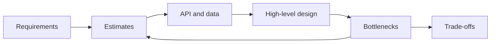

# Design process and estimation: expert

🌐 [Русский](expert.ru.md) · **English**

**Levels:** [overview](overview.en.md) · [1. Basics](basics.en.md) · [2. Advanced](advanced.en.md) · **3. Expert** · [4. Quiz](quiz.en.md)

## Under the hood

The calculations rest on three models.

- **Little's law** `L = λW` holds on average for any stable system, whatever the arrival distribution.
- **Queues.** As the utilization of a resource approaches 100%, waiting time grows non-linearly. That is why capacity is planned with headroom: the target utilization is well below 100%.
- **Probabilities.** The availability formulas assume independent failures. A shared dependency (DNS, configuration, one release for all replicas) breaks that assumption.



## Reference

| Requirements question | What it affects |
|---|---|
| How many users and what peak | number of instances, sharding |
| Read-to-write ratio | cache, read replicas, denormalization |
| Object size and retention | store type and volume |
| Acceptable latency (p50, p99) | geography, synchronous calls |
| Acceptable data staleness | consistency model, cache |
| RPO and RTO | backups, replication |
| Regulatory requirements | storage region, audit, deletion |
| Budget and team size | managed services, complexity |

| Formula | Meaning |
|---|---|
| `QPS = per_day / 86400` | average load |
| `L = λW` | requests in progress |
| `A = A1 · A2 · …` | serial dependencies |
| `A = 1 - (1-A1)(1-A2)…` | independent replicas |
| `budget = 1 - SLO` | error budget |
| `burn = error_ratio / (1 - SLO)` | consumption speed |
| `P(slow) = 1 - (1-p)^n` | tail with fan-out |

| Recovery requirement | What it means |
|---|---|
| RPO (recovery point objective) | how much data, measured in time, may be lost |
| RTO (recovery time objective) | how quickly service must be restored |

## Gotchas

### int overflow in an estimate

```csharp
int users = 10_000_000, perUser = 20, bytes = 500;
Console.WriteLine(users * perUser * bytes);
Console.WriteLine((long)users * perUser * bytes);
```

Result: `1215752192`, then `100000000000`. `int` arithmetic is unchecked by default and overflows silently. Use `long` or `double` for volumes.

### The average of two p99 values is not a p99

```csharp
var fast = Enumerable.Repeat(10.0, 990).ToArray();
var slow = Enumerable.Repeat(1000.0, 10).ToArray();
double averaged = (P(fast, 99) + P(slow, 99)) / 2;   // P is the nearest-rank percentile
double real = P(fast.Concat(slow), 99);
```

Result: `averaged` = 505, `real` = 10. Percentiles can neither be added nor averaged: a server with a small share of traffic gets the same weight in an "average p99" as the main one.

## Trade-offs and alternatives

| Choice | Pro | Con |
|---|---|---|
| More "nines" | less downtime | many times more expensive, slower releases |
| Synchronous call | simplicity, immediate result | availabilities multiply |
| Asynchronous queue | decoupling and peak smoothing | delay and eventual consistency |
| Detailed estimate | fewer surprises | rests on assumptions, goes stale quickly |

Estimates do not replace load testing: they tell you *what* to test.

## Interview questions

**1. Where do you start with "design X"?**

<details><summary>Answer</summary>

By clarifying functional and non-functional requirements and the scope, then estimating the load.

</details>

**2. What is the difference between an SLO and an SLA?**

<details><summary>Answer</summary>

An SLO is an internal target for an indicator. An SLA is a contract with consequences for a breach.

</details>

**3. Three 99.9% services are called in sequence. What is the availability?**

<details><summary>Answer</summary>

About 99.70% (`0.999^3`), if failures are independent and all three are required.

</details>

**4. Do two 99% replicas always give 99.99%?**

<details><summary>Answer</summary>

No. Only with independent failures and instant failover. A shared dependency or a slow failover makes the result worse.

</details>

**5. Why not look at the average latency?**

<details><summary>Answer</summary>

It mixes fast and slow requests and hides the tail. Look at p50, p95, p99.

</details>

**6. How do you estimate the number of concurrently running requests?**

<details><summary>Answer</summary>

With Little's law: RPS × latency in seconds.

</details>

**7. What is an error budget and what is it for?**

<details><summary>Answer</summary>

`1 - SLO`. It is a shared criterion for choosing between release speed and reliability.

</details>

**8. A system makes 30 parallel calls, each slow in 1% of cases. How many requests will be slow?**

<details><summary>Answer</summary>

About 26%: `1 - 0.99^30`, assuming the calls are independent.

</details>

**9. What are RPO and RTO?**

<details><summary>Answer</summary>

RPO is the acceptable data loss measured in time, RTO is the acceptable recovery time.

</details>

**10. Trick question: a service returns 200 for 100% of requests. Is it 100% available?**

<details><summary>Answer</summary>

Not necessarily: responses may be empty, stale or too slow, and some requests may never have reached the service. SLIs have to be defined from the user's point of view.

</details>

## Related materials

- [Advanced theory](advanced.en.md)
- [Quiz](quiz.en.md) and [exercises](exercises.en.md)

## Sources

- [Google SRE Book: Service Level Objectives](https://sre.google/sre-book/service-level-objectives/)
- [Google SRE Workbook: Alerting on SLOs](https://sre.google/workbook/alerting-on-slos/)
