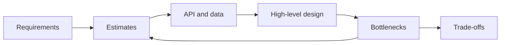

# Процесс проектирования и оценки: экспертная теория

🌐 **Русский** · [English](expert.en.md)

**Уровни:** [обзор](overview.ru.md) · [1. Базовая](basics.ru.md) · [2. Продвинутая](advanced.ru.md) · **3. Экспертная** · [4. Квиз](quiz.ru.md)

## Под капотом

Расчёты опираются на три модели.

- **Закон Литтла** `L = λW` верен для любой устойчивой системы в среднем, независимо от распределения прихода запросов.
- **Очереди.** Когда загрузка ресурса приближается к 100%, время ожидания растёт нелинейно. Поэтому мощность планируют с запасом: целевая загрузка заметно ниже 100%.
- **Вероятности.** Формулы доступности предполагают независимость отказов. Общая зависимость (DNS, конфигурация, один релиз на все реплики) это предположение нарушает.



## Справочник

| Вопрос о требованиях | На что влияет |
|---|---|
| Сколько пользователей и какой пик | число экземпляров, шардирование |
| Отношение чтения к записи | кэш, реплики чтения, денормализация |
| Размер объекта и срок хранения | тип и объём хранилища |
| Допустимая задержка (p50, p99) | география, синхронность вызовов |
| Допустимое устаревание данных | модель согласованности, кэш |
| RPO и RTO | резервное копирование, репликация |
| Регуляторные требования | регион хранения, аудит, удаление |
| Бюджет и размер команды | managed-сервисы, сложность |

| Формула | Смысл |
|---|---|
| `QPS = в_день / 86400` | средняя нагрузка |
| `L = λW` | одновременно обрабатываемые запросы |
| `A = A1 · A2 · …` | последовательные зависимости |
| `A = 1 - (1-A1)(1-A2)…` | независимые реплики |
| `budget = 1 - SLO` | бюджет ошибок |
| `burn = error_ratio / (1 - SLO)` | скорость расхода |
| `P(slow) = 1 - (1-p)^n` | хвост при fan-out |

| Требование к восстановлению | Что означает |
|---|---|
| RPO (recovery point objective) | сколько данных по времени допустимо потерять |
| RTO (recovery time objective) | за какое время нужно восстановить работу |

## Подвохи

### Переполнение int в оценке

```csharp
int users = 10_000_000, perUser = 20, bytes = 500;
Console.WriteLine(users * perUser * bytes);
Console.WriteLine((long)users * perUser * bytes);
```

Результат: `1215752192`, затем `100000000000`. Арифметика `int` по умолчанию не проверяется и молча переполняется. Для объёмов используйте `long` или `double`.

### Среднее двух p99 не является p99

```csharp
var fast = Enumerable.Repeat(10.0, 990).ToArray();
var slow = Enumerable.Repeat(1000.0, 10).ToArray();
double averaged = (P(fast, 99) + P(slow, 99)) / 2;   // P is the nearest-rank percentile
double real = P(fast.Concat(slow), 99);
```

Результат: `averaged` = 505, `real` = 10. Перцентили не складываются и не усредняются: сервер с малой долей трафика получает в «среднем p99» тот же вес, что и основной.

## Компромиссы и альтернативы

| Выбор | Плюс | Минус |
|---|---|---|
| Больше «девяток» | меньше простоя | кратно дороже, медленнее релизы |
| Синхронный вызов | простота, сразу результат | доступности перемножаются |
| Асинхронная очередь | развязка и сглаживание пиков | задержка и согласованность «в конечном счёте» |
| Детальная оценка | меньше сюрпризов | опирается на допущения, быстро устаревает |

Оценки не заменяют нагрузочное тестирование: они говорят, *что* тестировать.

## Вопросы с собеседований

**1. С чего начать задачу «спроектируйте X»?**

<details><summary>Ответ</summary>

С уточнения функциональных и нефункциональных требований и границ задачи, затем оценки нагрузки.

</details>

**2. Чем отличаются SLO и SLA?**

<details><summary>Ответ</summary>

SLO — внутренняя цель по показателю. SLA — договор, в котором есть последствия за нарушение.

</details>

**3. Три сервиса по 99,9% вызываются последовательно. Какая доступность?**

<details><summary>Ответ</summary>

Около 99,70% (`0.999^3`), если отказы независимы и все три обязательны.

</details>

**4. Две реплики по 99% всегда дают 99,99%?**

<details><summary>Ответ</summary>

Нет. Только при независимых отказах и мгновенном переключении. Общая зависимость или медленный failover ухудшают результат.

</details>

**5. Почему не смотреть на среднюю задержку?**

<details><summary>Ответ</summary>

Она смешивает быстрые и медленные запросы и скрывает хвост. Смотрят p50, p95, p99.

</details>

**6. Как оценить число одновременно выполняющихся запросов?**

<details><summary>Ответ</summary>

По закону Литтла: RPS × задержка в секундах.

</details>

**7. Что такое бюджет ошибок и зачем он?**

<details><summary>Ответ</summary>

`1 - SLO`. Это общий критерий для выбора между скоростью релизов и надёжностью.

</details>

**8. Система делает 30 параллельных вызовов, каждый медленный в 1% случаев. Сколько запросов будет медленными?**

<details><summary>Ответ</summary>

Примерно 26%: `1 - 0.99^30`, при независимости вызовов.

</details>

**9. Что такое RPO и RTO?**

<details><summary>Ответ</summary>

RPO — допустимая потеря данных по времени, RTO — допустимое время восстановления.

</details>

**10. Подвох: сервис отвечает 200 на 100% запросов. Он доступен на 100%?**

<details><summary>Ответ</summary>

Не обязательно: ответы могут быть пустыми, устаревшими или слишком медленными, а часть запросов могла не дойти до сервиса. SLI нужно определять с точки зрения пользователя.

</details>

## Связанные материалы

- [Продвинутая теория](advanced.ru.md)
- [Квиз](quiz.ru.md) и [упражнения](exercises.ru.md)

## Источники

- [Google SRE Book: Service Level Objectives](https://sre.google/sre-book/service-level-objectives/)
- [Google SRE Workbook: Alerting on SLOs](https://sre.google/workbook/alerting-on-slos/)
