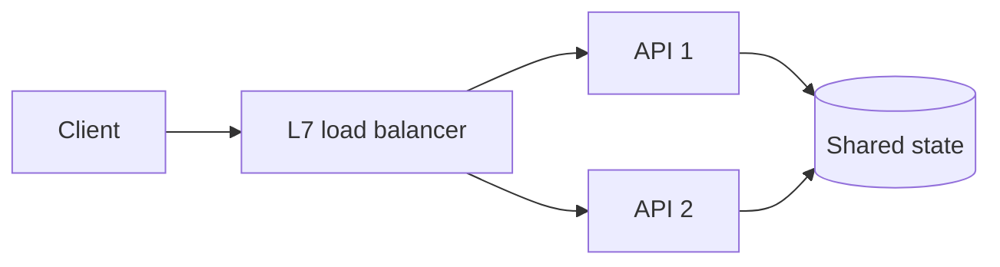

# Scaling and load balancing: expert

🌐 [Русский](expert.ru.md) · **English**

**Levels:** [overview](overview.en.md) · [1. Basics](basics.en.md) · [2. Advanced](advanced.en.md) · **3. Expert** · [4. Quiz](quiz.en.md)

## Under the hood

Amdahl's law: if a fraction `s` of the work is serial, the speedup on `n` nodes is `n / (1 + s(n-1))` and never exceeds `1/s`. The Universal Scalability Law (USL) adds the cost of keeping nodes in agreement, because of which throughput *drops* after the peak.

```csharp
public static double Amdahl(double serialFraction, int n) => n / (1 + serialFraction * (n - 1));

// contention: waiting for a shared resource; coherency: nodes keeping each other up to date.
public static double Universal(double contention, double coherency, int n) =>
    n / (1 + contention * (n - 1) + coherency * n * (n - 1));
```

| Nodes | Amdahl, s=0.05 | USL, 0.05 and 0.001 |
|---|---|---|
| 1 | 1.0 | 1.0 |
| 10 | 6.9 | 6.5 |
| 31 | 12.4 | 9.0 |
| 100 | 16.8 | 6.3 |

The coefficients here are illustrative: for a real system they are fitted to measurements.



## Reference

| YARP policy | Behavior |
|---|---|
| `PowerOfTwoChoices` | two random destinations, the less loaded of them; the default |
| `RoundRobin` | in a circle |
| `LeastRequests` | fewest requests, scans all destinations |
| `Random` | random |
| `FirstAlphabetical` | first by name; handy for failover |

A custom policy implements `ILoadBalancingPolicy`.

| YARP setting | Default |
|---|---|
| `HealthCheck:Active:Enabled` | `false` |
| `HealthCheck:Active:Interval` / `Timeout` | 15 s / 10 s |
| `ConsecutiveFailures` threshold | 2 |
| `HealthCheck:Passive:Enabled` | `false` |
| `HealthCheck:AvailableDestinationsPolicy` | `HealthyOrPanic` |
| `SessionAffinity:Enabled` | `false` |
| `SessionAffinity:Policy` | `HashCookie` |
| `SessionAffinity:FailurePolicy` | `Redistribute` |

`HealthyOrPanic` uses all destinations when none is healthy; `HealthyAndUnknown` answers 503 in that case.

| Balancing level | Example mechanisms |
|---|---|
| DNS | several addresses per name; caching hinders fast failover |
| Geographic | anycast, global load balancers |
| L4 | distributing connections |
| L7 | reverse proxy, ingress |
| In the client | the client picks the address itself (for example gRPC client-side balancing) |

Autoscaling in Kubernetes (HPA): `desiredReplicas = ceil(currentReplicas × currentMetricValue / desiredMetricValue)`, with a default tolerance of 0.1.

## Gotchas

### GetHashCode changes between runs

```csharp
Console.WriteLine("user:1".GetHashCode());
```

Two runs printed `-1500850359` and `1795110506`. String hashing is randomized per process, so different instances would route one key to different shards. Use a stable hash.

### Round robin counter overflow

```csharp
int counter = int.MaxValue;
int next = Interlocked.Increment(ref counter);
Console.WriteLine($"{next} {next % 3}");
```

Result: `-2147483648 -2` — a negative index and an exception when accessing the list. `Math.Abs` does not help: `Math.Abs(int.MinValue)` throws `OverflowException`. The fix is a cast to `uint`.

## Trade-offs and alternatives

| Approach | When | Price |
|---|---|---|
| Scale up | databases, small systems | a ceiling and downtime on replacement |
| Copies of a stateless service | web APIs | load moves to shared resources |
| Sharding | data does not fit on a node | complex queries and rebalancing |
| Queue and workers | uneven background work | asynchrony |
| Managed load balancer | cloud | less control |

An alternative to the ring is rendezvous hashing (the node with the highest hash of the "key, node" pair wins): simpler, but a pick costs O(N). Orleans and other actor frameworks solve state placement at their own level.

## Interview questions

**1. How does scale up differ from scale out?**

<details><summary>Answer</summary>

The first grows the machine, the second the number of machines. The second requires distributing requests and state.

</details>

**2. Why is gRPC balanced poorly by L4?**

<details><summary>Answer</summary>

Requests are multiplexed over a long-lived HTTP/2 connection, while L4 picks a node once per connection.

</details>

**3. Why virtual nodes in consistent hashing?**

<details><summary>Answer</summary>

To even out the shares and to spread a removed node's load over many nodes instead of one neighbour.

</details>

**4. How many keys move when a fifth node is added?**

<details><summary>Answer</summary>

With a ring about 1/5 on average, with `hash % N` about 4/5.

</details>

**5. Why is power of two choices better than a random pick?**

<details><summary>Answer</summary>

It sharply reduces load spread while staying O(1) and not needing an exact global picture.

</details>

**6. What happens if readiness checks a shared database?**

<details><summary>Answer</summary>

When the database fails, all instances become unready at once, and even operations that do not need the database disappear.

</details>

**7. Why does doubling the nodes not double throughput?**

<details><summary>Answer</summary>

Serial sections (Amdahl) and coordination costs (USL).

</details>

**8. When are sticky sessions acceptable?**

<details><summary>Answer</summary>

As a temporary measure or a locality optimization, if losing the pinning does not break correctness.

</details>

**9. What is a hot key?**

<details><summary>Answer</summary>

A key with a disproportionate share of requests. Consistent hashing does not help: the whole key lives on one node. A local cache, key copies or splitting help.

</details>

**10. Trick question: a load balancer has five backends. Is the system fault tolerant?**

<details><summary>Answer</summary>

Unknown: the balancer, the database, the region or the configuration may be a single point of failure.

</details>

## Related materials

- [Advanced theory](advanced.en.md)
- [Quiz](quiz.en.md) and [exercises](exercises.en.md)

## Sources

- [YARP: load balancing](https://learn.microsoft.com/aspnet/core/fundamentals/servers/yarp/load-balancing)
- [YARP: health checks](https://learn.microsoft.com/aspnet/core/fundamentals/servers/yarp/dests-health-checks)
- [Kubernetes: Horizontal Pod Autoscaling](https://kubernetes.io/docs/concepts/workloads/autoscaling/horizontal-pod-autoscale/)
