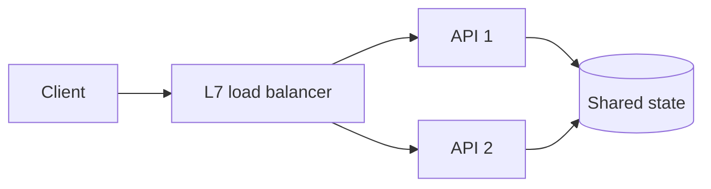

# Scaling and load balancing: expert

🌐 [Русский](expert.ru.md) · **English**

**Levels:** [overview](overview.en.md) · [1. Basics](basics.en.md) · [2. Advanced](advanced.en.md) · **3. Expert** · [4. Quiz](quiz.en.md)

## Under the hood

Amdahl's law: if a fraction `s` of the work is serial, the speedup on `n` nodes is `n / (1 + s(n-1))` and never exceeds `1/s`. The Universal Scalability Law (USL) adds the cost of keeping nodes in agreement, because of which throughput *drops* after the peak.

```csharp
public static double Amdahl(double serialFraction, int n) => n / (1 + serialFraction * (n - 1));

// contention: waiting for a shared resource; coherency: nodes keeping each other up to date.
public static double Universal(double contention, double coherency, int n) =>
    n / (1 + contention * (n - 1) + coherency * n * (n - 1));
```

| Nodes | Amdahl, s=0.05 | USL, 0.05 and 0.001 |
|---|---|---|
| 1 | 1.0 | 1.0 |
| 10 | 6.9 | 6.5 |
| 31 | 12.4 | 9.0 |
| 100 | 16.8 | 6.3 |

The coefficients here are illustrative: for a real system they are fitted to measurements.



### Rendezvous hashing

No ring is needed: for a key you compute a hash with every node and take the maximum.

```csharp
public static string NodeFor(string key, IReadOnlyList<string> nodes) =>
    nodes.MaxBy(node => StableHash.Of($"{node}\n{key}"))!;
```

When a node is removed only its keys move (in the five-node test, about a fifth). The price is O(n) per lookup. File: [Ex05_Rendezvous.cs](code/Examples/Ex05_Rendezvous.cs).

### Maglev hashing

Google's load balancer builds a table of a fixed size `M`. Two hashes give each node an `offset` and a `skip`, which define its preference order of slots `(offset + j × skip) mod M`. Nodes take turns claiming the first free slot of their list. A lookup is O(1).

```csharp
// Nodes take turns, each claiming the first free slot of its own preference order.
for (int filled = 0, i = 0; filled < size; i = (i + 1) % nodes.Count)
{
    int slot;
    do slot = (int)((offset[i] + (long)next[i]++ * skip[i]) % size);
    while (_table[slot] is not null);
```

`M` must be prime so that any `skip` visits all slots; the example rejects a composite size. Node shares differ by at most one slot. The paper gives priority to evenness: when membership changes, a small share of other nodes' slots changes too, not zero, which is why Maglev also tracks connections. The default size in the paper is 65537. File: [Ex06_Maglev.cs](code/Examples/Ex06_Maglev.cs).

### Graceful shutdown in ASP.NET Core

On a stop signal the host raises `ApplicationStopping`, the web server stops accepting new connections and gives active requests time to finish. `HostOptions.ShutdownTimeout` is 30 seconds by default (checked on .NET 11); requests that do not make it are aborted.

```csharp
builder.Services.Configure<HostOptions>(o => o.ShutdownTimeout = shutdownTimeout);
```

The tests show both outcomes: a request released during shutdown completes successfully; a request longer than the timeout gets an `HttpRequestException`. File: [Ex07_Draining.cs](code/Examples/Ex07_Draining.cs).

In Kubernetes, stopping a pod and removing it from the EndpointSlice happen at the same time, so new requests may still arrive for a while. The time given to stop (`terminationGracePeriodSeconds`) is 30 seconds by default and includes `preStop`: the application timeout must fit inside it.

### Client-side balancing

The client obtains the list of addresses itself (a resolver) and picks an address for a call (a load balancer). In `Grpc.Net.Client` the default is `pick_first`; `round_robin` is enabled through `ServiceConfig`, and the address is written with the `dns:///` scheme. The channel has to be reused. The gain is no extra hop; the price is that the client must know the nodes and be configured correctly.

## Reference

| YARP policy | Behavior |
|---|---|
| `PowerOfTwoChoices` | two random destinations, the less loaded of them; the default |
| `RoundRobin` | in a circle |
| `LeastRequests` | fewest requests, scans all destinations |
| `Random` | random |
| `FirstAlphabetical` | first by name; handy for failover |

A custom policy implements `ILoadBalancingPolicy`.

| YARP setting | Default |
|---|---|
| `HealthCheck:Active:Enabled` | `false` |
| `HealthCheck:Active:Interval` / `Timeout` | 15 s / 10 s |
| `ConsecutiveFailures` threshold | 2 |
| `HealthCheck:Passive:Enabled` | `false` |
| `HealthCheck:AvailableDestinationsPolicy` | `HealthyOrPanic` |
| `SessionAffinity:Enabled` | `false` |
| `SessionAffinity:Policy` | `HashCookie` |
| `SessionAffinity:FailurePolicy` | `Redistribute` |

`HealthyOrPanic` uses all destinations when none is healthy; `HealthyAndUnknown` answers 503 in that case.

| Balancing level | Example mechanisms |
|---|---|
| DNS | several addresses per name; caching hinders fast failover |
| Geographic | anycast, global load balancers |
| L4 | distributing connections |
| L7 | reverse proxy, ingress |
| In the client | the client picks the address itself (for example gRPC client-side balancing) |

Autoscaling in Kubernetes (HPA): `desiredReplicas = ceil(currentReplicas × currentMetricValue / desiredMetricValue)`, with a default tolerance of 0.1.

| Hashing | Lookup | Memory | Feature |
|---|---|---|---|
| `hash % N` | O(1) | none | almost everything moves |
| Ring with virtual nodes | O(log V) | V points | weights through the number of points |
| Rendezvous | O(n) | none | simplicity, only the removed node's keys move |
| Maglev | O(1) | a table of M | evenness, a few extra moves |

| Default HPA behavior | Up | Down |
|---|---|---|
| Stabilization window | 0 s | 300 s |
| Policies per 15 s | +100% or +4 pods (the larger wins) | up to −100% |

When scaling down, the HPA takes the highest of the desired values over the window, so as not to remove pods and recreate them right away.

| Kind of autoscaling | When |
|---|---|
| Reactive on a metric | load grows more slowly than instances start |
| Scheduled | known peaks |
| By queue length | workers and background processing |
| Pre-provisioned headroom | sharp bursts and a long warm-up |

| Global distribution | How a site is chosen | Feature |
|---|---|---|
| DNS by geography or latency | the name server's answer | failover is limited by DNS caching |
| Anycast | one address is announced from several places, routing picks the path | the client changes nothing |

### Beyond picking a node

| Technique | What it does | Where to see it |
|---|---|---|
| Direct Server Return | responses go from the backend straight to the router, bypassing the balancer, which handles only incoming packets | Maglev |
| Outlier detection | a passive check: a host that behaves unlike the others is ejected for a while; the time grows with repeated ejections | Envoy |
| Slow start | a newly added host receives a gradually growing share of traffic while it warms up | Envoy (round robin, least request) |
| Zone-aware routing | requests preferably stay in the caller's zone while keeping the load per host roughly even | Envoy |

These are features of particular products: check whether your balancer has them and what its defaults are.

## Gotchas

### GetHashCode changes between runs

```csharp
Console.WriteLine("user:1".GetHashCode());
```

Two runs printed `-1500850359` and `1795110506`. String hashing is randomized per process, so different instances would route one key to different shards. Use a stable hash.

### Round robin counter overflow

```csharp
int counter = int.MaxValue;
int next = Interlocked.Increment(ref counter);
Console.WriteLine($"{next} {next % 3}");
```

Result: `-2147483648 -2` — a negative index and an exception when accessing the list. `Math.Abs` does not help: `Math.Abs(int.MinValue)` throws `OverflowException`. The fix is a cast to `uint`.

### Shutdown aborts long requests

An application with a 200 ms `ShutdownTimeout` and a request still running: `StopAsync` completes and the client gets an `HttpRequestException`. Move long operations to the background or raise the timeout together with the platform's one.

### The Maglev table size must be prime

If `skip` and the table size share a divisor, a node visits only part of the slots and the search for a free one may never end. That is why the example throws `ArgumentException` for a size of 65536.

## Trade-offs and alternatives

| Approach | When | Price |
|---|---|---|
| Scale up | databases, small systems | a ceiling and downtime on replacement |
| Copies of a stateless service | web APIs | load moves to shared resources |
| Sharding | data does not fit on a node | complex queries and rebalancing |
| Queue and workers | uneven background work | asynchrony |
| Managed load balancer | cloud | less control |

An alternative to the ring is rendezvous hashing (the node with the highest hash of the "key, node" pair wins): simpler, but a pick costs O(N). Orleans and other actor frameworks solve state placement at their own level.

## Interview questions

**1. How does scale up differ from scale out?**

<details><summary>Answer</summary>

The first grows the machine, the second the number of machines. The second requires distributing requests and state.

</details>

**2. Why is gRPC balanced poorly by L4?**

<details><summary>Answer</summary>

Requests are multiplexed over a long-lived HTTP/2 connection, while L4 picks a node once per connection.

</details>

**3. Why virtual nodes in consistent hashing?**

<details><summary>Answer</summary>

To even out the shares and to spread a removed node's load over many nodes instead of one neighbour.

</details>

**4. How many keys move when a fifth node is added?**

<details><summary>Answer</summary>

With a ring about 1/5 on average, with `hash % N` about 4/5.

</details>

**5. Why is power of two choices better than a random pick?**

<details><summary>Answer</summary>

It sharply reduces load spread while staying O(1) and not needing an exact global picture.

</details>

**6. What happens if readiness checks a shared database?**

<details><summary>Answer</summary>

When the database fails, all instances become unready at once, and even operations that do not need the database disappear.

</details>

**7. Why does doubling the nodes not double throughput?**

<details><summary>Answer</summary>

Serial sections (Amdahl) and coordination costs (USL).

</details>

**8. When are sticky sessions acceptable?**

<details><summary>Answer</summary>

As a temporary measure or a locality optimization, if losing the pinning does not break correctness.

</details>

**9. What is a hot key?**

<details><summary>Answer</summary>

A key with a disproportionate share of requests. Consistent hashing does not help: the whole key lives on one node. A local cache, key copies or splitting help.

</details>

**10. Trick question: a load balancer has five backends. Is the system fault tolerant?**

<details><summary>Answer</summary>

Unknown: the balancer, the database, the region or the configuration may be a single point of failure.

</details>

**11. How does rendezvous hashing differ from a ring?**

<details><summary>Answer</summary>

It stores no structure: for each key it compares all nodes. Simpler, but O(n).

</details>

**12. What does Maglev optimize compared with a ring?**

<details><summary>Answer</summary>

Evenness and lookup speed at the price of a few extra moves.

</details>

**13. What does an application do on shutdown so as not to lose requests?**

<details><summary>Answer</summary>

Stops receiving new ones, waits for the active ones within the timeout, then releases resources.

</details>

**14. Why does the HPA not remove pods immediately?**

<details><summary>Answer</summary>

The stabilization window (300 seconds by default) protects against oscillation.

</details>

**15. Trick question: `round_robin` is enabled in gRPC but all traffic goes to one server. Why?**

<details><summary>Answer</summary>

The resolver may be returning a single address (for example a service's virtual address) instead of the instance addresses.

</details>

## Related materials

- [Advanced theory](advanced.en.md)
- [Quiz](quiz.en.md) and [exercises](exercises.en.md)

## Sources

- [YARP: load balancing](https://learn.microsoft.com/aspnet/core/fundamentals/servers/yarp/load-balancing)
- [YARP: health checks](https://learn.microsoft.com/aspnet/core/fundamentals/servers/yarp/dests-health-checks)
- [Kubernetes: Horizontal Pod Autoscaling](https://kubernetes.io/docs/concepts/workloads/autoscaling/horizontal-pod-autoscale/)
- [Maglev: A Fast and Reliable Software Network Load Balancer](https://research.google/pubs/maglev-a-fast-and-reliable-software-network-load-balancer/)
- [.NET Generic Host: shutdown](https://learn.microsoft.com/dotnet/core/extensions/generic-host)
- [gRPC: client-side load balancing](https://learn.microsoft.com/aspnet/core/grpc/loadbalancing)
- [Kubernetes: pod lifecycle](https://kubernetes.io/docs/concepts/workloads/pods/pod-lifecycle/)
- [Envoy: outlier detection](https://www.envoyproxy.io/docs/envoy/latest/intro/arch_overview/upstream/outlier)
- [Envoy: slow start](https://www.envoyproxy.io/docs/envoy/latest/intro/arch_overview/upstream/load_balancing/slow_start)
- [Envoy: zone aware routing](https://www.envoyproxy.io/docs/envoy/latest/intro/arch_overview/upstream/load_balancing/zone_aware)
