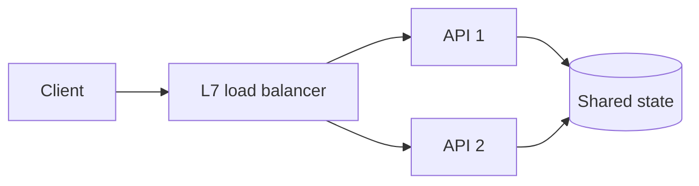

# Масштабирование и балансировка: экспертная теория

🌐 **Русский** · [English](expert.en.md)

**Уровни:** [обзор](overview.ru.md) · [1. Базовая](basics.ru.md) · [2. Продвинутая](advanced.ru.md) · **3. Экспертная** · [4. Квиз](quiz.ru.md)

## Под капотом

Закон Амдала: если доля `s` работы выполняется последовательно, ускорение на `n` узлах равно `n / (1 + s(n-1))` и не превышает `1/s`. Universal Scalability Law (USL) добавляет стоимость согласования узлов, из-за которой производительность после пика *падает*.

```csharp
public static double Amdahl(double serialFraction, int n) => n / (1 + serialFraction * (n - 1));

// contention: waiting for a shared resource; coherency: nodes keeping each other up to date.
public static double Universal(double contention, double coherency, int n) =>
    n / (1 + contention * (n - 1) + coherency * n * (n - 1));
```

| Узлов | Амдал, s=0,05 | USL, 0,05 и 0,001 |
|---|---|---|
| 1 | 1,0 | 1,0 |
| 10 | 6,9 | 6,5 |
| 31 | 12,4 | 9,0 |
| 100 | 16,8 | 6,3 |

Коэффициенты здесь учебные: для реальной системы их получают подгонкой по измерениям.



## Справочник

| Политика YARP | Поведение |
|---|---|
| `PowerOfTwoChoices` | два случайных адреса, из них менее загруженный; по умолчанию |
| `RoundRobin` | по кругу |
| `LeastRequests` | минимум запросов, просматривает все адреса |
| `Random` | случайный |
| `FirstAlphabetical` | первый по имени; удобно для failover |

Своя политика реализует `ILoadBalancingPolicy`.

| Настройка YARP | Значение по умолчанию |
|---|---|
| `HealthCheck:Active:Enabled` | `false` |
| `HealthCheck:Active:Interval` / `Timeout` | 15 с / 10 с |
| порог `ConsecutiveFailures` | 2 |
| `HealthCheck:Passive:Enabled` | `false` |
| `HealthCheck:AvailableDestinationsPolicy` | `HealthyOrPanic` |
| `SessionAffinity:Enabled` | `false` |
| `SessionAffinity:Policy` | `HashCookie` |
| `SessionAffinity:FailurePolicy` | `Redistribute` |

`HealthyOrPanic` при отсутствии здоровых адресов использует все; `HealthyAndUnknown` в этом случае отвечает 503.

| Уровень балансировки | Примеры механизма |
|---|---|
| DNS | несколько адресов на имя; кэширование мешает быстрому переключению |
| Географический | anycast, глобальные балансировщики |
| L4 | распределение соединений |
| L7 | reverse proxy, ingress |
| На клиенте | клиент сам выбирает адрес (например, gRPC client-side balancing) |

Автомасштабирование в Kubernetes (HPA): `desiredReplicas = ceil(currentReplicas × currentMetricValue / desiredMetricValue)`, с допуском 0,1 по умолчанию.

## Подвохи

### GetHashCode меняется между запусками

```csharp
Console.WriteLine("user:1".GetHashCode());
```

Два запуска напечатали `-1500850359` и `1795110506`. Хэш строк рандомизирован для процесса, поэтому разные экземпляры направили бы один ключ на разные шарды. Используйте стабильный хэш.

### Переполнение счётчика round robin

```csharp
int counter = int.MaxValue;
int next = Interlocked.Increment(ref counter);
Console.WriteLine($"{next} {next % 3}");
```

Результат: `-2147483648 -2` — отрицательный индекс и исключение при обращении к списку. `Math.Abs` не спасает: `Math.Abs(int.MinValue)` бросает `OverflowException`. Решение — приведение к `uint`.

## Компромиссы и альтернативы

| Подход | Когда | Цена |
|---|---|---|
| Scale up | база данных, небольшие системы | потолок и простой при замене |
| Копии stateless-сервиса | веб-API | нагрузка переезжает в общие ресурсы |
| Шардирование | данные не помещаются на узел | сложные запросы и ребалансировка |
| Очередь и воркеры | неравномерная фоновая работа | асинхронность |
| Managed load balancer | облако | меньше контроля |

Альтернатива кольцу — rendezvous hashing (выбирается узел с максимальным хэшем пары «ключ, узел»): проще, но выбор стоит O(N). Orleans и другие акторные фреймворки решают задачу размещения состояния на своём уровне.

## Вопросы с собеседований

**1. Чем scale up отличается от scale out?**

<details><summary>Ответ</summary>

Первый увеличивает машину, второй — число машин. Второй требует распределения запросов и состояния.

</details>

**2. Почему gRPC плохо балансируется через L4?**

<details><summary>Ответ</summary>

Запросы мультиплексируются в долгоживущем HTTP/2-соединении, а L4 выбирает узел один раз на соединение.

</details>

**3. Зачем виртуальные узлы в consistent hashing?**

<details><summary>Ответ</summary>

Чтобы выровнять доли и чтобы нагрузка выбывшего узла распределилась по многим, а не досталась одному соседу.

</details>

**4. Сколько ключей переезжает при добавлении пятого узла?**

<details><summary>Ответ</summary>

С кольцом — в среднем около 1/5, с `hash % N` — около 4/5.

</details>

**5. Чем power of two choices лучше случайного выбора?**

<details><summary>Ответ</summary>

Резко уменьшает разброс нагрузки, оставаясь O(1) и не требуя точной глобальной картины.

</details>

**6. Что случится, если readiness проверяет общую базу?**

<details><summary>Ответ</summary>

При сбое базы все экземпляры станут неготовыми одновременно, и пропадут даже операции, не требующие базы.

</details>

**7. Почему удвоение узлов не удваивает пропускную способность?**

<details><summary>Ответ</summary>

Последовательные участки (Амдал) и расходы на согласование (USL).

</details>

**8. Когда допустимы sticky sessions?**

<details><summary>Ответ</summary>

Как временная мера или оптимизация локальности, если потеря привязки не ломает корректность.

</details>

**9. Что такое горячий ключ?**

<details><summary>Ответ</summary>

Ключ с непропорциональной долей запросов. Consistent hashing не помогает: ключ целиком живёт на одном узле. Помогают локальный кэш, копии ключа или разбиение.

</details>

**10. Подвох: у балансировщика пять backend-ов. Система отказоустойчива?**

<details><summary>Ответ</summary>

Неизвестно: балансировщик, база, регион или конфигурация могут быть единой точкой отказа.

</details>

## Связанные материалы

- [Продвинутая теория](advanced.ru.md)
- [Квиз](quiz.ru.md) и [упражнения](exercises.ru.md)

## Источники

- [YARP: load balancing](https://learn.microsoft.com/aspnet/core/fundamentals/servers/yarp/load-balancing)
- [YARP: health checks](https://learn.microsoft.com/aspnet/core/fundamentals/servers/yarp/dests-health-checks)
- [Kubernetes: Horizontal Pod Autoscaling](https://kubernetes.io/docs/concepts/workloads/autoscaling/horizontal-pod-autoscale/)
