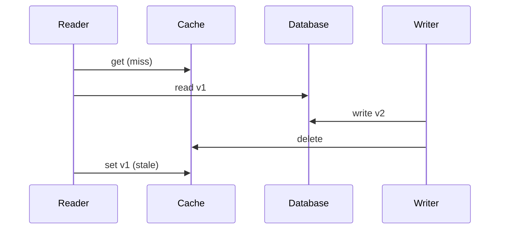

# Caching: expert

🌐 [Русский](expert.ru.md) · **English**

**Levels:** [overview](overview.en.md) · [1. Basics](basics.en.md) · [2. Advanced](advanced.en.md) · **3. Expert** · [4. Quiz](quiz.en.md)

## Under the hood

Even "delete after write" leaves a race window: a reader got a miss and read the old value, then a writer updated the database and deleted the key, and only after that the reader put the old value into the cache.



The window is closed with versions (old never overwrites new), a lease on a miss, or a delayed second delete; a TTL bounds the damage in any case.

The hit ratio affects the source non-linearly: at 10,000 requests per second, going from 99% to 98% doubles the database load from 100 to 200.

## Reference

| `HybridCache` | Value |
|---|---|
| `MaximumPayloadBytes` | 1 MB by default; larger values are not cached and are logged |
| `MaximumKeyLength` | 1024 characters by default |
| `Expiration` | overall entry lifetime |
| `LocalCacheExpiration` | lifetime in L1 |
| Stampede protection | within one `HybridCache` instance |
| `RemoveByTagAsync("*")` | invalidates all data |
| Objects | by default each caller gets a separate copy; reuse applies to `sealed` types with `[ImmutableObject(true)]` |

| Redis `maxmemory-policy` | What it evicts |
|---|---|
| `noeviction` | nothing: writes that need memory get an error |
| `allkeys-lru`, `allkeys-lfu`, `allkeys-random` | from all keys |
| `volatile-lru`, `volatile-lfu`, `volatile-random` | only from keys with a TTL |
| `volatile-ttl` | keys with the least remaining TTL |

Redis LRU is approximate: a sample of keys is compared, not all of them. The set of policies depends on the Redis version; Redis was not run for this material.

| Problem | Symptom | Remedy |
|---|---|---|
| Stampede | a burst of database requests when a key expires | single-flight, jitter, stale |
| Penetration | requests for nonexistent keys | negative cache, Bloom filter |
| Avalanche | many keys or the whole cache vanish at once | jitter, redundancy, load limiting |
| Hot key | one node overloaded | L1, key copies |

## Gotchas

### GetOrAdd may call the factory twice

```csharp
var d = new ConcurrentDictionary<int, int>();
int calls = 0;
using var barrier = new Barrier(2);
var threads = Enumerable.Range(0, 2).Select(_ => new Thread(() =>
    d.GetOrAdd(1, k => { Interlocked.Increment(ref calls); barrier.SignalAndWait(); return 1; }))).ToArray();
```

After starting and joining the threads: `calls` = 2, entries — 1. The factory runs outside the lock. That is why the value is made a `Lazy<Task<T>>`.

### IMemoryCache does not protect against a stampede

```csharp
var callers = Enumerable.Range(0, 10)
    .Select(_ => mc.GetOrCreateAsync("k", e => { loads++; return gate.Task; })).ToArray();
```

Result: `loads` = 10. `HybridCache` makes one load in the same situation.

### The in-memory cache returns the same reference

```csharp
mc.Set("list", new List<int> { 1 });
mc.Get<List<int>>("list")!.Add(2);
Console.WriteLine(mc.Get<List<int>>("list")!.Count);
```

Result: `2` — the caller corrupted the cache. The same experiment with `HybridCache` gives 1 and different instances.

### SizeLimit requires Size

```csharp
using var limited = new MemoryCache(new MemoryCacheOptions { SizeLimit = 1 });
limited.Set("a", 1);
```

Result: `InvalidOperationException` — `Cache entry must specify a value for Size when SizeLimit is set.` If two entries of size 1 are set in turn, the first one stays in the cache: the second is rejected rather than evicting it.

### null is cached, an exception is not

Three calls of `HybridCache.GetOrCreateAsync<string?>` with a factory returning `null` ran it once. Two calls with a factory that throws ran it twice.

### LRU and cyclic access

An `LruCache` of capacity 3 with accesses cycling over 4 keys gave 0 hits out of 400. A cache of capacity 100 kept none of the old keys after a pass over 100 new ones.

## Trade-offs and alternatives

| Option | Pro | Con |
|---|---|---|
| L1 only | minimal latency | divergence and a cold start on every instance |
| L2 only | one copy | network and serialization |
| L1 + L2 | balance | harder invalidation |
| Materialized view | consistency is defined by the refresh | write cost |
| Read replicas | fresher than a cache, full SQL | replication lag, more expensive |

Sometimes the best cache is an index: check the query plan first.

## Interview questions

**1. What is cache-aside?**

<details><summary>Answer</summary>

The application reads the cache, on a miss reads the source and fills the cache; after a write it invalidates.

</details>

**2. Why delete rather than update the cache on a write?**

<details><summary>Answer</summary>

Two writers may update the cache in the opposite order to their database writes, leaving the old value.

</details>

**3. Does deleting after a write remove all races?**

<details><summary>Answer</summary>

No: a slow reader may store the old value after the delete.

</details>

**4. What is a cache stampede and how do you fight it?**

<details><summary>Answer</summary>

Many simultaneous loads of one missing key. Single-flight, jitter, serving stale data.

</details>

**5. Does single-flight solve it in a cluster?**

<details><summary>Answer</summary>

Only partly: one load per instance. Strict merging needs distributed coordination, which has its own cost.

</details>

**6. How do you implement O(1) LRU?**

<details><summary>Answer</summary>

A hash table mapping a key to a node of a doubly linked list.

</details>

**7. How does `no-cache` differ from `no-store`?**

<details><summary>Answer</summary>

`no-cache` allows storing but requires revalidation before use; `no-store` forbids storing.

</details>

**8. What happens when a cache with a 99% hit ratio fails?**

<details><summary>Answer</summary>

Load on the source grows about 100 times. Load limiting and degradation are needed.

</details>

**9. Does `HybridCache.RemoveByTagAsync` invalidate the memory of other servers?**

<details><summary>Answer</summary>

No: it affects the current instance and L2.

</details>

**10. Trick question: the hit ratio is 99%. Is the cache doing well?**

<details><summary>Answer</summary>

Not necessarily: it may serve stale data, and the 1% of misses may be the most expensive requests. Look at source load and latency.

</details>

## Related materials

- [Advanced theory](advanced.en.md)
- [Quiz](quiz.en.md) and [exercises](exercises.en.md)

## Sources

- [HybridCache in ASP.NET Core](https://learn.microsoft.com/aspnet/core/performance/caching/hybrid)
- [Redis: key eviction](https://redis.io/docs/latest/develop/reference/eviction/)
