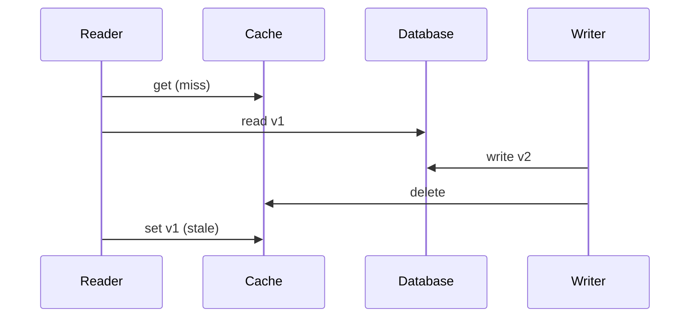

# Caching: expert

🌐 [Русский](expert.ru.md) · **English**

**Levels:** [overview](overview.en.md) · [1. Basics](basics.en.md) · [2. Advanced](advanced.en.md) · **3. Expert** · [4. Quiz](quiz.en.md)

## Under the hood

Even "delete after write" leaves a race window: a reader got a miss and read the old value, then a writer updated the database and deleted the key, and only after that the reader put the old value into the cache.



The window is closed with versions (old never overwrites new), a lease on a miss, or a delayed second delete; a TTL bounds the damage in any case.

The hit ratio affects the source non-linearly: at 10,000 requests per second, going from 99% to 98% doubles the database load from 100 to 200.

### Invalidating L1 across instances

Every instance holds its own cache, so after a write they are sent a "key changed" message (a backplane). Redis Pub/Sub delivers a message at most once: if a subscriber is disconnected, the message is lost.

```csharp
public string Get(string key)
{
    if (_entries.TryGet(key, out string cached)) return cached;
    string value = load(key);
    _entries.Set(key, value, ttl); // the TTL covers a lost invalidation
    return value;
}
```

The test: an instance that missed the message because of a break returns the old value until the TTL expires. So a backplane speeds agreement up, and the TTL guarantees it. After reconnecting it is sensible to clear L1 entirely. File: [Ex05_Backplane.cs](code/Examples/Ex05_Backplane.cs).

### Redis Cluster: slots

The key space is split into 16384 slots: `CRC16(key) mod 16384`, the CRC-16/XMODEM variant. If a key has a non-empty fragment between the first `{` and the first `}` after it (a hash tag), only that is hashed.

```csharp
int open = key.IndexOf('{');
if (open < 0) return key;
int close = key.IndexOf('}', open + 1);
return close > open + 1 ? key[(open + 1)..close] : key;
```

Multi-key operations are accepted only if all keys are in one slot. A node that does not serve a slot answers `MOVED` (remember the new address), and during a migration `ASK` (a one-off redirect). File: [Ex06_HashSlots.cs](code/Examples/Ex06_HashSlots.cs).

### Warming

An empty cache after a deployment sends all traffic to the source. Warming loads popular keys in advance, but with bounded parallelism.

```csharp
await Parallel.ForEachAsync(
    keys,
    new ParallelOptions { MaxDegreeOfParallelism = maxConcurrency, CancellationToken = ct },
```

Failures of individual keys are collected and do not interrupt the warm-up. File: [Ex07_Warming.cs](code/Examples/Ex07_Warming.cs).

### CDNs and purge by tag

A CDN caches responses closer to the user. To remove related objects at once, the origin marks responses with tags (in Cloudflare, the `Cache-Tag` header), and purging by a tag turns the next requests into misses. Another technique is to change the URL when the content changes (a hash in the file name): then there is nothing to purge.

## Reference

| `HybridCache` | Value |
|---|---|
| `MaximumPayloadBytes` | 1 MB by default; larger values are not cached and are logged |
| `MaximumKeyLength` | 1024 characters by default |
| `Expiration` | overall entry lifetime |
| `LocalCacheExpiration` | lifetime in L1 |
| Stampede protection | within one `HybridCache` instance |
| `RemoveByTagAsync("*")` | invalidates all data |
| Objects | by default each caller gets a separate copy; reuse applies to `sealed` types with `[ImmutableObject(true)]` |

| Redis `maxmemory-policy` | What it evicts |
|---|---|
| `noeviction` | nothing: writes that need memory get an error |
| `allkeys-lru`, `allkeys-lfu`, `allkeys-random` | from all keys |
| `volatile-lru`, `volatile-lfu`, `volatile-random` | only from keys with a TTL |
| `allkeys-lrm`, `volatile-lrm` (Redis 8.6+) | least recently modified: from all keys or from keys with a TTL |
| `volatile-ttl` | keys with the least remaining TTL |

Redis LRU is approximate: a sample of keys is compared, not all of them. The set of policies depends on the Redis version; Redis was not run for this material.

| HTTP mechanism | What it does |
|---|---|
| `Vary` | the named request headers become part of the match: a stored response is reused only if they agree; `Vary: *` never matches |
| `ETag` + `If-None-Match` | revalidation: if the content has not changed, the server answers a GET with 304 and no body |
| `must-revalidate` | once stale, the response must not be reused without successful validation, even when the server is unreachable |

| Problem | Symptom | Remedy |
|---|---|---|
| Stampede | a burst of database requests when a key expires | single-flight, jitter, stale |
| Penetration | requests for nonexistent keys | negative cache, Bloom filter |
| Avalanche | many keys or the whole cache vanish at once | jitter, redundancy, load limiting |
| Hot key | one node overloaded | L1, key copies |

| Invalidation method | Speed | Reliability |
|---|---|---|
| TTL | within the lifetime | always works |
| Delete on write | immediate, in one cache | does not see other instances |
| Pub/Sub backplane | almost immediate | a message may be lost |
| Change log (stream, CDC) | with a delay | can be reread after a failure |
| Version in the key | immediate | old entries live until their TTL |
| CDN purge by tag | through an API | depends on the provider |

| Hot key technique | Price |
|---|---|
| L1 in front of the shared cache | divergence up to the TTL |
| Several copies of the key | writing all copies |
| Read replicas | lag |
| Splitting the value into parts | harder reads |

| Serializing 1000 objects of one shape (checked by running) | Bytes |
|---|---|
| JSON | 63787 |
| JSON + gzip | 5410 |
| one object, JSON | 59 |
| one object, JSON + gzip | 79 |

The object is `record Product(int Id, string Name, decimal Price, string Category)` with values like `(1, "Product 1", 9.99m, "books")`, compressed with `CompressionLevel.Optimal`. Compression pays off on large values and enlarges small ones. Besides size, account for CPU time and format compatibility between application versions.

## Gotchas

### GetOrAdd may call the factory twice

```csharp
var d = new ConcurrentDictionary<int, int>();
int calls = 0;
using var barrier = new Barrier(2);
var threads = Enumerable.Range(0, 2).Select(_ => new Thread(() =>
    d.GetOrAdd(1, k => { Interlocked.Increment(ref calls); barrier.SignalAndWait(); return 1; }))).ToArray();
```

After starting and joining the threads: `calls` = 2, entries — 1. The factory runs outside the lock. That is why the value is made a `Lazy<Task<T>>`.

### IMemoryCache does not protect against a stampede

```csharp
var callers = Enumerable.Range(0, 10)
    .Select(_ => mc.GetOrCreateAsync("k", e => { loads++; return gate.Task; })).ToArray();
```

Result: `loads` = 10. `HybridCache` makes one load in the same situation.

### The in-memory cache returns the same reference

```csharp
mc.Set("list", new List<int> { 1 });
mc.Get<List<int>>("list")!.Add(2);
Console.WriteLine(mc.Get<List<int>>("list")!.Count);
```

Result: `2` — the caller corrupted the cache. The same experiment with `HybridCache` gives 1 and different instances.

### SizeLimit requires Size

```csharp
using var limited = new MemoryCache(new MemoryCacheOptions { SizeLimit = 1 });
limited.Set("a", 1);
```

Result: `InvalidOperationException` — `Cache entry must specify a value for Size when SizeLimit is set.` If two entries of size 1 are set in turn, the first one stays in the cache: the second is rejected rather than evicting it.

### null is cached, an exception is not

Three calls of `HybridCache.GetOrCreateAsync<string?>` with a factory returning `null` ran it once. Two calls with a factory that throws ran it twice.

### LRU and cyclic access

An `LruCache` of capacity 3 with accesses cycling over 4 keys gave 0 hits out of 400. A cache of capacity 100 kept none of the old keys after a pass over 100 new ones.

### An empty hash tag does not work

For `foo{}{bar}` the whole key is hashed, and for `foo{{bar}}zap` the fragment `{bar`. Check keys that must live together with a test, not by eye.

### Compression can enlarge a value

One object of 59 bytes takes 79 after gzip. Compress starting from a threshold.

## Trade-offs and alternatives

| Option | Pro | Con |
|---|---|---|
| L1 only | minimal latency | divergence and a cold start on every instance |
| L2 only | one copy | network and serialization |
| L1 + L2 | balance | harder invalidation |
| Materialized view | consistency is defined by the refresh | write cost |
| Read replicas | fresher than a cache, full SQL | replication lag, more expensive |

Sometimes the best cache is an index: check the query plan first.

## Interview questions

**1. What is cache-aside?**

<details><summary>Answer</summary>

The application reads the cache, on a miss reads the source and fills the cache; after a write it invalidates.

</details>

**2. Why delete rather than update the cache on a write?**

<details><summary>Answer</summary>

Two writers may update the cache in the opposite order to their database writes, leaving the old value.

</details>

**3. Does deleting after a write remove all races?**

<details><summary>Answer</summary>

No: a slow reader may store the old value after the delete.

</details>

**4. What is a cache stampede and how do you fight it?**

<details><summary>Answer</summary>

Many simultaneous loads of one missing key. Single-flight, jitter, serving stale data.

</details>

**5. Does single-flight solve it in a cluster?**

<details><summary>Answer</summary>

Only partly: one load per instance. Strict merging needs distributed coordination, which has its own cost.

</details>

**6. How do you implement O(1) LRU?**

<details><summary>Answer</summary>

A hash table mapping a key to a node of a doubly linked list.

</details>

**7. How does `no-cache` differ from `no-store`?**

<details><summary>Answer</summary>

`no-cache` allows storing but requires revalidation before use; `no-store` forbids storing.

</details>

**8. What happens when a cache with a 99% hit ratio fails?**

<details><summary>Answer</summary>

Load on the source grows about 100 times. Load limiting and degradation are needed.

</details>

**9. Does `HybridCache.RemoveByTagAsync` invalidate the memory of other servers?**

<details><summary>Answer</summary>

No: it affects the current instance and L2.

</details>

**10. Trick question: the hit ratio is 99%. Is the cache doing well?**

<details><summary>Answer</summary>

Not necessarily: it may serve stale data, and the 1% of misses may be the most expensive requests. Look at source load and latency.

</details>

**11. How do you invalidate L1 on all instances?**

<details><summary>Answer</summary>

Broadcast change messages and keep a short TTL in case of losses.

</details>

**12. Why is Redis Pub/Sub not enough for guaranteed invalidation?**

<details><summary>Answer</summary>

Delivery is at most once: a disconnected subscriber does not receive the message.

</details>

**13. How many slots does Redis Cluster have and how is a slot chosen?**

<details><summary>Answer</summary>

16384; `CRC16(key) mod 16384`, taking the hash tag into account.

</details>

**14. What is a hash tag for and what is dangerous about it?**

<details><summary>Answer</summary>

To put related keys into one slot. A tag that is too broad gathers everything on one node.

</details>

**15. Trick question: after a deployment the database went down although the code did not change. What do you check?**

<details><summary>Answer</summary>

A cold cache: all misses hit the database at once. Warming, a gradual rollout and load limiting are needed.

</details>

## Related materials

- [Advanced theory](advanced.en.md)
- [Quiz](quiz.en.md) and [exercises](exercises.en.md)

## Sources

- [HybridCache in ASP.NET Core](https://learn.microsoft.com/aspnet/core/performance/caching/hybrid)
- [Redis: key eviction](https://redis.io/docs/latest/develop/reference/eviction/)
- [Redis: cluster specification](https://redis.io/docs/latest/operate/oss_and_stack/reference/cluster-spec/)
- [Redis: Pub/Sub](https://redis.io/docs/latest/develop/pubsub/)
- [Cloudflare: purge by Cache-Tag](https://developers.cloudflare.com/cache/how-to/purge-cache/purge-by-tags/)
- [RFC 9111: HTTP Caching](https://www.rfc-editor.org/rfc/rfc9111)
- [RFC 9110: HTTP Semantics](https://www.rfc-editor.org/rfc/rfc9110)
