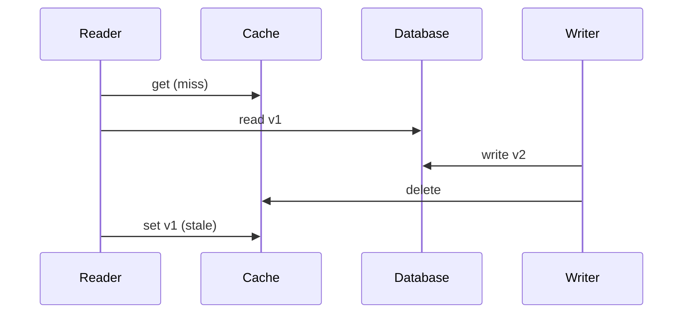

# Кэширование: экспертная теория

🌐 **Русский** · [English](expert.en.md)

**Уровни:** [обзор](overview.ru.md) · [1. Базовая](basics.ru.md) · [2. Продвинутая](advanced.ru.md) · **3. Экспертная** · [4. Квиз](quiz.ru.md)

## Под капотом

Даже «удаление после записи» оставляет окно гонки: читатель получил промах и прочитал старое значение, затем писатель обновил базу и удалил ключ, и только после этого читатель положил в кэш старое значение.



Окно закрывают версиями (старое не перезаписывает новое), арендой при промахе или повторным удалением с задержкой; TTL ограничивает ущерб в любом случае.

Доля попаданий нелинейно влияет на источник: при 10 000 запросах в секунду переход с 99% на 98% удваивает нагрузку на базу со 100 до 200.

### Инвалидация L1 между экземплярами

Каждый экземпляр держит свой кэш, поэтому после записи им рассылают сообщение «ключ изменился» (backplane). Redis Pub/Sub доставляет сообщение не более одного раза: если подписчик отключён, сообщение пропадает.

```csharp
public string Get(string key)
{
    if (_entries.TryGet(key, out string cached)) return cached;
    string value = load(key);
    _entries.Set(key, value, ttl); // the TTL covers a lost invalidation
    return value;
}
```

Тест: экземпляр, пропустивший сообщение из-за разрыва, отдаёт старое значение, пока не истечёт TTL. Поэтому backplane ускоряет согласование, а TTL его гарантирует. После переподключения разумно очистить L1 целиком. Файл: [Ex05_Backplane.cs](code/Examples/Ex05_Backplane.cs).

### Redis Cluster: слоты

Пространство ключей делится на 16384 слота: `CRC16(key) mod 16384`, вариант CRC-16/XMODEM. Если в ключе есть непустой фрагмент между первой `{` и первой `}` после неё (hash tag), хэшируется только он.

```csharp
int open = key.IndexOf('{');
if (open < 0) return key;
int close = key.IndexOf('}', open + 1);
return close > open + 1 ? key[(open + 1)..close] : key;
```

Многоключевые операции принимаются, только если все ключи в одном слоте. Узел, не обслуживающий слот, отвечает `MOVED` (запомнить новый адрес), а во время переноса — `ASK` (разовое перенаправление). Файл: [Ex06_HashSlots.cs](code/Examples/Ex06_HashSlots.cs).

### Прогрев

Пустой кэш после развёртывания отправляет весь трафик в источник. Прогрев загружает популярные ключи заранее, но с ограниченным параллелизмом.

```csharp
await Parallel.ForEachAsync(
    keys,
    new ParallelOptions { MaxDegreeOfParallelism = maxConcurrency, CancellationToken = ct },
```

Ошибки отдельных ключей собираются и не прерывают прогрев. Файл: [Ex07_Warming.cs](code/Examples/Ex07_Warming.cs).

### CDN и очистка по меткам

CDN кэширует ответы ближе к пользователю. Чтобы удалить связанные объекты разом, источник помечает ответы метками (у Cloudflare — заголовок `Cache-Tag`), а очистка по метке превращает следующие обращения в промахи. Другой приём — менять URL при изменении содержимого (хэш в имени файла): тогда чистить нечего.

## Справочник

| `HybridCache` | Значение |
|---|---|
| `MaximumPayloadBytes` | 1 МБ по умолчанию; большее не кэшируется и логируется |
| `MaximumKeyLength` | 1024 символа по умолчанию |
| `Expiration` | общий срок жизни записи |
| `LocalCacheExpiration` | срок жизни в L1 |
| Защита от stampede | в пределах одного экземпляра `HybridCache` |
| `RemoveByTagAsync("*")` | делает недействительными все данные |
| Объекты | по умолчанию каждый вызывающий получает отдельную копию; повторное использование — для `sealed` типов с `[ImmutableObject(true)]` |

| Политика `maxmemory-policy` в Redis | Что вытесняет |
|---|---|
| `noeviction` | ничего: записи, требующие памяти, получают ошибку |
| `allkeys-lru`, `allkeys-lfu`, `allkeys-random` | из всех ключей |
| `volatile-lru`, `volatile-lfu`, `volatile-random` | только из ключей с TTL |
| `allkeys-lrm`, `volatile-lrm` (Redis 8.6+) | давно не изменявшиеся (least recently modified): из всех ключей или из ключей с TTL |
| `volatile-ttl` | ключи с наименьшим остатком TTL |

LRU в Redis приближённый: сравнивается выборка ключей, а не все. Набор политик зависит от версии Redis; Redis в этом материале не запускался.

| Механизм HTTP | Что делает |
|---|---|
| `Vary` | названные заголовки запроса участвуют в сопоставлении: сохранённый ответ переиспользуется, только если они совпадают; `Vary: *` не совпадает никогда |
| `ETag` + `If-None-Match` | перепроверка: если содержимое не изменилось, сервер отвечает на GET кодом 304 без тела |
| `must-revalidate` | устаревший ответ нельзя использовать без успешной проверки, даже когда сервер недоступен |

| Проблема | Признак | Средство |
|---|---|---|
| Stampede | всплеск запросов к базе при истечении ключа | single-flight, jitter, stale |
| Penetration | запросы несуществующих ключей | негативный кэш, фильтр Блума |
| Avalanche | многие ключи или весь кэш пропадают разом | jitter, резерв, ограничение нагрузки |
| Hot key | один узел перегружен | L1, копии ключа |

| Способ инвалидации | Быстрота | Надёжность |
|---|---|---|
| TTL | в пределах срока | всегда срабатывает |
| Удаление при записи | сразу, в одном кэше | не видит других экземпляров |
| Pub/Sub backplane | почти сразу | сообщение может потеряться |
| Журнал изменений (stream, CDC) | с задержкой | можно перечитать после сбоя |
| Версия в ключе | сразу | старые записи доживают до TTL |
| Очистка CDN по метке | по API | зависит от провайдера |

| Горячий ключ: приём | Цена |
|---|---|
| L1 перед общим кэшем | расхождение до TTL |
| Несколько копий ключа | запись во все копии |
| Реплики для чтения | отставание |
| Разделение значения на части | сложнее чтение |

| Сериализация 1000 одинаково устроенных объектов (проверено запуском) | Байт |
|---|---|
| JSON | 63787 |
| JSON + gzip | 5410 |
| один объект, JSON | 59 |
| один объект, JSON + gzip | 79 |

Объект — `record Product(int Id, string Name, decimal Price, string Category)` со значениями вида `(1, "Product 1", 9.99m, "books")`, сжатие с `CompressionLevel.Optimal`. Сжатие окупается на крупных значениях, а мелкие увеличивает. Кроме размера, учитывайте процессорное время и совместимость формата между версиями приложения.

## Подвохи

### GetOrAdd может вызвать фабрику дважды

```csharp
var d = new ConcurrentDictionary<int, int>();
int calls = 0;
using var barrier = new Barrier(2);
var threads = Enumerable.Range(0, 2).Select(_ => new Thread(() =>
    d.GetOrAdd(1, k => { Interlocked.Increment(ref calls); barrier.SignalAndWait(); return 1; }))).ToArray();
```

После запуска и ожидания потоков: `calls` = 2, записей — 1. Фабрика выполняется вне блокировки. Поэтому значением делают `Lazy<Task<T>>`.

### IMemoryCache не защищает от stampede

```csharp
var callers = Enumerable.Range(0, 10)
    .Select(_ => mc.GetOrCreateAsync("k", e => { loads++; return gate.Task; })).ToArray();
```

Результат: `loads` = 10. `HybridCache` в той же ситуации делает одну загрузку.

### Кэш в памяти возвращает ту же ссылку

```csharp
mc.Set("list", new List<int> { 1 });
mc.Get<List<int>>("list")!.Add(2);
Console.WriteLine(mc.Get<List<int>>("list")!.Count);
```

Результат: `2` — вызывающий испортил кэш. Тот же опыт с `HybridCache` даёт 1 и разные экземпляры.

### SizeLimit требует Size

```csharp
using var limited = new MemoryCache(new MemoryCacheOptions { SizeLimit = 1 });
limited.Set("a", 1);
```

Результат: `InvalidOperationException` — `Cache entry must specify a value for Size when SizeLimit is set.` Если задать размер 1 двум записям по очереди, в кэше остаётся первая: вторая не принимается, а не вытесняет её.

### null кэшируется, исключение — нет

Три вызова `HybridCache.GetOrCreateAsync<string?>` с фабрикой, возвращающей `null`, выполнили её один раз. Два вызова с фабрикой, бросающей исключение, выполнили её дважды.

### LRU и циклический доступ

`LruCache` ёмкостью 3 при обращениях по кругу к 4 ключам дал 0 попаданий из 400. Кэш ёмкостью 100 после прохода по 100 новым ключам не сохранил ни одного прежнего.

### Пустой hash tag не работает

Для `foo{}{bar}` хэшируется весь ключ, а для `foo{{bar}}zap` — фрагмент `{bar`. Ключи, которые должны лежать вместе, проверяйте тестом, а не на глаз.

### Сжатие может увеличить значение

Один объект в 59 байт после gzip занимает 79. Сжимайте начиная с порога.

## Компромиссы и альтернативы

| Вариант | Плюс | Минус |
|---|---|---|
| Только L1 | минимальная задержка | расхождение и холодный старт на каждом экземпляре |
| Только L2 | одна копия | сеть и сериализация |
| L1 + L2 | баланс | сложнее инвалидация |
| Материализованное представление | согласованность задаётся обновлением | стоимость записи |
| Реплики чтения | свежее кэша, полный SQL | лаг репликации, дороже |

Иногда лучший кэш — индекс: сначала проверьте план запроса.

## Вопросы с собеседований

**1. Что такое cache-aside?**

<details><summary>Ответ</summary>

Приложение читает кэш, при промахе — источник и заполняет кэш; после записи инвалидирует.

</details>

**2. Почему удалять, а не обновлять кэш при записи?**

<details><summary>Ответ</summary>

Два писателя могут обновить кэш в порядке, обратном порядку записи в базу, и старое значение останется.

</details>

**3. Удаление после записи полностью устраняет гонки?**

<details><summary>Ответ</summary>

Нет: медленный читатель может положить старое значение после удаления.

</details>

**4. Что такое cache stampede и как с ним бороться?**

<details><summary>Ответ</summary>

Массовые одновременные загрузки одного отсутствующего ключа. Single-flight, jitter, отдача устаревшего.

</details>

**5. Решает ли single-flight проблему в кластере?**

<details><summary>Ответ</summary>

Только частично: по одной загрузке на экземпляр. Для строгого объединения нужна распределённая координация, у которой своя цена.

</details>

**6. Как реализовать LRU за O(1)?**

<details><summary>Ответ</summary>

Хэш-таблица ключ → узел двусвязного списка.

</details>

**7. Чем `no-cache` отличается от `no-store`?**

<details><summary>Ответ</summary>

`no-cache` разрешает хранить, но требует проверки перед использованием; `no-store` запрещает хранить.

</details>

**8. Что произойдёт при отказе кэша с долей попаданий 99%?**

<details><summary>Ответ</summary>

Нагрузка на источник вырастет примерно в 100 раз. Нужны ограничение нагрузки и деградация.

</details>

**9. Инвалидирует ли `HybridCache.RemoveByTagAsync` память других серверов?**

<details><summary>Ответ</summary>

Нет: действует на текущий экземпляр и L2.

</details>

**10. Подвох: доля попаданий 99%. Кэш работает хорошо?**

<details><summary>Ответ</summary>

Не обязательно: он может отдавать устаревшее, а 1% промахов может приходиться на самые дорогие запросы. Смотрите нагрузку на источник и задержку.

</details>

**11. Как инвалидировать L1 на всех экземплярах?**

<details><summary>Ответ</summary>

Рассылать сообщения об изменении и держать короткий TTL на случай потерь.

</details>

**12. Почему Redis Pub/Sub недостаточно для гарантированной инвалидации?**

<details><summary>Ответ</summary>

Доставка не более одного раза: отключённый подписчик сообщение не получит.

</details>

**13. Сколько слотов в Redis Cluster и как выбирается слот?**

<details><summary>Ответ</summary>

16384; `CRC16(key) mod 16384` с учётом hash tag.

</details>

**14. Зачем нужен hash tag и чем он опасен?**

<details><summary>Ответ</summary>

Чтобы связанные ключи попали в один слот. Слишком общий тег соберёт всё на одном узле.

</details>

**15. Подвох: после развёртывания упала база, хотя код не менялся. Что проверить?**

<details><summary>Ответ</summary>

Холодный кэш: все промахи пошли в базу одновременно. Нужны прогрев, постепенная выкатка и ограничение нагрузки.

</details>

## Связанные материалы

- [Продвинутая теория](advanced.ru.md)
- [Квиз](quiz.ru.md) и [упражнения](exercises.ru.md)

## Источники

- [HybridCache в ASP.NET Core](https://learn.microsoft.com/aspnet/core/performance/caching/hybrid)
- [Redis: key eviction](https://redis.io/docs/latest/develop/reference/eviction/)
- [Redis: cluster specification](https://redis.io/docs/latest/operate/oss_and_stack/reference/cluster-spec/)
- [Redis: Pub/Sub](https://redis.io/docs/latest/develop/pubsub/)
- [Cloudflare: очистка по Cache-Tag](https://developers.cloudflare.com/cache/how-to/purge-cache/purge-by-tags/)
- [RFC 9111: HTTP Caching](https://www.rfc-editor.org/rfc/rfc9111)
- [RFC 9110: HTTP Semantics](https://www.rfc-editor.org/rfc/rfc9110)
