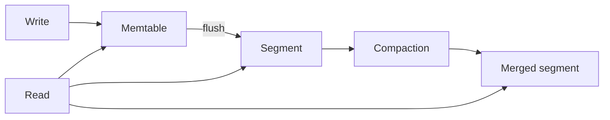

# Data storage: expert

🌐 [Русский](expert.ru.md) · **English**

**Levels:** [overview](overview.en.md) · [1. Basics](basics.en.md) · [2. Advanced](advanced.en.md) · **3. Expert** · [4. Quiz](quiz.en.md)

## Under the hood

A storage engine balances three kinds of amplification: read (how many structures and pages are read per query), write (how many bytes go to disk per byte of data) and space (how much is occupied beyond the useful data). Reducing one usually increases another.



## Reference

| Index kind | What for |
|---|---|
| B-tree | equality, ranges, ordering |
| Hash | equality only |
| Composite | several columns, order matters |
| Covering | a query without touching the table |
| Partial | only rows that satisfy a condition |
| Expression | `lower(email)` and the like |
| Inverted | words → documents |
| Unique | an integrity constraint |

| Question when choosing | Points to |
|---|---|
| transactions across entities are needed | a relational database |
| access by key only, minimal latency | key-value |
| an object is read and written as a whole | document |
| a huge write stream, queries known in advance | wide-column |
| text search and relevance | a search index |
| analytics over large volumes | a columnar store |

## Gotchas

Checked on SQLite 3.53.4 with an index on `email`.

### A function over a column disables the index

```sql
SELECT name FROM users WHERE email = 'a@b.c';        -- SEARCH users USING INDEX ix_email (email=?)
SELECT name FROM users WHERE lower(email) = 'a@b.c'; -- SCAN users
CREATE INDEX ix_lower ON users (lower(email));       -- after this: SEARCH ... ix_lower
```

The index stores column values, not function results.

### LIKE and OR

```sql
SELECT name FROM users WHERE email LIKE 'a%';              -- SCAN users
SELECT name FROM users WHERE email = 'a' OR age = 1;       -- SCAN users
```

By default `LIKE` in SQLite is case-insensitive for ASCII, while an ordinary index compares bytes. In the `OR` query there is no index for `age`, so the whole table is read.

### A unique index and NULL

```sql
CREATE UNIQUE INDEX ux ON users (name);
INSERT INTO users (name) VALUES (NULL);
INSERT INTO users (name) VALUES (NULL);
```

Both inserts succeed: in SQLite `NULL` values are not considered equal. The behavior differs between database systems.

## Trade-offs and alternatives

| Solution | Pro | Con |
|---|---|---|
| One relational database | transactions, simplicity | a vertical limit on writes |
| Read replicas | offloaded reads | lag |
| Denormalization | fast reads | keeping copies in agreement |
| Several specialized stores | each fits its task | synchronization and operations |
| CQRS | independent read and write models | complexity and delay |

## Interview questions

**1. Why not index everything?**

<details><summary>Answer</summary>

Every index takes space and slows inserts, updates and deletes.

</details>

**2. Does the column order of a composite index matter?**

<details><summary>Answer</summary>

Yes. Without a condition on the first column, a search by the others usually cannot use the ordering.

</details>

**3. What is a covering index?**

<details><summary>Answer</summary>

An index with all columns of the query: the table need not be read.

</details>

**4. How does an LSM tree differ from a B-tree?**

<details><summary>Answer</summary>

LSM appends immutable files and merges them in the background, a B-tree changes pages in place.

</details>

**5. Why are tombstones needed?**

<details><summary>Answer</summary>

Old files are immutable, so a delete is recorded as a new entry hiding previous values.

</details>

**6. Why a Bloom filter in an LSM tree?**

<details><summary>Answer</summary>

To avoid reading a file that certainly lacks the key. False positives are possible, false negatives are not.

</details>

**7. When should you denormalize?**

<details><summary>Answer</summary>

When measurements show reads are the bottleneck and it is clear how copies get updated.

</details>

**8. Does NoSQL always scale better?**

<details><summary>Answer</summary>

No. It scales for access patterns known in advance, often giving up queries and transactions.

</details>

**9. Why may a query still scan the table despite an index?**

<details><summary>Answer</summary>

A function over the column, mismatched types or comparison rules, low selectivity, stale statistics.

</details>

**10. Trick question: you added an index and reads got faster. Done?**

<details><summary>Answer</summary>

Check writes, size and other queries: the index has a cost and may duplicate an existing one.

</details>

## Related materials

- [Advanced theory](advanced.en.md)
- [Quiz](quiz.en.md) and [exercises](exercises.en.md)

## Sources

- [SQLite: EXPLAIN QUERY PLAN](https://www.sqlite.org/eqp.html)
- [SQLite: Query Planning](https://www.sqlite.org/queryplanner.html)
