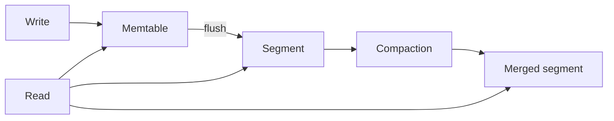

# Data storage: expert

🌐 [Русский](expert.ru.md) · **English**

**Levels:** [overview](overview.en.md) · [1. Basics](basics.en.md) · [2. Advanced](advanced.en.md) · **3. Expert** · [4. Quiz](quiz.en.md)

## Under the hood

A storage engine balances three kinds of amplification: read (how many structures and pages are read per query), write (how many bytes go to disk per byte of data) and space (how much is occupied beyond the useful data). Reducing one usually increases another.



### The write-ahead log (WAL)

Changes to data files are written only after the log records describing them have been flushed to permanent storage. So a commit only needs to flush the log, and after a crash the state is recovered by replaying it.

```csharp
int length = BinaryPrimitives.ReadInt32LittleEndian(header);
if (length < 0 || length > log.Length - log.Position) break; // cut off mid-record

byte[] payload = new byte[length];
log.ReadExactly(payload);
if (!SHA256.HashData(payload).AsSpan(0, 4).SequenceEqual(header[4..])) break; // damaged
```

A torn or damaged tail is discarded: a record has a length and a checksum. File: [Ex04_WriteAheadLog.cs](code/Examples/Ex04_WriteAheadLog.cs). A real log also forces data to disk and is cleared at checkpoints.

### MVCC and VACUUM

With MVCC readers and writers do not block each other: `UPDATE` and `DELETE` do not erase the old row version at once. In PostgreSQL `VACUUM` frees the space when nobody can see the version; it also updates statistics and the visibility map and protects against transaction ID wraparound. Plain `VACUUM` runs alongside queries but generally does not return space to the operating system. `VACUUM FULL` rewrites the table and takes an exclusive lock; autovacuum never runs it.

The same snapshot principle is visible in SQLite in WAL mode: a reader that started a transaction does not see a write committed later. File: [Ex06_Snapshot.cs](code/Examples/Ex06_Snapshot.cs). SQLite has one writer at a time.

### Bloom filter

It says "certainly not" or "possibly present" and lets you skip reading an LSM segment.

```csharp
// false: certainly absent. true: possibly present.
public bool MightContain(string key) => Positions(key).All(i => _bits[i]);
```

| Bits | Hashes | False positives with 1000 keys |
|---|---|---|
| 10,000 | 7 | 0.84% |
| 10,000 | 1 | 9.29% |
| 5,000 | 7 | 14.09% |

File: [Ex07_BloomAndIndexes.cs](code/Examples/Ex07_BloomAndIndexes.cs).

### Columnar storage

A row store reads a whole row, a column store only the needed columns: summing one of 50 columns over a million rows requires reading a million values instead of 50 million. Repeated values of a sorted column compress well, for example with run-length encoding. File: [Ex05_Columnar.cs](code/Examples/Ex05_Columnar.cs). This counts values, it does not measure time.

## Reference

| Index kind | What for |
|---|---|
| B-tree | equality, ranges, ordering |
| Hash | equality only |
| Composite | several columns, order matters |
| Covering | a query without touching the table |
| Partial | only rows that satisfy a condition |
| Expression | `lower(email)` and the like |
| Inverted | words → documents |
| Unique | an integrity constraint |

| Question when choosing | Points to |
|---|---|
| transactions across entities are needed | a relational database |
| access by key only, minimal latency | key-value |
| an object is read and written as a whole | document |
| a huge write stream, queries known in advance | wide-column |
| text search and relevance | a search index |
| analytics over large volumes | a columnar store |

| Compaction style (RocksDB) | Lowest | Pays with |
|---|---|---|
| Leveled (classic) | space amplification | reads and writes |
| Tiered (Universal) | write amplification | reads and space |
| Tiered+Leveled (the default, Level) | a compromise | less writing than leveled, less space than tiered |
| FIFO | old files are dropped | suits cache-like data |

| Secondary index with partitioning | Write | Read through it |
|---|---|---|
| Local (each partition has its own) | in one partition | asks all partitions |
| Global (partitioned by value) | updates another partition | only the needed partitions |

In DynamoDB the names have their own meaning: an LSI has the same partition key as the table, is created only together with it and supports strongly consistent reads; a GSI may have a different key, can be added later and is read only with eventual consistency.

| Store kind | What for |
|---|---|
| Row store (OLTP) | many short operations on whole rows |
| Column store (OLAP) | aggregates over few columns of large tables |
| Time-series | metrics and events over time: compression, expiry, downsampling |

## Gotchas

Checked on SQLite 3.53.4 with an index on `email`.

### A function over a column disables the index

```sql
SELECT name FROM users WHERE email = 'a@b.c';        -- SEARCH users USING INDEX ix_email (email=?)
SELECT name FROM users WHERE lower(email) = 'a@b.c'; -- SCAN users
CREATE INDEX ix_lower ON users (lower(email));       -- after this: SEARCH ... ix_lower
```

The index stores column values, not function results.

### LIKE and OR

```sql
SELECT name FROM users WHERE email LIKE 'a%';              -- SCAN users
SELECT name FROM users WHERE email = 'a' OR age = 1;       -- SCAN users
```

By default `LIKE` in SQLite is case-insensitive for ASCII, while an ordinary index compares bytes. In the `OR` query there is no index for `age`, so the whole table is read.

### A unique index and NULL

```sql
CREATE UNIQUE INDEX ux ON users (name);
INSERT INTO users (name) VALUES (NULL);
INSERT INTO users (name) VALUES (NULL);
```

Both inserts succeed: in SQLite `NULL` values are not considered equal. The behavior differs between database systems.

### A long reader stops SQLite from truncating the WAL

While a read transaction was open, `PRAGMA wal_checkpoint(TRUNCATE)` returned `busy=1`, 4 frames in the log, 3 moved. After the transaction ended — `0,0,0`. Long transactions make the log grow; in PostgreSQL they similarly keep `VACUUM` from removing old versions.

## Trade-offs and alternatives

| Solution | Pro | Con |
|---|---|---|
| One relational database | transactions, simplicity | a vertical limit on writes |
| Read replicas | offloaded reads | lag |
| Denormalization | fast reads | keeping copies in agreement |
| Several specialized stores | each fits its task | synchronization and operations |
| CQRS | independent read and write models | complexity and delay |

## Interview questions

**1. Why not index everything?**

<details><summary>Answer</summary>

Every index takes space and slows inserts, updates and deletes.

</details>

**2. Does the column order of a composite index matter?**

<details><summary>Answer</summary>

Yes. Without a condition on the first column, a search by the others usually cannot use the ordering.

</details>

**3. What is a covering index?**

<details><summary>Answer</summary>

An index with all columns of the query: the table need not be read.

</details>

**4. How does an LSM tree differ from a B-tree?**

<details><summary>Answer</summary>

LSM appends immutable files and merges them in the background, a B-tree changes pages in place.

</details>

**5. Why are tombstones needed?**

<details><summary>Answer</summary>

Old files are immutable, so a delete is recorded as a new entry hiding previous values.

</details>

**6. Why a Bloom filter in an LSM tree?**

<details><summary>Answer</summary>

To avoid reading a file that certainly lacks the key. False positives are possible, false negatives are not.

</details>

**7. When should you denormalize?**

<details><summary>Answer</summary>

When measurements show reads are the bottleneck and it is clear how copies get updated.

</details>

**8. Does NoSQL always scale better?**

<details><summary>Answer</summary>

No. It scales for access patterns known in advance, often giving up queries and transactions.

</details>

**9. Why may a query still scan the table despite an index?**

<details><summary>Answer</summary>

A function over the column, mismatched types or comparison rules, low selectivity, stale statistics.

</details>

**10. Trick question: you added an index and reads got faster. Done?**

<details><summary>Answer</summary>

Check writes, size and other queries: the index has a cost and may duplicate an existing one.

</details>

**11. What does the WAL guarantee?**

<details><summary>Answer</summary>

The description of a change is flushed before the data files themselves, so after a crash the changes can be redone.

</details>

**12. Why VACUUM with MVCC?**

<details><summary>Answer</summary>

To remove row versions nobody can see any more and to protect against transaction ID wraparound.

</details>

**13. What is dangerous about a long transaction?**

<details><summary>Answer</summary>

It prevents removing old versions or truncating the log: space grows and queries slow down.

</details>

**14. A local or a global secondary index?**

<details><summary>Answer</summary>

Local is cheaper to write, global is cheaper to read by a non-key field.

</details>

**15. Trick question: a Bloom filter said "possibly present" but the key is absent. Is that a bug?**

<details><summary>Answer</summary>

No, that is a false positive. A bug would be "no" for an existing key.

</details>

## Related materials

- [Advanced theory](advanced.en.md)
- [Quiz](quiz.en.md) and [exercises](exercises.en.md)

## Sources

- [SQLite: EXPLAIN QUERY PLAN](https://www.sqlite.org/eqp.html)
- [SQLite: Query Planning](https://www.sqlite.org/queryplanner.html)
- [PostgreSQL: Write-Ahead Logging](https://www.postgresql.org/docs/current/wal-intro.html)
- [PostgreSQL: VACUUM](https://www.postgresql.org/docs/current/routine-vacuuming.html)
- [SQLite: Write-Ahead Logging](https://www.sqlite.org/wal.html)
- [RocksDB: Compaction](https://github.com/facebook/rocksdb/wiki/Compaction)
- [DynamoDB: secondary indexes](https://docs.aws.amazon.com/amazondynamodb/latest/developerguide/SecondaryIndexes.html)
