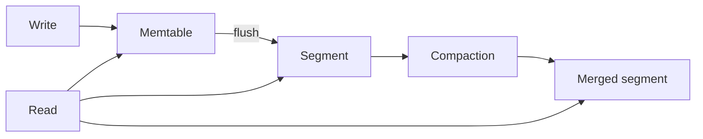

# Хранение данных: экспертная теория

🌐 **Русский** · [English](expert.en.md)

**Уровни:** [обзор](overview.ru.md) · [1. Базовая](basics.ru.md) · [2. Продвинутая](advanced.ru.md) · **3. Экспертная** · [4. Квиз](quiz.ru.md)

## Под капотом

Движок хранения балансирует три вида усиления: чтения (сколько структур и страниц читается на один запрос), записи (сколько байт пишется на диск на байт данных) и пространства (сколько занято сверх полезного). Уменьшая одно, обычно увеличивают другое.



## Справочник

| Вид индекса | Для чего |
|---|---|
| B-tree | равенство, диапазоны, сортировка |
| Hash | только равенство |
| Составной | несколько колонок, важен порядок |
| Покрывающий | запрос без обращения к таблице |
| Частичный | только строки, удовлетворяющие условию |
| По выражению | `lower(email)` и подобное |
| Инвертированный | слова → документы |
| Уникальный | ограничение целостности |

| Вопрос при выборе | Склоняет к |
|---|---|
| нужны транзакции между сущностями | реляционной базе |
| доступ только по ключу, минимальная задержка | ключ-значение |
| объект читается и пишется целиком | документной |
| огромный поток записи, запросы известны заранее | wide-column |
| поиск по тексту и релевантность | поисковому индексу |
| аналитика по большим объёмам | колоночному хранилищу |

## Подвохи

Проверено на SQLite 3.53.4 с индексом по `email`.

### Функция над колонкой отключает индекс

```sql
SELECT name FROM users WHERE email = 'a@b.c';        -- SEARCH users USING INDEX ix_email (email=?)
SELECT name FROM users WHERE lower(email) = 'a@b.c'; -- SCAN users
CREATE INDEX ix_lower ON users (lower(email));       -- after this: SEARCH ... ix_lower
```

Индекс хранит значения колонки, а не результат функции.

### LIKE и OR

```sql
SELECT name FROM users WHERE email LIKE 'a%';              -- SCAN users
SELECT name FROM users WHERE email = 'a' OR age = 1;       -- SCAN users
```

`LIKE` в SQLite по умолчанию не различает регистр ASCII, а обычный индекс сравнивает побайтно. В запросе с `OR` для `age` индекса нет, поэтому просматривается вся таблица.

### Уникальный индекс и NULL

```sql
CREATE UNIQUE INDEX ux ON users (name);
INSERT INTO users (name) VALUES (NULL);
INSERT INTO users (name) VALUES (NULL);
```

Обе вставки проходят: в SQLite значения `NULL` не считаются равными. Поведение различается между СУБД.

## Компромиссы и альтернативы

| Решение | Плюс | Минус |
|---|---|---|
| Одна реляционная база | транзакции, простота | вертикальный предел записи |
| Реплики чтения | разгрузка чтений | отставание |
| Денормализация | быстрые чтения | согласование копий |
| Несколько специализированных хранилищ | каждое под свою задачу | синхронизация и эксплуатация |
| CQRS | независимые модели чтения и записи | сложность и задержка |

## Вопросы с собеседований

**1. Почему не индексировать всё?**

<details><summary>Ответ</summary>

Каждый индекс занимает место и замедляет вставки, обновления и удаления.

</details>

**2. Имеет ли значение порядок колонок составного индекса?**

<details><summary>Ответ</summary>

Да. Без ограничения на первую колонку поиск по остальным обычно не использует упорядоченность.

</details>

**3. Что такое покрывающий индекс?**

<details><summary>Ответ</summary>

Индекс со всеми колонками запроса: таблицу читать не нужно.

</details>

**4. Чем LSM отличается от B-tree?**

<details><summary>Ответ</summary>

LSM дописывает неизменяемые файлы и объединяет их в фоне, B-tree меняет страницы на месте.

</details>

**5. Зачем нужны tombstones?**

<details><summary>Ответ</summary>

Старые файлы неизменяемы, поэтому удаление отмечается новой записью, скрывающей прежние значения.

</details>

**6. Зачем фильтр Блума в LSM?**

<details><summary>Ответ</summary>

Чтобы не читать файл, в котором ключа точно нет. Возможны ложные срабатывания, но не ложные отрицания.

</details>

**7. Когда денормализовать?**

<details><summary>Ответ</summary>

Когда измерения показывают, что чтение — узкое место, и ясно, как обновлять копии.

</details>

**8. NoSQL всегда масштабируется лучше?**

<details><summary>Ответ</summary>

Нет. Он масштабируется под заранее известные паттерны доступа, часто жертвуя запросами и транзакциями.

</details>

**9. Почему запрос с индексом может всё равно сканировать таблицу?**

<details><summary>Ответ</summary>

Функция над колонкой, несовпадение типов или сравнения, низкая селективность, устаревшая статистика.

</details>

**10. Подвох: добавили индекс, чтение ускорилось. Задача решена?**

<details><summary>Ответ</summary>

Проверьте запись, размер и другие запросы: индекс платный, и он мог дублировать существующий.

</details>

## Связанные материалы

- [Продвинутая теория](advanced.ru.md)
- [Квиз](quiz.ru.md) и [упражнения](exercises.ru.md)

## Источники

- [SQLite: EXPLAIN QUERY PLAN](https://www.sqlite.org/eqp.html)
- [SQLite: Query Planning](https://www.sqlite.org/queryplanner.html)
