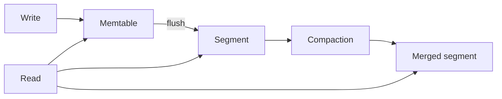

# Хранение данных: экспертная теория

🌐 **Русский** · [English](expert.en.md)

**Уровни:** [обзор](overview.ru.md) · [1. Базовая](basics.ru.md) · [2. Продвинутая](advanced.ru.md) · **3. Экспертная** · [4. Квиз](quiz.ru.md)

## Под капотом

Движок хранения балансирует три вида усиления: чтения (сколько структур и страниц читается на один запрос), записи (сколько байт пишется на диск на байт данных) и пространства (сколько занято сверх полезного). Уменьшая одно, обычно увеличивают другое.



### Журнал предзаписи (WAL)

Изменения файлов данных записываются только после того, как описывающие их записи журнала сброшены в постоянное хранилище. Поэтому фиксации достаточно сбросить журнал, а после сбоя состояние восстанавливают повторным проигрыванием.

```csharp
int length = BinaryPrimitives.ReadInt32LittleEndian(header);
if (length < 0 || length > log.Length - log.Position) break; // cut off mid-record

byte[] payload = new byte[length];
log.ReadExactly(payload);
if (!SHA256.HashData(payload).AsSpan(0, 4).SequenceEqual(header[4..])) break; // damaged
```

Оборванный или повреждённый хвост отбрасывается: у записи есть длина и контрольная сумма. Файл: [Ex04_WriteAheadLog.cs](code/Examples/Ex04_WriteAheadLog.cs). Настоящий журнал ещё принудительно сбрасывает данные на диск и очищается по контрольным точкам.

### MVCC и VACUUM

При MVCC читатели и писатели не блокируют друг друга: `UPDATE` и `DELETE` не стирают старую версию строки сразу. В PostgreSQL место освобождает `VACUUM`, когда версия никому не видна; он же обновляет статистику и карту видимости и защищает от переполнения счётчика транзакций. Обычный `VACUUM` работает параллельно с запросами, но, как правило, не возвращает место операционной системе. `VACUUM FULL` переписывает таблицу и берёт эксклюзивную блокировку; autovacuum его не запускает.

Тот же принцип снимка виден в SQLite в режиме WAL: читатель, начавший транзакцию, не видит записи, зафиксированной позже. Файл: [Ex06_Snapshot.cs](code/Examples/Ex06_Snapshot.cs). Писатель в SQLite в каждый момент один.

### Фильтр Блума

Говорит «точно нет» или «возможно есть» и позволяет не читать сегмент LSM.

```csharp
// false: certainly absent. true: possibly present.
public bool MightContain(string key) => Positions(key).All(i => _bits[i]);
```

| Бит | Хэшей | Ложные срабатывания на 1000 ключей |
|---|---|---|
| 10 000 | 7 | 0,84% |
| 10 000 | 1 | 9,29% |
| 5 000 | 7 | 14,09% |

Файл: [Ex07_BloomAndIndexes.cs](code/Examples/Ex07_BloomAndIndexes.cs).

### Колоночное хранение

Строковое хранилище читает всю строку, колоночное — только нужные колонки: сумма по одной из 50 колонок миллиона строк требует прочитать миллион значений вместо 50 миллионов. Повторяющиеся значения отсортированной колонки хорошо сжимаются, например кодированием длин серий. Файл: [Ex05_Columnar.cs](code/Examples/Ex05_Columnar.cs). Это счёт значений, а не измерение времени.

## Справочник

| Вид индекса | Для чего |
|---|---|
| B-tree | равенство, диапазоны, сортировка |
| Hash | только равенство |
| Составной | несколько колонок, важен порядок |
| Покрывающий | запрос без обращения к таблице |
| Частичный | только строки, удовлетворяющие условию |
| По выражению | `lower(email)` и подобное |
| Инвертированный | слова → документы |
| Уникальный | ограничение целостности |

| Вопрос при выборе | Склоняет к |
|---|---|
| нужны транзакции между сущностями | реляционной базе |
| доступ только по ключу, минимальная задержка | ключ-значение |
| объект читается и пишется целиком | документной |
| огромный поток записи, запросы известны заранее | wide-column |
| поиск по тексту и релевантность | поисковому индексу |
| аналитика по большим объёмам | колоночному хранилищу |

| Стиль compaction (RocksDB) | Меньше всего | Платит |
|---|---|---|
| Leveled (классический) | усиление пространства | чтением и записью |
| Tiered (Universal) | усиление записи | чтением и пространством |
| Tiered+Leveled (по умолчанию, Level) | компромисс | запись меньше, чем у leveled; пространство меньше, чем у tiered |
| FIFO | старые файлы удаляются | подходит для данных вроде кэша |

Первая строка — классическая схема для сравнения: в RocksDB она не реализована. RocksDB реализует Tiered+Leveled (в коде — Level), Tiered (Universal) и FIFO.

| Вторичный индекс при партиционировании | Запись | Чтение по нему |
|---|---|---|
| Локальный (у каждой партиции свой) | в одной партиции | опрос всех партиций |
| Глобальный (партиционирован по значению) | обновляет другую партицию | только нужные партиции |

В DynamoDB названия значат своё: LSI имеет тот же ключ партиции, что и таблица, создаётся только вместе с ней и поддерживает строгое чтение; GSI может иметь другой ключ, добавляется позже и читается только eventual consistent.

| Вид хранилища | Для чего |
|---|---|
| Строковое (OLTP) | много коротких операций с целыми строками |
| Колоночное (OLAP) | агрегаты по немногим колонкам больших таблиц |
| Time-series | метрики и события по времени: сжатие, удаление по сроку, прореживание |

## Подвохи

Проверено на SQLite 3.53.4 с индексом по `email`.

### Функция над колонкой отключает индекс

```sql
SELECT name FROM users WHERE email = 'a@b.c';        -- SEARCH users USING INDEX ix_email (email=?)
SELECT name FROM users WHERE lower(email) = 'a@b.c'; -- SCAN users
CREATE INDEX ix_lower ON users (lower(email));       -- after this: SEARCH ... ix_lower
```

Индекс хранит значения колонки, а не результат функции.

### LIKE и OR

```sql
SELECT name FROM users WHERE email LIKE 'a%';              -- SCAN users
SELECT name FROM users WHERE email = 'a' OR age = 1;       -- SCAN users
```

`LIKE` в SQLite по умолчанию не различает регистр ASCII, а обычный индекс сравнивает побайтно. В запросе с `OR` для `age` индекса нет, поэтому просматривается вся таблица.

### Уникальный индекс и NULL

```sql
CREATE UNIQUE INDEX ux ON users (name);
INSERT INTO users (name) VALUES (NULL);
INSERT INTO users (name) VALUES (NULL);
```

Обе вставки проходят: в SQLite значения `NULL` не считаются равными. Поведение различается между СУБД.

### Долгий читатель не даёт обрезать WAL в SQLite

Пока открыта читающая транзакция, `PRAGMA wal_checkpoint(TRUNCATE)` вернул `busy=1`, записей в журнале 4, перенесено 3. После завершения транзакции — `0,0,0`. Долгие транзакции заставляют журнал расти; в PostgreSQL они аналогично мешают `VACUUM` убирать старые версии.

## Компромиссы и альтернативы

| Решение | Плюс | Минус |
|---|---|---|
| Одна реляционная база | транзакции, простота | вертикальный предел записи |
| Реплики чтения | разгрузка чтений | отставание |
| Денормализация | быстрые чтения | согласование копий |
| Несколько специализированных хранилищ | каждое под свою задачу | синхронизация и эксплуатация |
| CQRS | независимые модели чтения и записи | сложность и задержка |

## Вопросы с собеседований

**1. Почему не индексировать всё?**

<details><summary>Ответ</summary>

Каждый индекс занимает место и замедляет вставки, обновления и удаления.

</details>

**2. Имеет ли значение порядок колонок составного индекса?**

<details><summary>Ответ</summary>

Да. Без ограничения на первую колонку поиск по остальным обычно не использует упорядоченность.

</details>

**3. Что такое покрывающий индекс?**

<details><summary>Ответ</summary>

Индекс со всеми колонками запроса: таблицу читать не нужно.

</details>

**4. Чем LSM отличается от B-tree?**

<details><summary>Ответ</summary>

LSM дописывает неизменяемые файлы и объединяет их в фоне, B-tree меняет страницы на месте.

</details>

**5. Зачем нужны tombstones?**

<details><summary>Ответ</summary>

Старые файлы неизменяемы, поэтому удаление отмечается новой записью, скрывающей прежние значения.

</details>

**6. Зачем фильтр Блума в LSM?**

<details><summary>Ответ</summary>

Чтобы не читать файл, в котором ключа точно нет. Возможны ложные срабатывания, но не ложные отрицания.

</details>

**7. Когда денормализовать?**

<details><summary>Ответ</summary>

Когда измерения показывают, что чтение — узкое место, и ясно, как обновлять копии.

</details>

**8. NoSQL всегда масштабируется лучше?**

<details><summary>Ответ</summary>

Нет. Он масштабируется под заранее известные паттерны доступа, часто жертвуя запросами и транзакциями.

</details>

**9. Почему запрос с индексом может всё равно сканировать таблицу?**

<details><summary>Ответ</summary>

Функция над колонкой, несовпадение типов или сравнения, низкая селективность, устаревшая статистика.

</details>

**10. Подвох: добавили индекс, чтение ускорилось. Задача решена?**

<details><summary>Ответ</summary>

Проверьте запись, размер и другие запросы: индекс платный, и он мог дублировать существующий.

</details>

**11. Что гарантирует WAL?**

<details><summary>Ответ</summary>

Описание изменения сбрасывается раньше самих файлов данных, поэтому после сбоя изменения можно повторить.

</details>

**12. Зачем VACUUM при MVCC?**

<details><summary>Ответ</summary>

Убирать версии строк, которые больше никому не видны, и защищать от переполнения идентификаторов транзакций.

</details>

**13. Чем опасна долгая транзакция?**

<details><summary>Ответ</summary>

Не даёт убирать старые версии или обрезать журнал: растёт место и замедляются запросы.

</details>

**14. Локальный или глобальный вторичный индекс?**

<details><summary>Ответ</summary>

Локальный дешевле в записи, глобальный — в чтении по неключевому полю.

</details>

**15. Подвох: фильтр Блума ответил «возможно есть», а ключа нет. Это ошибка?**

<details><summary>Ответ</summary>

Нет, это ложное срабатывание. Ошибкой было бы «нет» для существующего ключа.

</details>

## Связанные материалы

- [Продвинутая теория](advanced.ru.md)
- [Квиз](quiz.ru.md) и [упражнения](exercises.ru.md)

## Источники

- [SQLite: EXPLAIN QUERY PLAN](https://www.sqlite.org/eqp.html)
- [SQLite: Query Planning](https://www.sqlite.org/queryplanner.html)
- [PostgreSQL: Write-Ahead Logging](https://www.postgresql.org/docs/current/wal-intro.html)
- [PostgreSQL: VACUUM](https://www.postgresql.org/docs/current/routine-vacuuming.html)
- [SQLite: Write-Ahead Logging](https://www.sqlite.org/wal.html)
- [RocksDB: Compaction](https://github.com/facebook/rocksdb/wiki/Compaction)
- [DynamoDB: вторичные индексы](https://docs.aws.amazon.com/amazondynamodb/latest/developerguide/SecondaryIndexes.html)
