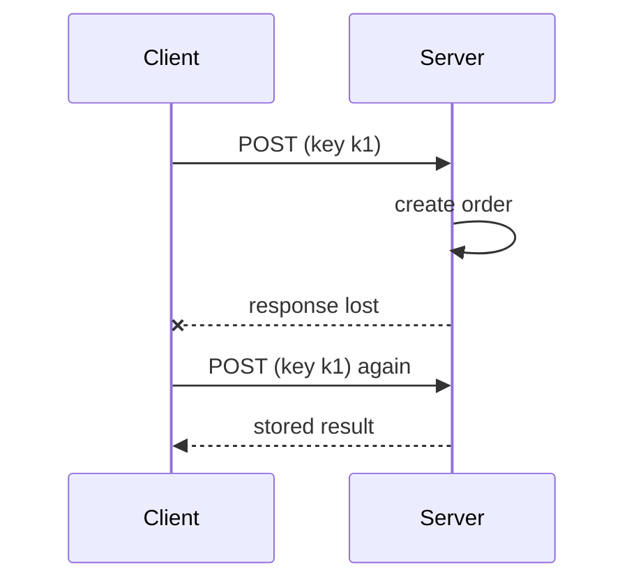

# API design: expert

🌐 [Русский](expert.ru.md) · **English**

**Levels:** [overview](overview.en.md) · [1. Basics](basics.en.md) · [2. Advanced](advanced.en.md) · **3. Expert** · [4. Quiz](quiz.en.md)

## Under the hood

"Exactly once" over a network is not guaranteed: the sender cannot tell a lost request from a lost response. The practical substitute is "at least once" delivery plus idempotent processing.



## Reference

| Element | Purpose |
|---|---|
| `Location` | address of the created resource |
| `ETag` / `If-Match` | update only if the version is the same |
| `If-None-Match` | do not send unchanged content (304 for GET) |
| `Retry-After` | when to retry |
| `Idempotency-Key` | recognize a repeat |
| `W/"1"` | a weak ETag: equivalence, not byte equality |

| Case in the Idempotency-Key draft | Code |
|---|---|
| the key is required but missing | 400 |
| same key, different body | 422 |
| the first request is still running | 409 |

| Decision | Options |
|---|---|
| Style | REST, gRPC, GraphQL, events |
| Version | path, header, query parameter, no versions with compatibility |
| Pagination | offset, keyset, continuation token |
| Long operation | status polling, webhook, stream |

## Gotchas

### A record's ToString is not a fingerprint

```csharp
record Cart(List<string> Items);

var a = new Cart(["book"]);
var b = new Cart(["pen", "car"]);
Console.WriteLine(a.ToString());
Console.WriteLine(a.ToString() == b.ToString());
```

Result: `Cart { Items = System.Collections.Generic.List`1[System.String] }` and `True`. Different bodies would get one fingerprint. In the API example this is safe only because `NewOrder` holds a string and a number; in general hash the body bytes.

### A missing field silently becomes the default value

```csharp
record Item(string Name, int Qty);

Console.WriteLine(JsonSerializer.Deserialize<Item>("""{"name":"x","extra":1}""", JsonSerializerOptions.Web));
Console.WriteLine(JsonSerializer.Deserialize<Item>("""{"name":"x","qty":2}"""));
```

Result: `Item { Name = x, Qty = 0 }` and `Item { Name = , Qty = 0 }`. The unknown field was ignored, and without web options names are case-sensitive. A `required` member that is absent gives a `JsonException`.

### An enum is serialized as a number by default

```csharp
Console.WriteLine(JsonSerializer.Serialize(new { Day = DayOfWeek.Monday }));
```

Result: `{"Day":1}`. Reordering enum values changes the meaning of the contract.

## Trade-offs and alternatives

| Choice | Pro | Con |
|---|---|---|
| REST | simplicity, HTTP cache | too much or too little data |
| gRPC | strict contract, streaming | worse from a browser |
| GraphQL | the client picks fields | harder caching and cost control |
| Events | decoupling | no immediate answer |
| PUT with a client id | idempotency without a separate store | the client manages identifiers |

## Interview questions

**1. How does a safe method differ from an idempotent one?**

<details><summary>Answer</summary>

A safe one does not change state. An idempotent one may, but a repeat adds no effect.

</details>

**2. Is DELETE idempotent if the second time answers 404?**

<details><summary>Answer</summary>

Yes: idempotency is about the effect on the server, not the response code.

</details>

**3. How do you make a POST safe to retry?**

<details><summary>Answer</summary>

An idempotency key with an atomic claim and a stored result.

</details>

**4. How do you prevent a lost update?**

<details><summary>Answer</summary>

A resource version: `ETag` and `If-Match`, with check and write done atomically.

</details>

**5. Why is a large offset slow?**

<details><summary>Answer</summary>

The database still walks over the skipped rows.

</details>

**6. A downside of keyset pagination?**

<details><summary>Answer</summary>

You cannot jump to an arbitrary page; an unambiguous ordering is needed.

</details>

**7. Which protobuf changes are incompatible?**

<details><summary>Answer</summary>

Changing a field number or type, renaming a package, service or method, removing a method.

</details>

**8. When do you answer 202?**

<details><summary>Answer</summary>

When the work is accepted and will be done later; give the client a way to learn the result.

</details>

**9. Where do you keep idempotency keys?**

<details><summary>Answer</summary>

In a shared durable store, preferably in the same transaction as the effect.

</details>

**10. Trick question: every service has an idempotency key. Is delivery "exactly once" now?**

<details><summary>Answer</summary>

No: there may still be several deliveries. The effect becomes single, as long as the key is retained and covers all side effects.

</details>

## Related materials

- [Advanced theory](advanced.en.md)
- [Quiz](quiz.en.md) and [exercises](exercises.en.md)

## Sources

- [RFC 9110: HTTP Semantics](https://www.rfc-editor.org/rfc/rfc9110)
- [IETF draft: Idempotency-Key](https://datatracker.ietf.org/doc/draft-ietf-httpapi-idempotency-key-header/)
