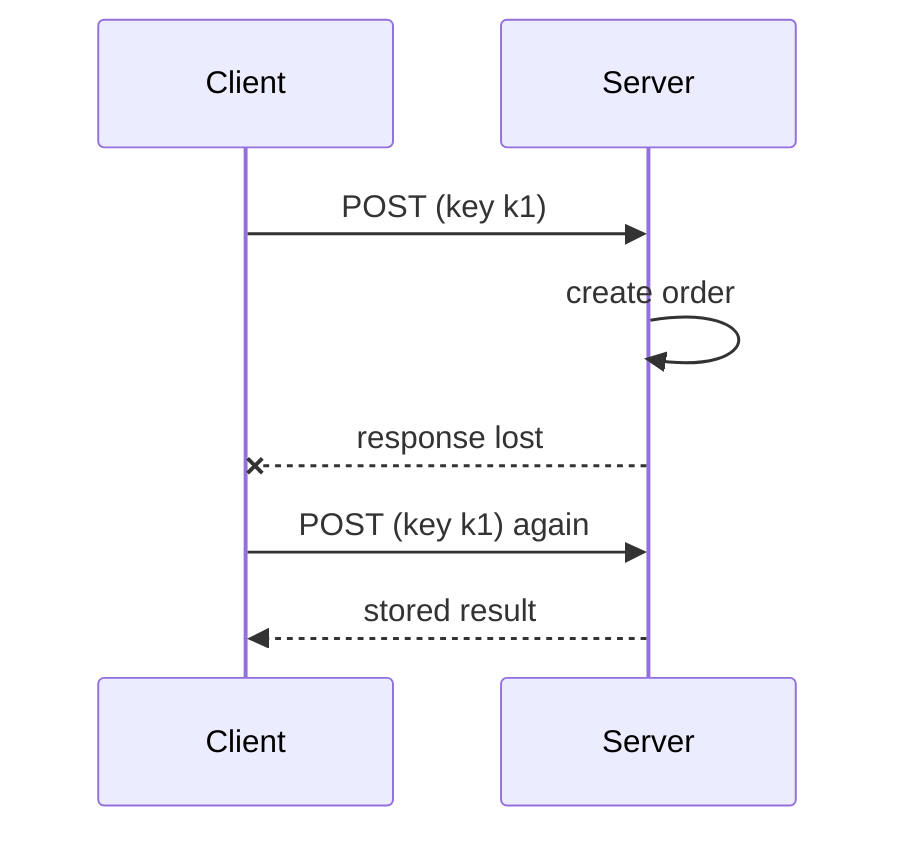

# API design: expert

🌐 [Русский](expert.ru.md) · **English**

**Levels:** [overview](overview.en.md) · [1. Basics](basics.en.md) · [2. Advanced](advanced.en.md) · **3. Expert** · [4. Quiz](quiz.en.md)

## Under the hood

"Exactly once" over a network is not guaranteed: the sender cannot tell a lost request from a lost response. The practical substitute is "at least once" delivery plus idempotent processing.



### Webhooks

A webhook is a call in the opposite direction: the provider sends you an HTTP request about an event. The receiver verifies the signature over the raw body bytes, drops repeats by delivery identifier and answers quickly, deferring the work.

```csharp
if (!WebhookSignature.Verify(secret, body, signature)) return WebhookResult.Rejected;
if (!_deliveries.Add(deliveryId)) return WebhookResult.Duplicate;

Work.Enqueue(Encoding.UTF8.GetString(body)); // processed by a worker, not here
return WebhookResult.Accepted;
```

In GitHub the signature arrives in `X-Hub-Signature-256` (HMAC-SHA256 with the `sha256=` prefix), the identifier in `X-GitHub-Delivery`, which is kept on redelivery, and a 2xx answer is needed within 10 seconds. The code is checked against the test vector from their documentation. File: [Ex04_Webhooks.cs](code/Examples/Ex04_Webhooks.cs). A webhook sender needs retries with delays, signing and a delivery log.

### GraphQL

The client picks the fields. A naive resolver makes a separate query for every list item — the N+1 problem. A loader collects keys and requests them in a batch.

```csharp
if (!_requested.TryGetValue(key, out var source))
{
    _requested[key] = source = new(); // the same key is asked for once
    _pending.Add(key);
}
return source.Task;
```

Ten requests for three authors give one query with three keys. A loader lives for one client request. File: [Ex07_Batching.cs](code/Examples/Ex07_Batching.cs). This is a simplification: the batch is dispatched manually.

A GraphQL response holds `data`, `errors` and `extensions`; if `data` is not `null`, a 2xx code is recommended even with errors, so monitoring by HTTP codes will not see them. A public GraphQL API is limited by depth, the number of aliases and operations per batch, and the "cost" of a query.

### Contract compatibility

The rules are asymmetric: what is safe for a response may break a request.

```csharp
if (!after.TryGetValue(name, out Field? now))
{
    // A server that stops reading a request field does not break the sender.
    if (direction == Direction.Response) problems.Add($"removed {name}");
    continue;
}
```

Such a check runs in CI, comparing the new OpenAPI or `.proto` schema with the published one. File: [Ex06_Compatibility.cs](code/Examples/Ex06_Compatibility.cs). The model in the example covers flat objects only.

### API gateway

A gateway is a single entry point: routing, TLS, authentication, limits, transforms. In .NET it is built on [YARP](../02-scalability-and-load-balancing/basics.en.md). Business logic and permission checks on particular objects stay in the services. A BFF is a separate gateway for a particular kind of client.

## Reference

| Element | Purpose |
|---|---|
| `Location` | address of the created resource |
| `ETag` / `If-Match` | update only if the version is the same |
| `If-None-Match` | do not send unchanged content (304 for GET) |
| `Retry-After` | when to retry |
| `Idempotency-Key` | recognize a repeat |
| `W/"1"` | a weak ETag: equivalence, not byte equality |

| Case in the Idempotency-Key draft | Code |
|---|---|
| the key is required but missing | 400 |
| same key, different body | 422 |
| the first request is still running | 409 |

| Decision | Options |
|---|---|
| Style | REST, gRPC, GraphQL, events |
| Version | path, header, query parameter, no versions with compatibility |
| Pagination | offset, keyset, continuation token |
| Long operation | status polling, webhook, stream |

| Header or code | Meaning |
|---|---|
| 429 | the client exceeded a limit |
| `Retry-After` | seconds or an HTTP date |
| `RateLimit-Policy`, `RateLimit` | quotas and what remains, per an IETF draft (not an RFC) |

```csharp
TimeSpan delay = value.Delta ?? value.Date!.Value - now;
return delay < TimeSpan.Zero ? TimeSpan.Zero : delay; // the date may already be in the past
```

File: [Ex05_RetryAfter.cs](code/Examples/Ex05_RetryAfter.cs).

| Change | Request | Response |
|---|---|---|
| removed a field | does not break the sender | breaks |
| added an optional one | does not break | does not break |
| added a required one | breaks | does not break |
| a field became required | breaks | does not break |
| a field became optional | does not break | breaks |
| changed a type | breaks | breaks |

| Check | What it catches |
|---|---|
| Schema comparison | changes of shape |
| Consumer contract tests | expectations of particular clients |
| Integration tests | behavior |

The current version of the OpenAPI specification as of November 2026 is 3.2.1.

## Gotchas

### A record's ToString is not a fingerprint

```csharp
record Cart(List<string> Items);

var a = new Cart(["book"]);
var b = new Cart(["pen", "car"]);
Console.WriteLine(a.ToString());
Console.WriteLine(a.ToString() == b.ToString());
```

Result: `Cart { Items = System.Collections.Generic.List`1[System.String] }` and `True`. Different bodies would get one fingerprint. In the API example this is safe only because `NewOrder` holds a string and a number; in general hash the body bytes.

### A missing field silently becomes the default value

```csharp
record Item(string Name, int Qty);

Console.WriteLine(JsonSerializer.Deserialize<Item>("""{"name":"x","extra":1}""", JsonSerializerOptions.Web));
Console.WriteLine(JsonSerializer.Deserialize<Item>("""{"name":"x","qty":2}"""));
```

Result: `Item { Name = x, Qty = 0 }` and `Item { Name = , Qty = 0 }`. The unknown field was ignored, and without web options names are case-sensitive. A `required` member that is absent gives a `JsonException`.

### An enum is serialized as a number by default

```csharp
Console.WriteLine(JsonSerializer.Serialize(new { Day = DayOfWeek.Monday }));
```

Result: `{"Day":1}`. Reordering enum values changes the meaning of the contract.

### A signature over re-serialized JSON

The bodies `{"a":1}` and `{"a": 1}` mean the same, but their signatures differ. Verify the signature over the received bytes before deserializing.

### Retry-After is not always a number

The header may be a date, including one already in the past. Code that reads only seconds will silently not wait.

## Trade-offs and alternatives

| Choice | Pro | Con |
|---|---|---|
| REST | simplicity, HTTP cache | too much or too little data |
| gRPC | strict contract, streaming | worse from a browser |
| GraphQL | the client picks fields | harder caching and cost control |
| Events | decoupling | no immediate answer |
| PUT with a client id | idempotency without a separate store | the client manages identifiers |

## Interview questions

**1. How does a safe method differ from an idempotent one?**

<details><summary>Answer</summary>

A safe one does not change state. An idempotent one may, but a repeat adds no effect.

</details>

**2. Is DELETE idempotent if the second time answers 404?**

<details><summary>Answer</summary>

Yes: idempotency is about the effect on the server, not the response code.

</details>

**3. How do you make a POST safe to retry?**

<details><summary>Answer</summary>

An idempotency key with an atomic claim and a stored result.

</details>

**4. How do you prevent a lost update?**

<details><summary>Answer</summary>

A resource version: `ETag` and `If-Match`, with check and write done atomically.

</details>

**5. Why is a large offset slow?**

<details><summary>Answer</summary>

The database still walks over the skipped rows.

</details>

**6. A downside of keyset pagination?**

<details><summary>Answer</summary>

You cannot jump to an arbitrary page; an unambiguous ordering is needed.

</details>

**7. Which protobuf changes are incompatible?**

<details><summary>Answer</summary>

Changing a field number or type, renaming a package, service or method, removing a method.

</details>

**8. When do you answer 202?**

<details><summary>Answer</summary>

When the work is accepted and will be done later; give the client a way to learn the result.

</details>

**9. Where do you keep idempotency keys?**

<details><summary>Answer</summary>

In a shared durable store, preferably in the same transaction as the effect.

</details>

**10. Trick question: every service has an idempotency key. Is delivery "exactly once" now?**

<details><summary>Answer</summary>

No: there may still be several deliveries. The effect becomes single, as long as the key is retained and covers all side effects.

</details>

**11. How do you protect webhook reception?**

<details><summary>Answer</summary>

Verify the signature in constant time over raw bytes, deduplicate by delivery identifier, answer quickly.

</details>

**12. What is the N+1 problem in GraphQL?**

<details><summary>Answer</summary>

A resolver makes a separate query per list item; batch loading solves it.

</details>

**13. Why are GraphQL errors hard to see in HTTP metrics?**

<details><summary>Answer</summary>

A response with partial data usually has a 2xx code, and the errors are in the body.

</details>

**14. What should not move into an API gateway?**

<details><summary>Answer</summary>

Business rules and object level authorization.

</details>

**15. Trick question: you made a response field optional. It is a relaxation, so it is compatible?**

<details><summary>Answer</summary>

No: a client that always expected it will break.

</details>

## Related materials

- [Advanced theory](advanced.en.md)
- [Quiz](quiz.en.md) and [exercises](exercises.en.md)

## Sources

- [RFC 9110: HTTP Semantics](https://www.rfc-editor.org/rfc/rfc9110)
- [IETF draft: Idempotency-Key](https://datatracker.ietf.org/doc/draft-ietf-httpapi-idempotency-key-header/)
- [GitHub: validating webhook deliveries](https://docs.github.com/en/webhooks/using-webhooks/validating-webhook-deliveries)
- [GitHub: webhook best practices](https://docs.github.com/en/webhooks/using-webhooks/best-practices-for-using-webhooks)
- [GraphQL: serving over HTTP](https://graphql.org/learn/serving-over-http/)
- [GraphQL: security](https://graphql.org/learn/security/)
- [IETF draft: RateLimit headers](https://datatracker.ietf.org/doc/draft-ietf-httpapi-ratelimit-headers/)
- [OpenAPI Specification](https://spec.openapis.org/oas/latest.html)
