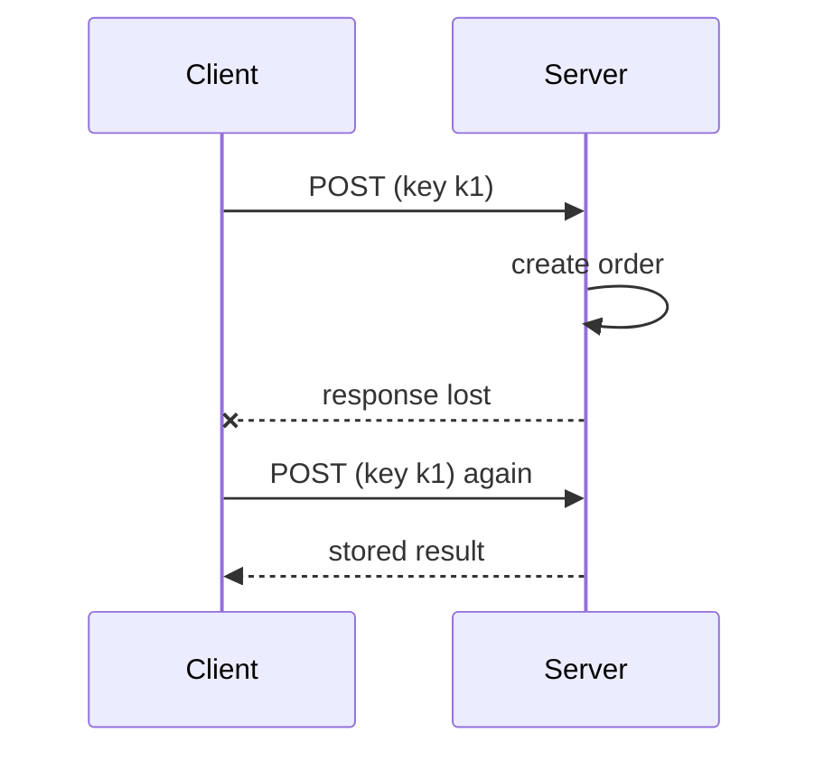

# Проектирование API: экспертная теория

🌐 **Русский** · [English](expert.en.md)

**Уровни:** [обзор](overview.ru.md) · [1. Базовая](basics.ru.md) · [2. Продвинутая](advanced.ru.md) · **3. Экспертная** · [4. Квиз](quiz.ru.md)

## Под капотом

«Ровно один раз» по сети не гарантируется: отправитель не отличает потерянный запрос от потерянного ответа. Практическая замена — доставка «хотя бы один раз» плюс идемпотентная обработка.



### Webhooks

Webhook — это вызов в обратную сторону: поставщик отправляет вам HTTP-запрос о событии. Получатель проверяет подпись по исходным байтам тела, отбрасывает повторы по идентификатору доставки и быстро отвечает, откладывая работу.

```csharp
if (!WebhookSignature.Verify(secret, body, signature)) return WebhookResult.Rejected;
if (!_deliveries.Add(deliveryId)) return WebhookResult.Duplicate;

Work.Enqueue(Encoding.UTF8.GetString(body)); // processed by a worker, not here
return WebhookResult.Accepted;
```

У GitHub подпись приходит в `X-Hub-Signature-256` (HMAC-SHA256 с префиксом `sha256=`), идентификатор — в `X-GitHub-Delivery` и сохраняется при повторной отправке, а ответ 2xx нужен в пределах 10 секунд. Код проверен на тестовом векторе из их документации. Файл: [Ex04_Webhooks.cs](code/Examples/Ex04_Webhooks.cs). Отправителю webhooks нужны повторы с задержкой, подпись и журнал доставок.

### GraphQL

Клиент сам выбирает поля. Наивный resolver для каждого элемента списка делает отдельный запрос — это проблема N+1. Загрузчик накапливает ключи и запрашивает их пачкой.

```csharp
if (!_requested.TryGetValue(key, out var source))
{
    _requested[key] = source = new(); // the same key is asked for once
    _pending.Add(key);
}
return source.Task;
```

Десять обращений к трём авторам дают один запрос с тремя ключами. Загрузчик живёт один запрос клиента. Файл: [Ex07_Batching.cs](code/Examples/Ex07_Batching.cs). Это упрощение: пачку здесь отправляют вручную.

Ответ GraphQL содержит `data`, `errors` и `extensions`; если `data` не `null`, рекомендуется код 2xx даже при ошибках, поэтому мониторинг по кодам HTTP их не увидит. Публичный GraphQL ограничивают по глубине, числу псевдонимов и операций в пачке и по «стоимости» запроса.

### Совместимость контрактов

Правила несимметричны: что безопасно для ответа, может ломать запрос.

```csharp
if (!after.TryGetValue(name, out Field? now))
{
    // A server that stops reading a request field does not break the sender.
    if (direction == Direction.Response) problems.Add($"removed {name}");
    continue;
}
```

Такую проверку запускают в CI, сравнивая новую схему OpenAPI или `.proto` с опубликованной. Файл: [Ex06_Compatibility.cs](code/Examples/Ex06_Compatibility.cs). Модель в примере — только плоские объекты.

### API-шлюз

Шлюз — единая точка входа: маршрутизация, TLS, аутентификация, лимиты, преобразования. В .NET его строят на [YARP](../02-scalability-and-load-balancing/basics.ru.md). Бизнес-логику и проверку прав на конкретные объекты оставляют сервисам. BFF — отдельный шлюз под конкретный вид клиента.

## Справочник

| Элемент | Назначение |
|---|---|
| `Location` | адрес созданного ресурса |
| `ETag` / `If-Match` | обновить, только если версия та же |
| `If-None-Match` | не присылать неизменившееся (304 для GET) |
| `Retry-After` | когда повторить |
| `Idempotency-Key` | распознать повтор |
| `W/"1"` | слабый ETag: эквивалентность, не побайтовое равенство |

| Случай по проекту Idempotency-Key | Код |
|---|---|
| ключ обязателен, но отсутствует | 400 |
| тот же ключ, другое тело | 422 |
| первый запрос ещё выполняется | 409 |

| Решение | Варианты |
|---|---|
| Стиль | REST, gRPC, GraphQL, события |
| Версия | путь, заголовок, query-параметр, без версий с совместимостью |
| Пагинация | offset, keyset, токен продолжения |
| Долгая операция | polling статуса, webhook, поток |

| Заголовок или код | Смысл |
|---|---|
| 429 | клиент превысил лимит |
| `Retry-After` | секунды или HTTP-дата |
| `RateLimit-Policy`, `RateLimit` | квоты и остаток по проекту IETF (черновик, не RFC) |

```csharp
TimeSpan delay = value.Delta ?? value.Date!.Value - now;
return delay < TimeSpan.Zero ? TimeSpan.Zero : delay; // the date may already be in the past
```

Файл: [Ex05_RetryAfter.cs](code/Examples/Ex05_RetryAfter.cs).

| Изменение | Запрос | Ответ |
|---|---|---|
| удалили поле | не ломает отправителя | ломает |
| добавили необязательное | не ломает | не ломает |
| добавили обязательное | ломает | не ломает |
| поле стало обязательным | ломает | не ломает |
| поле стало необязательным | не ломает | ломает |
| изменили тип | ломает | ломает |

| Проверка | Что ловит |
|---|---|
| Сравнение схем | изменения формы |
| Контрактные тесты потребителя | ожидания конкретных клиентов |
| Интеграционные тесты | поведение |

Актуальная версия спецификации OpenAPI на ноябрь 2026 года — 3.2.1.

## Подвохи

### ToString записи не является отпечатком

```csharp
record Cart(List<string> Items);

var a = new Cart(["book"]);
var b = new Cart(["pen", "car"]);
Console.WriteLine(a.ToString());
Console.WriteLine(a.ToString() == b.ToString());
```

Результат: `Cart { Items = System.Collections.Generic.List`1[System.String] }` и `True`. Разные тела получили бы один отпечаток. В примере API это безопасно только потому, что в `NewOrder` строка и число; в общем случае хэшируют байты тела.

### Пропущенное поле молча становится значением по умолчанию

```csharp
record Item(string Name, int Qty);

Console.WriteLine(JsonSerializer.Deserialize<Item>("""{"name":"x","extra":1}""", JsonSerializerOptions.Web));
Console.WriteLine(JsonSerializer.Deserialize<Item>("""{"name":"x","qty":2}"""));
```

Результат: `Item { Name = x, Qty = 0 }` и `Item { Name = , Qty = 0 }`. Неизвестное поле проигнорировано, а без веб-настроек имена чувствительны к регистру. Член с `required` при отсутствии даёт `JsonException`.

### Enum по умолчанию сериализуется числом

```csharp
Console.WriteLine(JsonSerializer.Serialize(new { Day = DayOfWeek.Monday }));
```

Результат: `{"Day":1}`. Перестановка значений enum меняет смысл контракта.

### Подпись по пересериализованному JSON

Тела `{"a":1}` и `{"a": 1}` значат одно и то же, но их подписи различаются. Проверяйте подпись по полученным байтам до десериализации.

### Retry-After не всегда число

Заголовок может быть датой, в том числе уже прошедшей. Код, читающий только число секунд, молча не станет ждать.

## Компромиссы и альтернативы

| Выбор | Плюс | Минус |
|---|---|---|
| REST | простота, HTTP-кэш | лишние или недостающие данные |
| gRPC | строгий контракт, потоки | хуже из браузера |
| GraphQL | клиент выбирает поля | кэширование и контроль стоимости сложнее |
| События | развязка | нет немедленного ответа |
| PUT с клиентским id | идемпотентность без отдельного хранилища | клиент управляет идентификаторами |

## Вопросы с собеседований

**1. Чем безопасный метод отличается от идемпотентного?**

<details><summary>Ответ</summary>

Безопасный не меняет состояние. Идемпотентный может менять, но повтор не добавляет эффекта.

</details>

**2. DELETE идемпотентен, если второй раз отвечает 404?**

<details><summary>Ответ</summary>

Да: идемпотентность касается эффекта на сервере, а не кода ответа.

</details>

**3. Как сделать POST безопасным для повтора?**

<details><summary>Ответ</summary>

Idempotency key с атомарным захватом и сохранённым результатом.

</details>

**4. Как предотвратить потерянное обновление?**

<details><summary>Ответ</summary>

Версия ресурса: `ETag` и `If-Match`, проверка и запись атомарно.

</details>

**5. Почему большой offset медленный?**

<details><summary>Ответ</summary>

База всё равно проходит пропускаемые строки.

</details>

**6. Минус keyset-пагинации?**

<details><summary>Ответ</summary>

Нельзя перейти на произвольную страницу; нужна однозначная сортировка.

</details>

**7. Какие изменения protobuf несовместимы?**

<details><summary>Ответ</summary>

Смена номера поля или типа, переименование пакета, сервиса или метода, удаление метода.

</details>

**8. Когда отвечать 202?**

<details><summary>Ответ</summary>

Когда работа принята и выполнится позже; дайте клиенту способ узнать результат.

</details>

**9. Где хранить ключи идемпотентности?**

<details><summary>Ответ</summary>

В общем долговечном хранилище, по возможности в той же транзакции, что и эффект.

</details>

**10. Подвох: у каждого сервиса есть idempotency key. Доставка «ровно один раз» получена?**

<details><summary>Ответ</summary>

Нет: доставок по-прежнему может быть несколько. Однократным становится эффект, пока ключ хранится и охватывает все побочные действия.

</details>

**11. Как защитить приём webhooks?**

<details><summary>Ответ</summary>

Проверять подпись в постоянное время по сырым байтам, дедуплицировать по идентификатору доставки, отвечать быстро.

</details>

**12. Что такое проблема N+1 в GraphQL?**

<details><summary>Ответ</summary>

Resolver делает отдельный запрос на каждый элемент списка; решается пакетной загрузкой.

</details>

**13. Почему GraphQL-ошибки трудно увидеть в метриках HTTP?**

<details><summary>Ответ</summary>

Ответ с частичными данными обычно имеет код 2xx, а ошибки лежат в теле.

</details>

**14. Что не стоит переносить в API-шлюз?**

<details><summary>Ответ</summary>

Бизнес-правила и авторизацию на уровне объектов.

</details>

**15. Подвох: сделали поле ответа необязательным. Это расширение, значит совместимо?**

<details><summary>Ответ</summary>

Нет: клиент, ожидавший его всегда, сломается.

</details>

## Связанные материалы

- [Продвинутая теория](advanced.ru.md)
- [Квиз](quiz.ru.md) и [упражнения](exercises.ru.md)

## Источники

- [RFC 9110: HTTP Semantics](https://www.rfc-editor.org/rfc/rfc9110)
- [Проект IETF: Idempotency-Key](https://datatracker.ietf.org/doc/draft-ietf-httpapi-idempotency-key-header/)
- [GitHub: проверка доставок webhooks](https://docs.github.com/en/webhooks/using-webhooks/validating-webhook-deliveries)
- [GitHub: best practices для webhooks](https://docs.github.com/en/webhooks/using-webhooks/best-practices-for-using-webhooks)
- [GraphQL: serving over HTTP](https://graphql.org/learn/serving-over-http/)
- [GraphQL: security](https://graphql.org/learn/security/)
- [Проект IETF: RateLimit headers](https://datatracker.ietf.org/doc/draft-ietf-httpapi-ratelimit-headers/)
- [OpenAPI Specification](https://spec.openapis.org/oas/latest.html)
