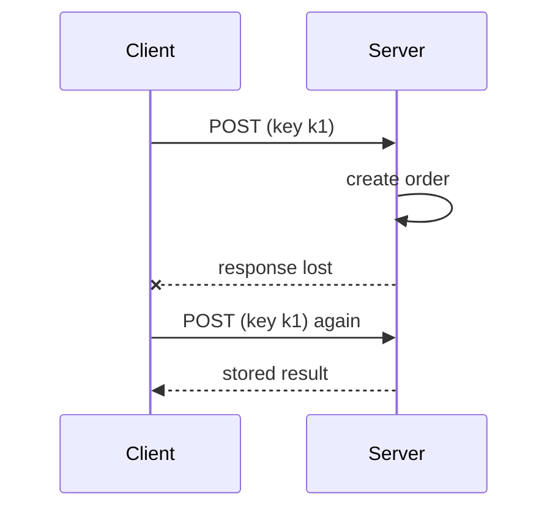

# Проектирование API: экспертная теория

🌐 **Русский** · [English](expert.en.md)

**Уровни:** [обзор](overview.ru.md) · [1. Базовая](basics.ru.md) · [2. Продвинутая](advanced.ru.md) · **3. Экспертная** · [4. Квиз](quiz.ru.md)

## Под капотом

«Ровно один раз» по сети не гарантируется: отправитель не отличает потерянный запрос от потерянного ответа. Практическая замена — доставка «хотя бы один раз» плюс идемпотентная обработка.



## Справочник

| Элемент | Назначение |
|---|---|
| `Location` | адрес созданного ресурса |
| `ETag` / `If-Match` | обновить, только если версия та же |
| `If-None-Match` | не присылать неизменившееся (304 для GET) |
| `Retry-After` | когда повторить |
| `Idempotency-Key` | распознать повтор |
| `W/"1"` | слабый ETag: эквивалентность, не побайтовое равенство |

| Случай по проекту Idempotency-Key | Код |
|---|---|
| ключ обязателен, но отсутствует | 400 |
| тот же ключ, другое тело | 422 |
| первый запрос ещё выполняется | 409 |

| Решение | Варианты |
|---|---|
| Стиль | REST, gRPC, GraphQL, события |
| Версия | путь, заголовок, query-параметр, без версий с совместимостью |
| Пагинация | offset, keyset, токен продолжения |
| Долгая операция | polling статуса, webhook, поток |

## Подвохи

### ToString записи не является отпечатком

```csharp
record Cart(List<string> Items);

var a = new Cart(["book"]);
var b = new Cart(["pen", "car"]);
Console.WriteLine(a.ToString());
Console.WriteLine(a.ToString() == b.ToString());
```

Результат: `Cart { Items = System.Collections.Generic.List`1[System.String] }` и `True`. Разные тела получили бы один отпечаток. В примере API это безопасно только потому, что в `NewOrder` строка и число; в общем случае хэшируют байты тела.

### Пропущенное поле молча становится значением по умолчанию

```csharp
record Item(string Name, int Qty);

Console.WriteLine(JsonSerializer.Deserialize<Item>("""{"name":"x","extra":1}""", JsonSerializerOptions.Web));
Console.WriteLine(JsonSerializer.Deserialize<Item>("""{"name":"x","qty":2}"""));
```

Результат: `Item { Name = x, Qty = 0 }` и `Item { Name = , Qty = 0 }`. Неизвестное поле проигнорировано, а без веб-настроек имена чувствительны к регистру. Член с `required` при отсутствии даёт `JsonException`.

### Enum по умолчанию сериализуется числом

```csharp
Console.WriteLine(JsonSerializer.Serialize(new { Day = DayOfWeek.Monday }));
```

Результат: `{"Day":1}`. Перестановка значений enum меняет смысл контракта.

## Компромиссы и альтернативы

| Выбор | Плюс | Минус |
|---|---|---|
| REST | простота, HTTP-кэш | лишние или недостающие данные |
| gRPC | строгий контракт, потоки | хуже из браузера |
| GraphQL | клиент выбирает поля | кэширование и контроль стоимости сложнее |
| События | развязка | нет немедленного ответа |
| PUT с клиентским id | идемпотентность без отдельного хранилища | клиент управляет идентификаторами |

## Вопросы с собеседований

**1. Чем безопасный метод отличается от идемпотентного?**

<details><summary>Ответ</summary>

Безопасный не меняет состояние. Идемпотентный может менять, но повтор не добавляет эффекта.

</details>

**2. DELETE идемпотентен, если второй раз отвечает 404?**

<details><summary>Ответ</summary>

Да: идемпотентность касается эффекта на сервере, а не кода ответа.

</details>

**3. Как сделать POST безопасным для повтора?**

<details><summary>Ответ</summary>

Idempotency key с атомарным захватом и сохранённым результатом.

</details>

**4. Как предотвратить потерянное обновление?**

<details><summary>Ответ</summary>

Версия ресурса: `ETag` и `If-Match`, проверка и запись атомарно.

</details>

**5. Почему большой offset медленный?**

<details><summary>Ответ</summary>

База всё равно проходит пропускаемые строки.

</details>

**6. Минус keyset-пагинации?**

<details><summary>Ответ</summary>

Нельзя перейти на произвольную страницу; нужна однозначная сортировка.

</details>

**7. Какие изменения protobuf несовместимы?**

<details><summary>Ответ</summary>

Смена номера поля или типа, переименование пакета, сервиса или метода, удаление метода.

</details>

**8. Когда отвечать 202?**

<details><summary>Ответ</summary>

Когда работа принята и выполнится позже; дайте клиенту способ узнать результат.

</details>

**9. Где хранить ключи идемпотентности?**

<details><summary>Ответ</summary>

В общем долговечном хранилище, по возможности в той же транзакции, что и эффект.

</details>

**10. Подвох: у каждого сервиса есть idempotency key. Доставка «ровно один раз» получена?**

<details><summary>Ответ</summary>

Нет: доставок по-прежнему может быть несколько. Однократным становится эффект, пока ключ хранится и охватывает все побочные действия.

</details>

## Связанные материалы

- [Продвинутая теория](advanced.ru.md)
- [Квиз](quiz.ru.md) и [упражнения](exercises.ru.md)

## Источники

- [RFC 9110: HTTP Semantics](https://www.rfc-editor.org/rfc/rfc9110)
- [Проект IETF: Idempotency-Key](https://datatracker.ietf.org/doc/draft-ietf-httpapi-idempotency-key-header/)
