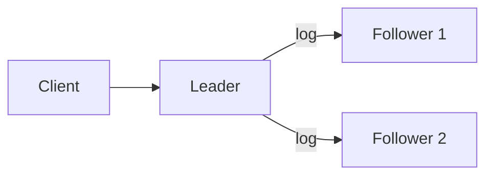

# Replication and partitioning: expert

🌐 [Русский](expert.ru.md) · **English**

**Levels:** [overview](overview.en.md) · [1. Basics](basics.en.md) · [2. Advanced](advanced.en.md) · **3. Expert** · [4. Quiz](quiz.en.md)

## Under the hood

With several writers the order of events is not determined by node clocks: they drift. A version vector keeps a counter per node and tells "earlier" apart from "concurrent".

```csharp
return (less, greater) switch
{
    (false, false) => Causality.Equal,
    (true, false) => Causality.Before,
    (false, true) => Causality.After,
    _ => Causality.Concurrent,
};
```

The vectors `{n1:2, n2:1}` and `{n1:1, n2:2}` are concurrent: neither has seen everything the other has. File: [Ex04_VersionVectors.cs](code/Examples/Ex04_VersionVectors.cs).



## Reference

| Read guarantee | What it promises |
|---|---|
| Read-your-writes | you see your own writes |
| Monotonic reads | you do not "go back" in time |
| Consistent prefix | a cause is visible before its effect |
| Eventual consistency | with no new writes the copies converge some day |

| Conflict resolution | Property |
|---|---|
| Last write wins | simple, silently loses data |
| Application merge | precise but needs code |
| CRDT | converge automatically for suitable types |
| Avoid conflicts | one leader per record or per user |

| Leaderless repair of copies | Idea |
|---|---|
| Read repair | fix a stale copy during a read |
| Anti-entropy | background comparison |
| Hinted handoff | temporarily accept a write for an unavailable node |

## Gotchas

### A failed write is still visible

```csharp
var r = new QuorumRegister(3);
r.Write(1, "v1", 0, 1, 2);
r.Write(2, "v2", 0);                 // reached one replica: W = 2 was not met
Console.WriteLine($"{r.Read(0, 1).Value} {r.Read(1, 2).Value}");
```

Result: `v2 v1`. The client would get a write error, but there is no rollback: some reads see the new value, others the old one.

### The remainder of a negative hash

```csharp
int hash = -7;
Console.WriteLine(hash % 4);
```

Result: `-3` — an invalid partition number. Hash into a `uint`.

### The fast clock wins, not the later write

In the test a node whose clock was 5 seconds fast wrote `first`; then the write `second` happened. `LastWriteWins.Resolve` chose `first`.

Another trap: `DateTime` values with equal ticks and different `Kind` (`Utc` and `Local`) compare as equal — the check printed `True`. Use `DateTimeOffset` for timestamps and do not rely on them for ordering.

## Trade-offs and alternatives

| Choice | Pro | Con |
|---|---|---|
| Single leader | a simple model | writes limited to one node |
| Multi-leader | writes in every region | conflicts |
| Leaderless | write availability | subtle guarantees |
| Hash partitions | evenness | ranges visit everything |
| Ranges | fast scans | hot partitions |
| Lookup directory | flexible movement | one more critical component |

The alternative to sharding by yourself is a distributed or managed database that does it for you.

## Interview questions

**1. How does replication differ from partitioning?**

<details><summary>Answer</summary>

The first copies the same data, the second divides different data.

</details>

**2. Does a replica replace a backup?**

<details><summary>Answer</summary>

No: an erroneous delete is replicated.

</details>

**3. What is replication lag and what does it cause?**

<details><summary>Answer</summary>

A replica falling behind; a user may not see their own write.

</details>

**4. How do you provide read-your-writes?**

<details><summary>Answer</summary>

Read from the leader after writing, or require the replica to be at least at your position.

</details>

**5. What does `W + R > N` guarantee?**

<details><summary>Answer</summary>

An overlap of the write and read sets. It does not rule out anomalies with partial and concurrent writes.

</details>

**6. What is split brain?**

<details><summary>Answer</summary>

Two nodes consider themselves leader and accept writes. A quorum and fencing tokens help.

</details>

**7. How do you pick a shard key?**

<details><summary>Answer</summary>

High cardinality, even load, frequent queries within one partition.

</details>

**8. What do you do with a hot key?**

<details><summary>Answer</summary>

A cache, a salt, a dedicated partition.

</details>

**9. Why is last write wins dangerous?**

<details><summary>Answer</summary>

Clocks drift, and one of the concurrent writes is silently lost.

</details>

**10. Trick question: a write returned an error. Does that mean the data was not written?**

<details><summary>Answer</summary>

No: it may have reached some replicas, or succeeded while the acknowledgement was lost. Idempotent retries are needed.

</details>

## Related materials

- [Advanced theory](advanced.en.md)
- [Quiz](quiz.en.md) and [exercises](exercises.en.md)

## Sources

- [PostgreSQL: WAL settings](https://www.postgresql.org/docs/current/runtime-config-wal.html)
- [Azure: data partitioning](https://learn.microsoft.com/azure/architecture/best-practices/data-partitioning)
