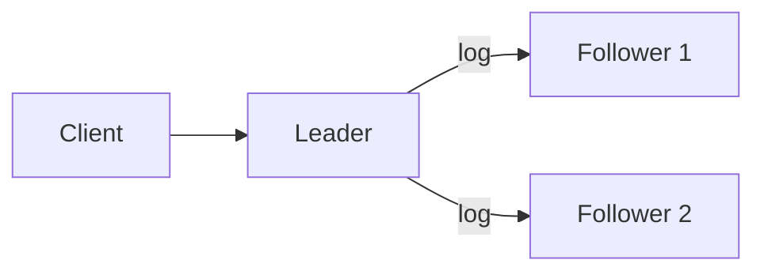

# Replication and partitioning: expert

🌐 [Русский](expert.ru.md) · **English**

**Levels:** [overview](overview.en.md) · [1. Basics](basics.en.md) · [2. Advanced](advanced.en.md) · **3. Expert** · [4. Quiz](quiz.en.md)

## Under the hood

With several writers the order of events is not determined by node clocks: they drift. A version vector keeps a counter per node and tells "earlier" apart from "concurrent".

```csharp
return (less, greater) switch
{
    (false, false) => Causality.Equal,
    (true, false) => Causality.Before,
    (false, true) => Causality.After,
    _ => Causality.Concurrent,
};
```

The vectors `{n1:2, n2:1}` and `{n1:1, n2:2}` are concurrent: neither has seen everything the other has. File: [Ex04_VersionVectors.cs](code/Examples/Ex04_VersionVectors.cs).



### Chain replication

Servers form a chain: a write enters at the head and is passed on, reads are served by the tail. Since everything visible has gone through the whole chain, consistency is strong.

```csharp
public bool Write(string key, string value, int stopAfter = int.MaxValue)
{
    for (int i = 0; i < _servers.Count && i < stopAfter; i++) _servers[i][key] = value;
    return stopAfter >= _servers.Count;
}

public string? Read(string key) => _servers[^1].GetValueOrDefault(key);
```

An unfinished write is not visible. When a server fails, a master reconfigures the chain; if the tail failed, its predecessor becomes the tail. File: [Ex05_ChainReplication.cs](code/Examples/Ex05_ChainReplication.cs). The example does not model the master or resending.

### Sloppy quorum and hinted handoff

In the Dynamo paper reads and writes go to the first N *healthy* nodes of the preference list. If an intended node is unavailable, a stand-in accepts the replica with a hint saying whom it is meant for, and passes it on after recovery.

```csharp
_data[node] = value;
if (node >= n) _hints[node] = missed.Dequeue();
```

This raises write availability, but until the handoff the returned node serves the old value, and quorum overlap is not guaranteed. Dynamo repairs replica divergence with background comparison of Merkle trees. File: [Ex06_HintedHandoff.cs](code/Examples/Ex06_HintedHandoff.cs).

### Rebalancing logical partitions

Many partitions are created in advance and assigned to nodes whole. When a node is added only its share moves.

```csharp
// Take from whoever has most, so the old nodes end up even.
int donor = result.Where(n => n != newNode).CountBy(n => n).MaxBy(g => g.Value).Key;
result[Array.LastIndexOf(result, donor)] = newNode;
```

1024 partitions going from 4 nodes to 5: 204 move, all to the new one. File: [Ex07_Rebalancing.cs](code/Examples/Ex07_Rebalancing.cs).

### Queries across all shards

To return a page, every shard must return `offset + size` rows.

```csharp
int[][] parts = [.. shards.Select(s => s.Order().Take(offset + size).ToArray())];
return ([.. parts.SelectMany(p => p).Order().Skip(offset).Take(size)], parts.Sum(p => p.Length));
```

For a page of 10 rows at offset 500 over four shards, 2040 rows are transferred. Keyset pagination and a key that keeps the query in one shard help. File: [Ex08_ScatterGather.cs](code/Examples/Ex08_ScatterGather.cs).

## Reference

| Read guarantee | What it promises |
|---|---|
| Read-your-writes | you see your own writes |
| Monotonic reads | you do not "go back" in time |
| Consistent prefix | a cause is visible before its effect |
| Eventual consistency | with no new writes the copies converge some day |

| Conflict resolution | Property |
|---|---|
| Last write wins | simple, silently loses data |
| Application merge | precise but needs code |
| CRDT | converge automatically for suitable types |
| Avoid conflicts | one leader per record or per user |

| Leaderless repair of copies | Idea |
|---|---|
| Read repair | fix a stale copy during a read |
| Anti-entropy | background comparison |
| Hinted handoff | temporarily accept a write for an unavailable node |

| Replication scheme | Write | Read | Feature |
|---|---|---|---|
| Primary-backup | through the primary | primary or replicas | a simple model |
| Chain replication | through the head, down the chain | from the tail | strong consistency, latency grows with length |
| Leaderless quorums | W of N | R of N | a tunable trade-off |
| Sloppy quorum | the first N healthy | the first N healthy | more available, weaker guarantees |

| Rebalancing strategy | Pro | Con |
|---|---|---|
| A fixed number of partitions | simple, whole moves | the number is chosen in advance |
| Dynamic splitting | adapts to volume | more complex |
| Consistent hashing with virtual nodes | only part moves | managing tokens |

| Query across shards | How to combine |
|---|---|
| sum, count, minimum, maximum | from partial results |
| average | from sums and counts |
| distinct values, percentiles | move data or use approximate structures |
| join | avoid across shards where possible |

## Gotchas

### A failed write is still visible

```csharp
var r = new QuorumRegister(3);
r.Write(1, "v1", 0, 1, 2);
r.Write(2, "v2", 0);                 // reached one replica: W = 2 was not met
Console.WriteLine($"{r.Read(0, 1).Value} {r.Read(1, 2).Value}");
```

Result: `v2 v1`. The client would get a write error, but there is no rollback: some reads see the new value, others the old one.

### The remainder of a negative hash

```csharp
int hash = -7;
Console.WriteLine(hash % 4);
```

Result: `-3` — an invalid partition number. Hash into a `uint`.

### The fast clock wins, not the later write

In the test a node whose clock was 5 seconds fast wrote `first`; then the write `second` happened. `LastWriteWins.Resolve` chose `first`.

Another trap: `DateTime` values with equal ticks and different `Kind` (`Utc` and `Local`) compare as equal — the check printed `True`. Use `DateTimeOffset` for timestamps and do not rely on them for ordering.

### An average of averages

One shard: a sum of 10 over 1 record. The second: a sum of 1890 over 99. The correct average is 19, while the average of the two averages is about 14.5.

### A deep page

The offset grows on every shard: the cost multiplies by the number of shards, although the client gets the same 10 rows.

## Trade-offs and alternatives

| Choice | Pro | Con |
|---|---|---|
| Single leader | a simple model | writes limited to one node |
| Multi-leader | writes in every region | conflicts |
| Leaderless | write availability | subtle guarantees |
| Hash partitions | evenness | ranges visit everything |
| Ranges | fast scans | hot partitions |
| Lookup directory | flexible movement | one more critical component |

The alternative to sharding by yourself is a distributed or managed database that does it for you.

## Interview questions

**1. How does replication differ from partitioning?**

<details><summary>Answer</summary>

The first copies the same data, the second divides different data.

</details>

**2. Does a replica replace a backup?**

<details><summary>Answer</summary>

No: an erroneous delete is replicated.

</details>

**3. What is replication lag and what does it cause?**

<details><summary>Answer</summary>

A replica falling behind; a user may not see their own write.

</details>

**4. How do you provide read-your-writes?**

<details><summary>Answer</summary>

Read from the leader after writing, or require the replica to be at least at your position.

</details>

**5. What does `W + R > N` guarantee?**

<details><summary>Answer</summary>

An overlap of the write and read sets. It does not rule out anomalies with partial and concurrent writes.

</details>

**6. What is split brain?**

<details><summary>Answer</summary>

Two nodes consider themselves leader and accept writes. A quorum and fencing tokens help.

</details>

**7. How do you pick a shard key?**

<details><summary>Answer</summary>

High cardinality, even load, frequent queries within one partition.

</details>

**8. What do you do with a hot key?**

<details><summary>Answer</summary>

A cache, a salt, a dedicated partition.

</details>

**9. Why is last write wins dangerous?**

<details><summary>Answer</summary>

Clocks drift, and one of the concurrent writes is silently lost.

</details>

**10. Trick question: a write returned an error. Does that mean the data was not written?**

<details><summary>Answer</summary>

No: it may have reached some replicas, or succeeded while the acknowledgement was lost. Idempotent retries are needed.

</details>

**11. Where are reads served in chain replication and why?**

<details><summary>Answer</summary>

From the tail: everything there has passed all replicas.

</details>

**12. What is hinted handoff?**

<details><summary>Answer</summary>

A stand-in node temporarily accepts a replica for an unavailable one and passes it on later.

</details>

**13. How does a sloppy quorum differ from an ordinary one?**

<details><summary>Answer</summary>

The first N healthy nodes count rather than the strictly assigned ones, so overlap is not guaranteed.

</details>

**14. Why many more partitions than nodes?**

<details><summary>Answer</summary>

To move load in small whole portions without recomputing keys.

</details>

**15. Trick question: each shard returned its top 10. Is that enough for global page 51–60?**

<details><summary>Answer</summary>

No: you need the first 60 from every shard.

</details>

## Related materials

- [Advanced theory](advanced.en.md)
- [Quiz](quiz.en.md) and [exercises](exercises.en.md)

## Sources

- [PostgreSQL: WAL settings](https://www.postgresql.org/docs/current/runtime-config-wal.html)
- [Azure: data partitioning](https://learn.microsoft.com/azure/architecture/best-practices/data-partitioning)
- [Chain Replication (OSDI 2004)](https://www.cs.cornell.edu/home/rvr/papers/OSDI04.pdf)
- [Dynamo (SOSP 2007)](https://www.allthingsdistributed.com/files/amazon-dynamo-sosp2007.pdf)
