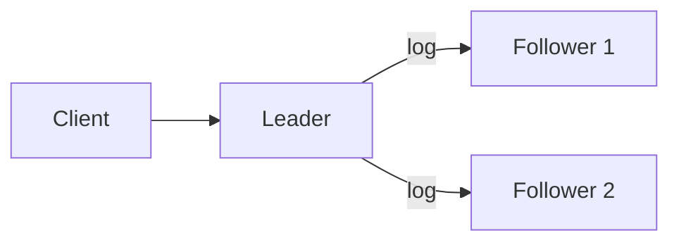

# Репликация и партиционирование: экспертная теория

🌐 **Русский** · [English](expert.en.md)

**Уровни:** [обзор](overview.ru.md) · [1. Базовая](basics.ru.md) · [2. Продвинутая](advanced.ru.md) · **3. Экспертная** · [4. Квиз](quiz.ru.md)

## Под капотом

При нескольких писателях порядок событий не определяется часами узлов: они расходятся. Version vector хранит счётчик на каждый узел и позволяет отличить «раньше» от «одновременно».

```csharp
return (less, greater) switch
{
    (false, false) => Causality.Equal,
    (true, false) => Causality.Before,
    (false, true) => Causality.After,
    _ => Causality.Concurrent,
};
```

Векторы `{n1:2, n2:1}` и `{n1:1, n2:2}` одновременны: ни один не видел всего, что видел другой. Файл: [Ex04_VersionVectors.cs](code/Examples/Ex04_VersionVectors.cs).



### Chain replication

Серверы выстроены в цепочку: запись входит в голову и передаётся дальше, чтения обслуживает хвост. Так как всё видимое прошло всю цепочку, согласованность строгая.

```csharp
public bool Write(string key, string value, int stopAfter = int.MaxValue)
{
    for (int i = 0; i < _servers.Count && i < stopAfter; i++) _servers[i][key] = value;
    return stopAfter >= _servers.Count;
}

public string? Read(string key) => _servers[^1].GetValueOrDefault(key);
```

Незавершённая запись не видна. При отказе сервера мастер перестраивает цепочку; если отказал хвост, им становится предыдущий. Файл: [Ex05_ChainReplication.cs](code/Examples/Ex05_ChainReplication.cs). Пример не моделирует мастера и досылку.

### Sloppy quorum и hinted handoff

В статье о Dynamo запись и чтение идут на первые N *здоровых* узлов списка предпочтения. Если нужный узел недоступен, реплику принимает запасной с пометкой, кому она предназначена, и передаёт после восстановления.

```csharp
_data[node] = value;
if (node >= n) _hints[node] = missed.Dequeue();
```

Это повышает доступность записи, но до передачи вернувшийся узел отдаёт старое значение, и пересечение кворумов не гарантировано. Расхождения реплик Dynamo устраняет фоновым сравнением деревьев Меркла. Файл: [Ex06_HintedHandoff.cs](code/Examples/Ex06_HintedHandoff.cs).

### Ребалансировка логических партиций

Создают заранее много партиций, а узлам назначают их целиком. При добавлении узла переезжает только его доля.

```csharp
// Take from whoever has most, so the old nodes end up even.
int donor = result.Where(n => n != newNode).CountBy(n => n).MaxBy(g => g.Value).Key;
result[Array.LastIndexOf(result, donor)] = newNode;
```

1024 партиции, переход с 4 узлов на 5: переезжают 204, все на новый. Файл: [Ex07_Rebalancing.cs](code/Examples/Ex07_Rebalancing.cs).

### Запросы по всем шардам

Чтобы выдать страницу, каждый шард должен вернуть `offset + size` строк.

```csharp
int[][] parts = [.. shards.Select(s => s.Order().Take(offset + size).ToArray())];
return ([.. parts.SelectMany(p => p).Order().Skip(offset).Take(size)], parts.Sum(p => p.Length));
```

Для страницы из 10 строк со смещением 500 на четырёх шардах передаётся 2040 строк. Помогают keyset-пагинация и ключ, держащий запрос в одном шарде. Файл: [Ex08_ScatterGather.cs](code/Examples/Ex08_ScatterGather.cs).

## Справочник

| Гарантия чтения | Что обещает |
|---|---|
| Read-your-writes | видишь свои записи |
| Monotonic reads | не «откатываешься» в прошлое |
| Consistent prefix | причина видна раньше следствия |
| Eventual consistency | без новых записей копии когда-нибудь сойдутся |

| Разрешение конфликтов | Свойство |
|---|---|
| Last write wins | просто, молча теряет данные |
| Слияние приложением | точно, но нужен код |
| CRDT | сходятся автоматически для подходящих типов |
| Избегать конфликтов | один лидер на запись или на пользователя |

| Восстановление копий без лидера | Идея |
|---|---|
| Read repair | исправить отставшую при чтении |
| Anti-entropy | фоновое сравнение |
| Hinted handoff | временно принять запись за недоступный узел |

| Схема репликации | Запись | Чтение | Особенность |
|---|---|---|---|
| Primary-backup | через primary | primary или реплики | простая модель |
| Chain replication | через голову, по цепочке | из хвоста | строгая согласованность, задержка растёт с длиной |
| Кворумы без лидера | W из N | R из N | настраиваемый компромисс |
| Sloppy quorum | первые N здоровых | первые N здоровых | доступнее, слабее гарантии |

| Стратегия ребалансировки | Плюс | Минус |
|---|---|---|
| Фиксированное число партиций | просто, переезд целиком | число выбирают заранее |
| Динамическое деление | подстраивается под объём | сложнее |
| Consistent hashing с виртуальными узлами | переезжает часть | управление токенами |

| Запрос по шардам | Как объединять |
|---|---|
| сумма, количество, минимум, максимум | из частичных результатов |
| среднее | из сумм и количеств |
| уникальные значения, перцентили | передавать данные или приближённые структуры |
| join | по возможности не между шардами |

## Подвохи

### Неудавшаяся запись всё равно видна

```csharp
var r = new QuorumRegister(3);
r.Write(1, "v1", 0, 1, 2);
r.Write(2, "v2", 0);                 // reached one replica: W = 2 was not met
Console.WriteLine($"{r.Read(0, 1).Value} {r.Read(1, 2).Value}");
```

Результат: `v2 v1`. Клиент получил бы ошибку записи, но отката нет: одни чтения видят новое значение, другие старое.

### Остаток от отрицательного хэша

```csharp
int hash = -7;
Console.WriteLine(hash % 4);
```

Результат: `-3` — недопустимый номер партиции. Хэшируйте в `uint`.

### Побеждает не поздняя запись, а быстрые часы

В тесте узел с часами, спешащими на 5 секунд, записал `first`; затем произошла запись `second`. `LastWriteWins.Resolve` выбрал `first`.

Ещё одна ловушка: `DateTime` с одинаковыми тиками и разными `Kind` (`Utc` и `Local`) сравниваются как равные — проверка напечатала `True`. Для меток времени используйте `DateTimeOffset` и не полагайтесь на них для порядка.

### Среднее средних

Один шард: сумма 10 по 1 записи. Второй: сумма 1890 по 99. Правильное среднее — 19, а среднее двух средних — около 14,5.

### Глубокая страница

Смещение растёт на каждом шарде: стоимость умножается на число шардов, хотя клиент получает всё те же 10 строк.

## Компромиссы и альтернативы

| Выбор | Плюс | Минус |
|---|---|---|
| Один лидер | простая модель | запись ограничена одним узлом |
| Несколько лидеров | запись в каждом регионе | конфликты |
| Без лидера | доступность записи | сложные гарантии |
| Хэш-партиции | равномерность | диапазоны обходят всё |
| Диапазоны | быстрые сканы | горячие партиции |
| Справочник (lookup) | гибкое перемещение | ещё один критичный компонент |

Альтернатива самостоятельному шардированию — распределённая или управляемая база, делающая это сама.

## Вопросы с собеседований

**1. Чем репликация отличается от партиционирования?**

<details><summary>Ответ</summary>

Первая копирует одни данные, второе делит разные.

</details>

**2. Реплика заменяет резервную копию?**

<details><summary>Ответ</summary>

Нет: ошибочное удаление реплицируется.

</details>

**3. Что такое replication lag и к чему он приводит?**

<details><summary>Ответ</summary>

Отставание реплики; пользователь может не увидеть свою запись.

</details>

**4. Как обеспечить read-your-writes?**

<details><summary>Ответ</summary>

Читать с лидера после записи или требовать от реплики позицию не меньше своей.

</details>

**5. Что гарантирует `W + R > N`?**

<details><summary>Ответ</summary>

Пересечение множеств записи и чтения. Не гарантирует отсутствие аномалий при частичных и одновременных записях.

</details>

**6. Что такое split brain?**

<details><summary>Ответ</summary>

Два узла считают себя лидером и принимают записи. Помогают кворум и fencing tokens.

</details>

**7. Как выбрать ключ шардирования?**

<details><summary>Ответ</summary>

Высокая кардинальность, равномерная нагрузка, частые запросы внутри одной партиции.

</details>

**8. Что делать с горячим ключом?**

<details><summary>Ответ</summary>

Кэш, соль, выделенная партиция.

</details>

**9. Почему last write wins опасен?**

<details><summary>Ответ</summary>

Часы расходятся, а одна из одновременных записей молча пропадает.

</details>

**10. Подвох: запись вернула ошибку. Значит ли это, что данные не записаны?**

<details><summary>Ответ</summary>

Нет: она могла дойти до части реплик или выполниться, а подтверждение потеряться. Нужны идемпотентные повторы.

</details>

**11. Откуда читают в chain replication и почему?**

<details><summary>Ответ</summary>

Из хвоста: всё, что там есть, прошло все реплики.

</details>

**12. Что такое hinted handoff?**

<details><summary>Ответ</summary>

Запасной узел временно принимает реплику за недоступный и передаёт её позже.

</details>

**13. Чем sloppy quorum отличается от обычного?**

<details><summary>Ответ</summary>

Считаются первые N здоровых узлов, а не строго назначенные, поэтому пересечение не гарантировано.

</details>

**14. Зачем партиций намного больше, чем узлов?**

<details><summary>Ответ</summary>

Чтобы переносить нагрузку небольшими целыми порциями без пересчёта ключей.

</details>

**15. Подвох: каждый шард вернул свои топ-10. Хватит ли этого для глобальной страницы 51–60?**

<details><summary>Ответ</summary>

Нет: нужны первые 60 с каждого шарда.

</details>

## Связанные материалы

- [Продвинутая теория](advanced.ru.md)
- [Квиз](quiz.ru.md) и [упражнения](exercises.ru.md)

## Источники

- [PostgreSQL: настройки WAL](https://www.postgresql.org/docs/current/runtime-config-wal.html)
- [Azure: партиционирование данных](https://learn.microsoft.com/azure/architecture/best-practices/data-partitioning)
- [Chain Replication (OSDI 2004)](https://www.cs.cornell.edu/home/rvr/papers/OSDI04.pdf)
- [Dynamo (SOSP 2007)](https://www.allthingsdistributed.com/files/amazon-dynamo-sosp2007.pdf)
