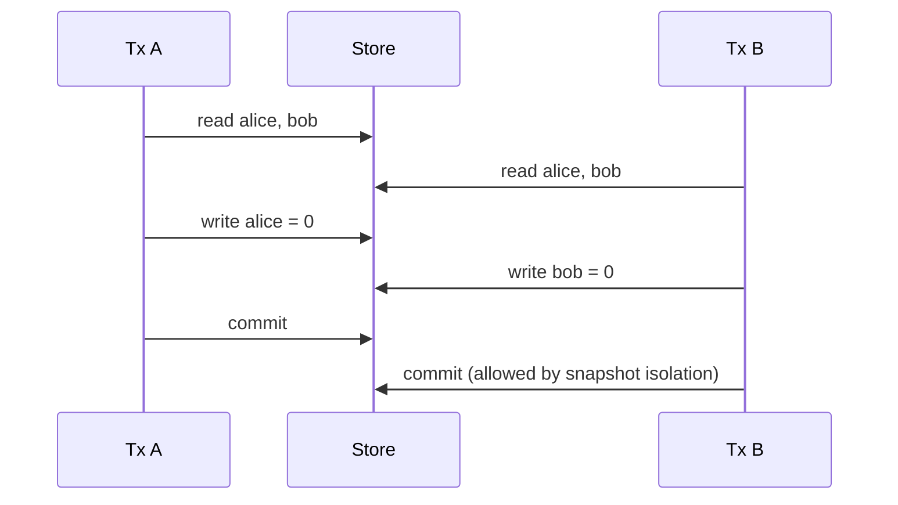

# Consistency and CAP: expert

🌐 [Русский](expert.ru.md) · **English**

**Levels:** [overview](overview.en.md) · [1. Basics](basics.en.md) · [2. Advanced](advanced.en.md) · **3. Expert** · [4. Quiz](quiz.en.md)

## Under the hood

MVCC keeps several versions of a row with commit marks. A reader takes the latest version no newer than its snapshot, so readers do not block writers.



## Reference

| Means | What it protects against |
|---|---|
| An atomic `SET x = x + 1` | a lost update of one row |
| `SELECT ... FOR UPDATE` | concurrent change of rows that were read |
| A row version in `WHERE` | lost updates without long locks |
| A unique index | duplicates |
| Serializable | including write skew |
| A distributed lock | mutual exclusion between processes, needs fencing tokens |

| CRDT | Merge idea |
|---|---|
| G-Counter | maximum per node, the sum is the value |
| PN-Counter | two G-Counters: increments and decrements |
| LWW-Register | the larger timestamp wins |
| OR-Set | only observed additions are removed |

| Operation | Usually enough |
|---|---|
| charging money | serializability or an explicit lock |
| a unique user name | a constraint on one leader |
| feeds, counters | eventual |
| your own profile after editing | read-your-writes |

## Gotchas

### A thread-safe collection does not make an operation atomic

```csharp
var d = new ConcurrentDictionary<string, int> { ["x"] = 0 };
using var barrier = new Barrier(2);
// both threads run:
int v = d["x"];
barrier.SignalAndWait();
d["x"] = v + 1;
```

Result: `d["x"]` is `1`, not `2`. Each access is safe, the "read, then write" pair is not. Use `AddOrUpdate`. The same happens with a database at Read committed if the application reads and writes with separate statements.

### Restoring the connection does not reconcile data

In the AP mode test the nodes keep returning `left` and `right` after `Heal()`. Reconciliation is a separate mechanism: merging, versions or picking a winner.

## Trade-offs and alternatives

| Choice | Pro | Con |
|---|---|---|
| Serializable | simple reasoning | rollbacks and retries |
| Pessimistic locking | no retries | waiting and deadlocks |
| Optimistic check | no long locks | many retries under contention |
| CRDT | availability | limited invariants |
| One writer per key | no conflicts | a bottleneck |

## Interview questions

**1. What does CAP mean?**

<details><summary>Answer</summary>

During a network partition you cannot both keep linearizability and answer all requests.

</details>

**2. What does PACELC add?**

<details><summary>Answer</summary>

Without a partition there is also a choice: latency or consistency.

</details>

**3. How does C in ACID differ from C in CAP?**

<details><summary>Answer</summary>

The first is preserving invariants, the second is behaving like a single copy.

</details>

**4. What is write skew?**

<details><summary>Answer</summary>

Transactions read a common set, write different rows and together break a rule.

</details>

**5. The default isolation level of PostgreSQL?**

<details><summary>Answer</summary>

Read committed.

</details>

**6. What do you do on a serialization failure?**

<details><summary>Answer</summary>

Retry the whole transaction, with a limit on attempts.

</details>

**7. How does linearizability differ from serializability?**

<details><summary>Answer</summary>

The first is about real time and single objects, the second about equivalence to some serial order of transactions.

</details>

**8. Why does a G-Counter take the maximum rather than the sum when merging?**

<details><summary>Answer</summary>

So that merging the same state again changes nothing.

</details>

**9. How many of five nodes make a majority?**

<details><summary>Answer</summary>

Three.

</details>

**10. Trick question: the system is "CP". Does that mean it is always available while there is no partition?**

<details><summary>Answer</summary>

No: CAP says nothing about other failures, overload or latency.

</details>

## Related materials

- [Advanced theory](advanced.en.md)
- [Quiz](quiz.en.md) and [exercises](exercises.en.md)

## Sources

- [PostgreSQL: transaction isolation](https://www.postgresql.org/docs/current/transaction-iso.html)
