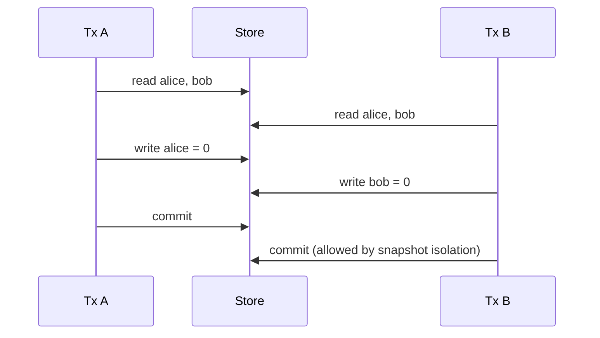
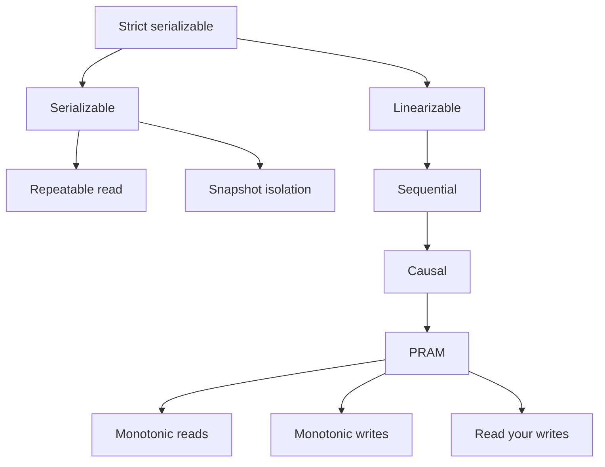

# Consistency and CAP: expert

🌐 [Русский](expert.ru.md) · **English**

**Levels:** [overview](overview.en.md) · [1. Basics](basics.en.md) · [2. Advanced](advanced.en.md) · **3. Expert** · [4. Quiz](quiz.en.md)

## Under the hood

MVCC keeps several versions of a row with commit marks. A reader takes the latest version no newer than its snapshot, so readers do not block writers.



### The hierarchy of models

Consistency models form a graph, not a ladder: "stronger" means "allows fewer histories". According to Jepsen's classification:



Snapshot isolation and repeatable read are incomparable with each other. Models at or stronger than cursor stability, snapshot isolation and sequential cannot be totally available in an asynchronous network; read-your-writes and stronger are at most "sticky" available (the client must keep going to the same node).

### Checking linearizability

A history is linearizable if the operations can be put into one order without breaking real time or the meaning of a register.

```csharp
// An operation may go first only if no other one finished before it started.
int earliestEnd = remaining.Min(o => o.End);
foreach (Operation op in remaining.Where(o => o.Start <= earliestEnd))
{
    if (!op.IsWrite && op.Value != value) continue;
```

A read overlapping a write may see either value; but once the new value has been observed, the old one cannot return. File: [Ex04_Linearizability.cs](code/Examples/Ex04_Linearizability.cs). The search is exponential and fits small histories.

### Serializability as a graph without cycles

There are dependencies between transactions: who has to come first. An execution is equivalent to a serial one if the graph has no cycle. Write skew gives a cycle: A read what B then overwrote, and the other way round. File: [Ex05_SerializationGraph.cs](code/Examples/Ex05_SerializationGraph.cs).

At the Serializable level PostgreSQL (SSI) tracks such dependencies with `SIReadLock` predicate locks: they block nobody, and on a dangerous combination one transaction gets error `40001`. Short of memory, locks are coarsened to a page or a table, and a sequential scan takes a relation-level lock — which increases the number of failures.

### More CRDTs

A PN-Counter is two grow-only counters; the value is the difference.

```csharp
public long Value => _plus.Values.Sum() - _minus.Values.Sum();
```

An LWW-Register breaks timestamp ties with the node id so that replicas do not diverge. File: [Ex06_Crdts.cs](code/Examples/Ex06_Crdts.cs).

## Reference

| Means | What it protects against |
|---|---|
| An atomic `SET x = x + 1` | a lost update of one row |
| `SELECT ... FOR UPDATE` | concurrent change of rows that were read |
| A row version in `WHERE` | lost updates without long locks |
| A unique index | duplicates |
| Serializable | including write skew |
| A distributed lock | mutual exclusion between processes, needs fencing tokens |

| CRDT | Merge idea |
|---|---|
| G-Counter | maximum per node, the sum is the value |
| PN-Counter | two G-Counters: increments and decrements |
| LWW-Register | the larger timestamp wins |
| OR-Set | only observed additions are removed |

| Operation | Usually enough |
|---|---|
| charging money | serializability or an explicit lock |
| a unique user name | a constraint on one leader |
| feeds, counters | eventual |
| your own profile after editing | read-your-writes |

| DBMS | Default level | Features |
|---|---|---|
| PostgreSQL | Read committed | Repeatable read is snapshot isolation; Serializable is SSI |
| SQL Server | Read committed | `READ_COMMITTED_SNAPSHOT` is off by default; there is a `SNAPSHOT` level |
| Azure SQL Database | Read committed | `READ_COMMITTED_SNAPSHOT` is on by default |
| MySQL InnoDB 8.4 | Repeatable read | plain reads use the snapshot of the first read; locking reads use record, gap and next-key locks |

In SQL Server with `READ_COMMITTED_SNAPSHOT` off readers take locks, while in Azure SQL Database they read row versions: the same code may wait and see data differently in different environments.

| Configuration | PACELC |
|---|---|
| synchronous quorums, refusal without a majority | PC / EC |
| asynchronous replicas, replica reads, write anywhere | PA / EL |
| quorums with tunable W and R | depends on the values |

PACELC describes a configuration, not a product name: the same database may behave differently.

## Gotchas

### A thread-safe collection does not make an operation atomic

```csharp
var d = new ConcurrentDictionary<string, int> { ["x"] = 0 };
using var barrier = new Barrier(2);
// both threads run:
int v = d["x"];
barrier.SignalAndWait();
d["x"] = v + 1;
```

Result: `d["x"]` is `1`, not `2`. Each access is safe, the "read, then write" pair is not. Use `AddOrUpdate`. The same happens with a database at Read committed if the application reads and writes with separate statements.

### Restoring the connection does not reconcile data

In the AP mode test the nodes keep returning `left` and `right` after `Heal()`. Reconciliation is a separate mechanism: merging, versions or picking a winner.

### A read overlapping a write

A value seen during a write does not guarantee that the next read sees the same. But linearizability forbids returning to the old value after the new one — the test with the history "write 1, read 1, read 0" checks that.

### The same level name, different behavior

"Repeatable read" works differently in MySQL and PostgreSQL, and the default level differs. When moving an application between databases, check invariants with tests that run concurrent transactions.

## Trade-offs and alternatives

| Choice | Pro | Con |
|---|---|---|
| Serializable | simple reasoning | rollbacks and retries |
| Pessimistic locking | no retries | waiting and deadlocks |
| Optimistic check | no long locks | many retries under contention |
| CRDT | availability | limited invariants |
| One writer per key | no conflicts | a bottleneck |

## Interview questions

**1. What does CAP mean?**

<details><summary>Answer</summary>

During a network partition you cannot both keep linearizability and answer all requests.

</details>

**2. What does PACELC add?**

<details><summary>Answer</summary>

Without a partition there is also a choice: latency or consistency.

</details>

**3. How does C in ACID differ from C in CAP?**

<details><summary>Answer</summary>

The first is preserving invariants, the second is behaving like a single copy.

</details>

**4. What is write skew?**

<details><summary>Answer</summary>

Transactions read a common set, write different rows and together break a rule.

</details>

**5. The default isolation level of PostgreSQL?**

<details><summary>Answer</summary>

Read committed.

</details>

**6. What do you do on a serialization failure?**

<details><summary>Answer</summary>

Retry the whole transaction, with a limit on attempts.

</details>

**7. How does linearizability differ from serializability?**

<details><summary>Answer</summary>

The first is about real time and single objects, the second about equivalence to some serial order of transactions.

</details>

**8. Why does a G-Counter take the maximum rather than the sum when merging?**

<details><summary>Answer</summary>

So that merging the same state again changes nothing.

</details>

**9. How many of five nodes make a majority?**

<details><summary>Answer</summary>

Three.

</details>

**10. Trick question: the system is "CP". Does that mean it is always available while there is no partition?**

<details><summary>Answer</summary>

No: CAP says nothing about other failures, overload or latency.

</details>

**11. The default level in SQL Server and MySQL InnoDB?**

<details><summary>Answer</summary>

SQL Server — Read committed, InnoDB — Repeatable read.

</details>

**12. What is SSI?**

<details><summary>Answer</summary>

Serializability on top of snapshots: read and write dependencies are tracked, and one transaction is rolled back when there is danger.

</details>

**13. When is an execution serializable?**

<details><summary>Answer</summary>

When the transaction dependency graph has no cycles (for conflict serializability).

</details>

**14. Can you have linearizability and total availability?**

<details><summary>Answer</summary>

No: during a network partition a linearizable system cannot answer everyone.

</details>

**15. Trick question: tests pass locally, but in the cloud there are mutual waits and different results. A possible cause?**

<details><summary>Answer</summary>

Different read versioning settings, for example `READ_COMMITTED_SNAPSHOT`.

</details>

## Related materials

- [Advanced theory](advanced.en.md)
- [Quiz](quiz.en.md) and [exercises](exercises.en.md)

## Sources

- [PostgreSQL: transaction isolation](https://www.postgresql.org/docs/current/transaction-iso.html)
- [Jepsen: consistency models](https://jepsen.io/consistency/models)
- [SQL Server: SET TRANSACTION ISOLATION LEVEL](https://learn.microsoft.com/sql/t-sql/statements/set-transaction-isolation-level-transact-sql)
- [MySQL 8.4: InnoDB isolation levels](https://dev.mysql.com/doc/refman/8.4/en/innodb-transaction-isolation-levels.html)
