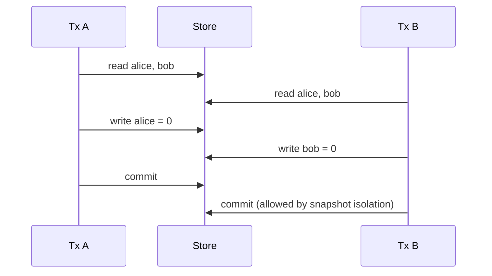
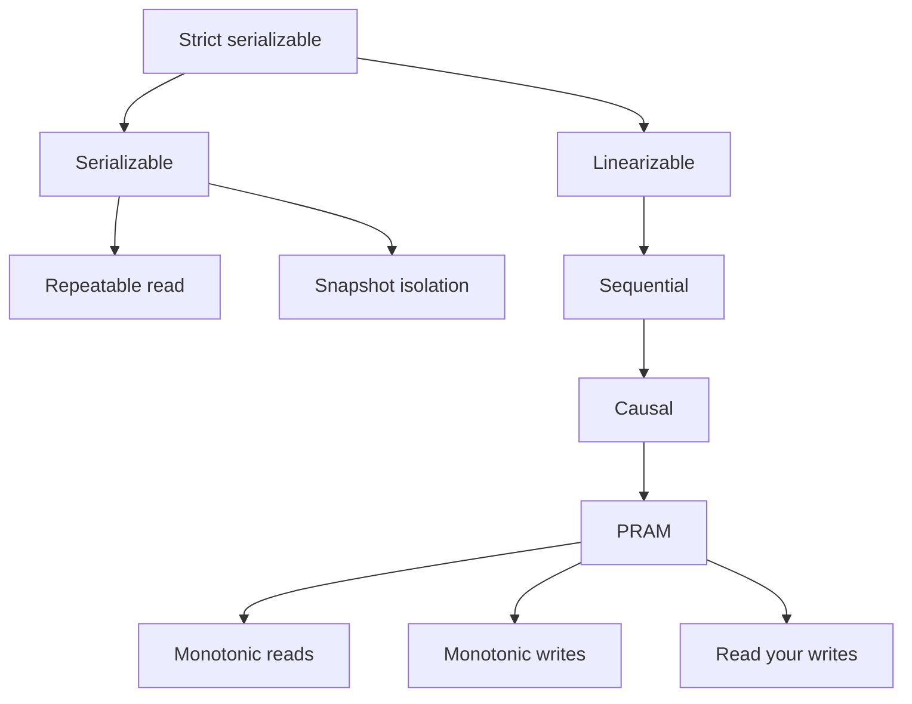

# Согласованность и CAP: экспертная теория

🌐 **Русский** · [English](expert.en.md)

**Уровни:** [обзор](overview.ru.md) · [1. Базовая](basics.ru.md) · [2. Продвинутая](advanced.ru.md) · **3. Экспертная** · [4. Квиз](quiz.ru.md)

## Под капотом

MVCC хранит несколько версий строки с метками фиксации. Читатель берёт последнюю версию не новее своего снимка, поэтому читатели не блокируют писателей.



### Иерархия моделей

Модели согласованности образуют не лестницу, а граф: «сильнее» значит «допускает меньше историй». По классификации Jepsen:



Snapshot isolation и repeatable read между собой несравнимы. Модели не слабее cursor stability, snapshot isolation и sequential не могут быть полностью доступны в асинхронной сети; read-your-writes и сильнее — не более чем «липко» доступны (клиент должен ходить на тот же узел).

### Как проверить линеаризуемость

История линеаризуема, если операции можно выстроить в один порядок, не нарушая реальное время и смысл регистра.

```csharp
// An operation may go first only if no other one finished before it started.
int earliestEnd = remaining.Min(o => o.End);
foreach (Operation op in remaining.Where(o => o.Start <= earliestEnd))
{
    if (!op.IsWrite && op.Value != value) continue;
```

Чтение, пересекающееся с записью, может увидеть любое значение; но после того как новое значение уже наблюдали, старое вернуться не может. Файл: [Ex04_Linearizability.cs](code/Examples/Ex04_Linearizability.cs). Перебор экспоненциален и годится для маленьких историй.

### Сериализуемость как граф без циклов

Между транзакциями есть зависимости: кто должен идти раньше. Исполнение эквивалентно последовательному, если в графе нет цикла. Write skew даёт цикл: A читала то, что потом переписала B, и наоборот. Файл: [Ex05_SerializationGraph.cs](code/Examples/Ex05_SerializationGraph.cs).

PostgreSQL на уровне Serializable (SSI) отслеживает такие зависимости с помощью предикатных блокировок `SIReadLock`: они никого не блокируют, а при опасной комбинации одна из транзакций получает ошибку `40001`. Под нехваткой памяти блокировки укрупняются до страницы или таблицы, а последовательное сканирование берёт блокировку на всю таблицу — это увеличивает число отказов.

### Ещё CRDT

PN-Counter — два растущих счётчика; значение равно разности.

```csharp
public long Value => _plus.Values.Sum() - _minus.Values.Sum();
```

LWW-Register разрешает равенство меток идентификатором узла, чтобы реплики не разошлись. Файл: [Ex06_Crdts.cs](code/Examples/Ex06_Crdts.cs).

## Справочник

| Средство | От чего защищает |
|---|---|
| Атомарная операция `SET x = x + 1` | lost update одной строки |
| `SELECT ... FOR UPDATE` | конкурентное изменение прочитанных строк |
| Версия строки в `WHERE` | lost update без долгих блокировок |
| Уникальный индекс | дубликаты |
| Serializable | в том числе write skew |
| Распределённая блокировка | взаимное исключение между процессами, нужны fencing tokens |

| CRDT | Идея слияния |
|---|---|
| G-Counter | максимум по каждому узлу, сумма — значение |
| PN-Counter | два G-Counter: плюсы и минусы |
| LWW-Register | побеждает большая метка |
| OR-Set | удаляются только увиденные добавления |

| Операция | Обычно достаточно |
|---|---|
| списание денег | сериализуемость или явная блокировка |
| имя пользователя уникально | ограничение на одном лидере |
| лента, счётчики | eventual |
| свой профиль после правки | read-your-writes |

| СУБД | Уровень по умолчанию | Особенности |
|---|---|---|
| PostgreSQL | Read committed | Repeatable read — snapshot isolation; Serializable — SSI |
| SQL Server | Read committed | `READ_COMMITTED_SNAPSHOT` по умолчанию выключен; есть уровень `SNAPSHOT` |
| Azure SQL Database | Read committed | `READ_COMMITTED_SNAPSHOT` по умолчанию включён |
| MySQL InnoDB 8.4 | Repeatable read | обычные чтения берут снимок первого чтения; блокирующие — record, gap и next-key блокировки |

В SQL Server с выключенным `READ_COMMITTED_SNAPSHOT` читатели берут блокировки, а в Azure SQL Database читают версии строк: один и тот же код может по-разному ждать и видеть данные в разных средах.

| Конфигурация | PACELC |
|---|---|
| синхронные кворумы, отказ без большинства | PC / EC |
| асинхронные реплики, чтения с реплик, запись везде | PA / EL |
| кворумы с настраиваемыми W и R | зависит от значений |

PACELC описывает конфигурацию, а не название продукта: одна и та же база может вести себя по-разному.

### Ещё две аномалии

| Аномалия | Что происходит |
|---|---|
| Dirty write (грязная запись) | транзакция перезаписывает значение, записанное другой, ещё не зафиксированной и не отменённой |
| Read skew (перекос чтения) | транзакция читает `x`, другая меняет и `x`, и `y` и фиксируется, затем первая читает `y`: такой пары значений одновременно не существовало |

Snapshot isolation и repeatable read в определениях Jepsen исключают read skew, потому что все чтения идут из одного состояния. Write skew snapshot isolation всё равно допускает.

## Подвохи

### Потокобезопасная коллекция не делает операцию атомарной

```csharp
var d = new ConcurrentDictionary<string, int> { ["x"] = 0 };
using var barrier = new Barrier(2);
// both threads run:
int v = d["x"];
barrier.SignalAndWait();
d["x"] = v + 1;
```

Результат: `d["x"]` равно `1`, а не `2`. Каждое обращение безопасно, а пара «прочитал — записал» нет. Нужен `AddOrUpdate`. То же происходит с базой на уровне Read committed, если приложение читает и пишет отдельными командами.

### Восстановление связи не согласует данные

В тесте режима AP после `Heal()` узлы продолжают отдавать `left` и `right`. Согласование — отдельный механизм: слияние, версии или выбор победителя.

### Чтение, пересекающееся с записью

Значение, увиденное во время записи, не гарантирует, что следующее чтение увидит то же. Но линеаризуемость запрещает вернуться к старому после нового — это проверяет тест с историей «запись 1, чтение 1, чтение 0».

### Одинаковое имя уровня — разное поведение

«Repeatable read» в MySQL и PostgreSQL устроены по-разному, а уровень по умолчанию различается. Перенося приложение между базами, проверяйте инварианты тестами с параллельными транзакциями.

## Компромиссы и альтернативы

| Выбор | Плюс | Минус |
|---|---|---|
| Serializable | простое рассуждение | откаты и повторы |
| Пессимистичная блокировка | нет повторов | ожидание и deadlock |
| Оптимистичная проверка | нет долгих блокировок | много повторов под конкуренцией |
| CRDT | доступность | ограниченные инварианты |
| Один писатель на ключ | нет конфликтов | узкое место |

## Вопросы с собеседований

**1. Что означает CAP?**

<details><summary>Ответ</summary>

При сетевом разделении нельзя одновременно сохранить линеаризуемость и отвечать на все запросы.

</details>

**2. Что добавляет PACELC?**

<details><summary>Ответ</summary>

Без разделения тоже есть выбор: задержка или согласованность.

</details>

**3. Чем C в ACID отличается от C в CAP?**

<details><summary>Ответ</summary>

Первая — сохранение инвариантов, вторая — поведение как у одной копии.

</details>

**4. Что такое write skew?**

<details><summary>Ответ</summary>

Транзакции читают общий набор, пишут разные строки и вместе нарушают правило.

</details>

**5. Уровень изоляции PostgreSQL по умолчанию?**

<details><summary>Ответ</summary>

Read committed.

</details>

**6. Что делать при ошибке сериализации?**

<details><summary>Ответ</summary>

Повторить транзакцию целиком, с ограничением числа попыток.

</details>

**7. Чем линеаризуемость отличается от serializable?**

<details><summary>Ответ</summary>

Первая — про реальное время и отдельные объекты, вторая — про эквивалентность какому-то последовательному порядку транзакций.

</details>

**8. Почему G-Counter берёт максимум, а не сумму при слиянии?**

<details><summary>Ответ</summary>

Чтобы повторное слияние того же состояния ничего не меняло.

</details>

**9. Сколько узлов из пяти нужно для большинства?**

<details><summary>Ответ</summary>

Три.

</details>

**10. Подвох: система «CP». Значит, она всегда доступна, пока нет разделения?**

<details><summary>Ответ</summary>

Нет: CAP ничего не говорит о других отказах, перегрузке и задержке.

</details>

**11. Уровень по умолчанию в SQL Server и MySQL InnoDB?**

<details><summary>Ответ</summary>

SQL Server — Read committed, InnoDB — Repeatable read.

</details>

**12. Что такое SSI?**

<details><summary>Ответ</summary>

Сериализуемость поверх снимков: зависимости чтения и записи отслеживаются, и при опасности одну транзакцию откатывают.

</details>

**13. Когда исполнение сериализуемо?**

<details><summary>Ответ</summary>

Когда граф зависимостей транзакций не содержит циклов (для конфликтной сериализуемости).

</details>

**14. Можно ли иметь линеаризуемость и полную доступность?**

<details><summary>Ответ</summary>

Нет: при разделении сети линеаризуемая система не может отвечать всем.

</details>

**15. Подвох: тесты проходят локально, а в облаке появились взаимные ожидания и другие результаты. Возможная причина?**

<details><summary>Ответ</summary>

Разные настройки версионирования чтений, например `READ_COMMITTED_SNAPSHOT`.

</details>

## Связанные материалы

- [Продвинутая теория](advanced.ru.md)
- [Квиз](quiz.ru.md) и [упражнения](exercises.ru.md)

## Источники

- [PostgreSQL: изоляция транзакций](https://www.postgresql.org/docs/current/transaction-iso.html)
- [Jepsen: модели согласованности](https://jepsen.io/consistency/models)
- [SQL Server: SET TRANSACTION ISOLATION LEVEL](https://learn.microsoft.com/sql/t-sql/statements/set-transaction-isolation-level-transact-sql)
- [MySQL 8.4: уровни изоляции InnoDB](https://dev.mysql.com/doc/refman/8.4/en/innodb-transaction-isolation-levels.html)
- [Jepsen: dirty write](https://jepsen.io/consistency/phenomena/p0)
- [Jepsen: read skew](https://jepsen.io/consistency/phenomena/a5a)
