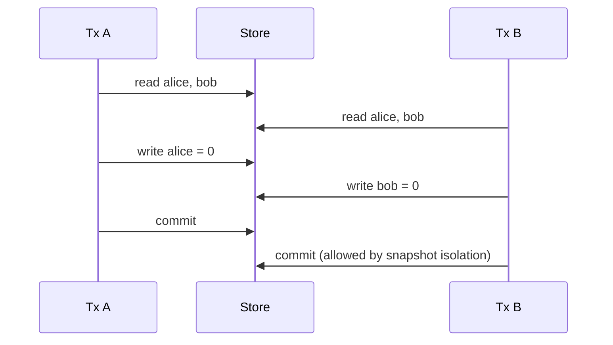

# Согласованность и CAP: экспертная теория

🌐 **Русский** · [English](expert.en.md)

**Уровни:** [обзор](overview.ru.md) · [1. Базовая](basics.ru.md) · [2. Продвинутая](advanced.ru.md) · **3. Экспертная** · [4. Квиз](quiz.ru.md)

## Под капотом

MVCC хранит несколько версий строки с метками фиксации. Читатель берёт последнюю версию не новее своего снимка, поэтому читатели не блокируют писателей.



## Справочник

| Средство | От чего защищает |
|---|---|
| Атомарная операция `SET x = x + 1` | lost update одной строки |
| `SELECT ... FOR UPDATE` | конкурентное изменение прочитанных строк |
| Версия строки в `WHERE` | lost update без долгих блокировок |
| Уникальный индекс | дубликаты |
| Serializable | в том числе write skew |
| Распределённая блокировка | взаимное исключение между процессами, нужны fencing tokens |

| CRDT | Идея слияния |
|---|---|
| G-Counter | максимум по каждому узлу, сумма — значение |
| PN-Counter | два G-Counter: плюсы и минусы |
| LWW-Register | побеждает большая метка |
| OR-Set | удаляются только увиденные добавления |

| Операция | Обычно достаточно |
|---|---|
| списание денег | сериализуемость или явная блокировка |
| имя пользователя уникально | ограничение на одном лидере |
| лента, счётчики | eventual |
| свой профиль после правки | read-your-writes |

## Подвохи

### Потокобезопасная коллекция не делает операцию атомарной

```csharp
var d = new ConcurrentDictionary<string, int> { ["x"] = 0 };
using var barrier = new Barrier(2);
// both threads run:
int v = d["x"];
barrier.SignalAndWait();
d["x"] = v + 1;
```

Результат: `d["x"]` равно `1`, а не `2`. Каждое обращение безопасно, а пара «прочитал — записал» нет. Нужен `AddOrUpdate`. То же происходит с базой на уровне Read committed, если приложение читает и пишет отдельными командами.

### Восстановление связи не согласует данные

В тесте режима AP после `Heal()` узлы продолжают отдавать `left` и `right`. Согласование — отдельный механизм: слияние, версии или выбор победителя.

## Компромиссы и альтернативы

| Выбор | Плюс | Минус |
|---|---|---|
| Serializable | простое рассуждение | откаты и повторы |
| Пессимистичная блокировка | нет повторов | ожидание и deadlock |
| Оптимистичная проверка | нет долгих блокировок | много повторов под конкуренцией |
| CRDT | доступность | ограниченные инварианты |
| Один писатель на ключ | нет конфликтов | узкое место |

## Вопросы с собеседований

**1. Что означает CAP?**

<details><summary>Ответ</summary>

При сетевом разделении нельзя одновременно сохранить линеаризуемость и отвечать на все запросы.

</details>

**2. Что добавляет PACELC?**

<details><summary>Ответ</summary>

Без разделения тоже есть выбор: задержка или согласованность.

</details>

**3. Чем C в ACID отличается от C в CAP?**

<details><summary>Ответ</summary>

Первая — сохранение инвариантов, вторая — поведение как у одной копии.

</details>

**4. Что такое write skew?**

<details><summary>Ответ</summary>

Транзакции читают общий набор, пишут разные строки и вместе нарушают правило.

</details>

**5. Уровень изоляции PostgreSQL по умолчанию?**

<details><summary>Ответ</summary>

Read committed.

</details>

**6. Что делать при ошибке сериализации?**

<details><summary>Ответ</summary>

Повторить транзакцию целиком, с ограничением числа попыток.

</details>

**7. Чем линеаризуемость отличается от serializable?**

<details><summary>Ответ</summary>

Первая — про реальное время и отдельные объекты, вторая — про эквивалентность какому-то последовательному порядку транзакций.

</details>

**8. Почему G-Counter берёт максимум, а не сумму при слиянии?**

<details><summary>Ответ</summary>

Чтобы повторное слияние того же состояния ничего не меняло.

</details>

**9. Сколько узлов из пяти нужно для большинства?**

<details><summary>Ответ</summary>

Три.

</details>

**10. Подвох: система «CP». Значит, она всегда доступна, пока нет разделения?**

<details><summary>Ответ</summary>

Нет: CAP ничего не говорит о других отказах, перегрузке и задержке.

</details>

## Связанные материалы

- [Продвинутая теория](advanced.ru.md)
- [Квиз](quiz.ru.md) и [упражнения](exercises.ru.md)

## Источники

- [PostgreSQL: изоляция транзакций](https://www.postgresql.org/docs/current/transaction-iso.html)
