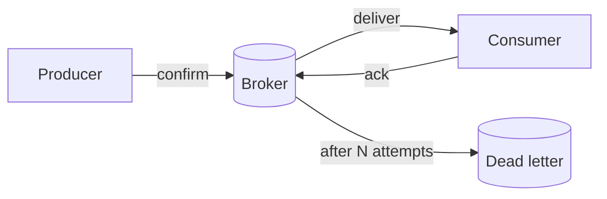

# Messaging and events: expert

🌐 [Русский](expert.ru.md) · **English**

**Levels:** [overview](overview.en.md) · [1. Basics](basics.en.md) · [2. Advanced](advanced.en.md) · **3. Expert** · [4. Quiz](quiz.en.md)

## Under the hood

A reliable path has three legs: producer → broker, storage in the broker, broker → consumer. Loss is possible on each. In RabbitMQ the first is covered by publisher confirms, the second by durable queues and replication, the third by manual acknowledgements.



## Reference

| Pattern | Task |
|---|---|
| Work queue / competing consumers | distribute work: one receiver gets a message |
| Publish/subscribe | deliver a copy to every subscriber |
| Request/reply | a reply through a queue with a correlation id |
| Outbox | do not lose an event when writing to the database |
| Inbox | do not process twice |
| Saga | coordinate steps of several services |
| Claim check | keep a large object separately |

| Message field | Why |
|---|---|
| id | deduplication |
| type, version | compatibility |
| correlation / causation id | tracing the chain |
| key | ordering and partition |
| event time | analytics, not ordering |

## Gotchas

### DropOldest reports success although data is lost

```csharp
var ch = Channel.CreateBounded<int>(
    new BoundedChannelOptions(1) { FullMode = BoundedChannelFullMode.DropOldest },
    dropped => Console.WriteLine($"dropped {dropped}"));
Console.WriteLine(ch.Writer.TryWrite(1));
Console.WriteLine(ch.Writer.TryWrite(2));
```

Result: `True`, then `dropped 1` and `True`. You can learn about the loss only through the `itemDropped` callback.

### The reader waits until the writer is completed

```csharp
ch.Writer.Complete();
Console.WriteLine(ch.Writer.TryWrite(3));
await foreach (var x in ch.Reader.ReadAllAsync()) Console.WriteLine($"read {x}");
```

Result: `False`, then `read 2`. Without `Complete()` the `ReadAllAsync` loop never ends.

## Trade-offs and alternatives

| Choice | Pro | Con |
|---|---|---|
| `Channel<T>` in process | fast, no infrastructure | everything is lost on restart |
| Queue broker | routing, acknowledgements | one more service |
| Log | history replay, high throughput | ordering and scale through partitions |
| A database table as a queue | one transaction with the data | limited throughput |
| Direct call | simplicity | temporal coupling |

## Interview questions

**1. How does a command differ from an event?**

<details><summary>Answer</summary>

A command is a request to one owner, an event is a fact for any subscribers.

</details>

**2. How do you get at-least-once?**

<details><summary>Answer</summary>

Acknowledge after successful processing; the producer needs broker confirms and retries.

</details>

**3. Is exactly-once delivery possible?**

<details><summary>Answer</summary>

In the general case with external effects you aim for a single effect: repeatable delivery plus idempotency or a transaction.

</details>

**4. How do you keep the order of an order's events?**

<details><summary>Answer</summary>

One key — one partition, processed sequentially, with retries not overtaking.

</details>

**5. What is a poison message?**

<details><summary>Answer</summary>

A message whose processing always fails.

</details>

**6. What is backpressure?**

<details><summary>Answer</summary>

A mechanism that slows down or rejects the producer when the consumer cannot keep up.

</details>

**7. Why an outbox?**

<details><summary>Answer</summary>

A database write and a broker publish cannot be made atomic directly.

</details>

**8. The lag is growing. What do you do?**

<details><summary>Answer</summary>

Find what is slow, add consumers within the partition count, optimize processing, limit the incoming flow.

</details>

**9. How long do you keep identifiers for deduplication?**

<details><summary>Answer</summary>

Longer than the maximum period in which redelivery is possible, including manual replay.

</details>

**10. Trick question: you added 20 consumers to a topic with 4 partitions. What happens?**

<details><summary>Answer</summary>

In one Kafka group no more than four will work, the rest stay idle.

</details>

## Related materials

- [Advanced theory](advanced.en.md)
- [Quiz](quiz.en.md) and [exercises](exercises.en.md)

## Sources

- [Channels in .NET](https://learn.microsoft.com/dotnet/core/extensions/channels)
- [RabbitMQ: confirms](https://www.rabbitmq.com/docs/confirms)
