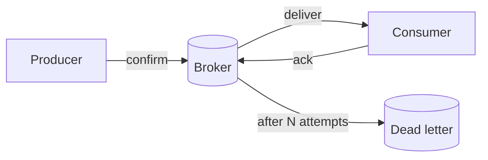

# Messaging and events: expert

🌐 [Русский](expert.ru.md) · **English**

**Levels:** [overview](overview.en.md) · [1. Basics](basics.en.md) · [2. Advanced](advanced.en.md) · **3. Expert** · [4. Quiz](quiz.en.md)

## Under the hood

A reliable path has three legs: producer → broker, storage in the broker, broker → consumer. Loss is possible on each. In RabbitMQ the first is covered by publisher confirms, the second by durable queues and replication, the third by manual acknowledgements.



### Kafka transactions and "exactly once"

An idempotent producer does not create duplicates in the log when resending. A transaction lets you write messages to several partitions atomically, including the consumer position. A `read_committed` consumer sees only what was committed.

```csharp
public void Commit(long transaction)
{
    _outcome[transaction] = true;
    if (_pendingOffsets.TryGetValue(transaction, out int offset)) ConsumedOffset = offset;
}
```

While an earlier transaction is open, the reader does not advance past it, even if a later one has committed. The "exactly once" guarantee covers the chain "read from Kafka — process — write to Kafka"; an external database or email needs its own idempotency. File: [Ex05_Transactions.cs](code/Examples/Ex05_Transactions.cs). This models the idea, not Kafka's protocol; details are in the [Kafka track](../../../kafka/modules/05-delivery-semantics/overview.en.md).

### Quorum queues and streams in RabbitMQ

A quorum queue is a durable replicated queue on Raft; a publisher confirm arrives once the message is written to a majority. Since 4.0 the default delivery limit is 20: a message that exceeds it is dropped, or goes to a dead-letter exchange if one is configured. Dead lettering is at-most-once by default; at-least-once needs separate settings.

A stream is a log: reading does not remove messages, and the consumer picks the starting position (`first`, `last`, `next`, an offset or a time). Retention limits (`max-age`, `max-length-bytes`) are not set by default.

### Schema evolution

```csharp
public static bool CanRead(IReadOnlyList<SchemaField> reader, IReadOnlyList<SchemaField> writer) =>
    reader.All(r => r.HasDefault || writer.Any(w => w.Name == r.Name));
```

Backward: a new reader understands old data. Forward: an old reader understands new data. File: [Ex06_SchemaCompatibility.cs](code/Examples/Ex06_SchemaCompatibility.cs). The model considers only the presence of fields and default values.

### Retry queues

So as not to block the stream, a failed message is sent to a delayed queue, then to one with a longer delay, and finally to the dead letter queue. The price is ordering: in the test `a`, which failed once, was processed after `b` and `d`. File: [Ex07_RetryTiers.cs](code/Examples/Ex07_RetryTiers.cs).

### Rebalancing

When group membership changes, partitions are reassigned. A full recalculation moves more than necessary: in a test with 12 partitions and one of four consumers leaving, 9 against 3 for the "sticky" variant. File: [Ex08_Assignment.cs](code/Examples/Ex08_Assignment.cs).

In Kafka the new group protocol (KIP-848) is available since 4.0 and is enabled on the client with `group.protocol=consumer`; in it the broker performs the assignment (`uniform` by default, or `range`).

## Reference

| Pattern | Task |
|---|---|
| Work queue / competing consumers | distribute work: one receiver gets a message |
| Publish/subscribe | deliver a copy to every subscriber |
| Request/reply | a reply through a queue with a correlation id |
| Outbox | do not lose an event when writing to the database |
| Inbox | do not process twice |
| Saga | coordinate steps of several services |
| Claim check | keep a large object separately |

| Message field | Why |
|---|---|
| id | deduplication |
| type, version | compatibility |
| correlation / causation id | tracing the chain |
| key | ordering and partition |
| event time | analytics, not ordering |

| Schema Registry compatibility | What it guarantees | Whom to upgrade first |
|---|---|---|
| `BACKWARD` (default) | new consumers read old data | consumers |
| `FORWARD` | old consumers read new data | producers |
| `FULL` | both directions | in any order |
| `NONE` | no checks | with care |

The `_TRANSITIVE` variants check compatibility with all earlier versions, not only the latest.

| Schema change | Backward | Forward |
|---|---|---|
| added a field with a default | yes | yes |
| added a field without a default | no | yes |
| removed a field without a default | yes | no |

| RabbitMQ | Quorum queue | Stream |
|---|---|---|
| After reading | removed after ack | stays |
| Reading again | no | yes |
| Replication | Raft | a leader and replicas |

## Gotchas

### DropOldest reports success although data is lost

```csharp
var ch = Channel.CreateBounded<int>(
    new BoundedChannelOptions(1) { FullMode = BoundedChannelFullMode.DropOldest },
    dropped => Console.WriteLine($"dropped {dropped}"));
Console.WriteLine(ch.Writer.TryWrite(1));
Console.WriteLine(ch.Writer.TryWrite(2));
```

Result: `True`, then `dropped 1` and `True`. You can learn about the loss only through the `itemDropped` callback.

### The reader waits until the writer is completed

```csharp
ch.Writer.Complete();
Console.WriteLine(ch.Writer.TryWrite(3));
await foreach (var x in ch.Reader.ReadAllAsync()) Console.WriteLine($"read {x}");
```

Result: `False`, then `read 2`. Without `Complete()` the `ReadAllAsync` loop never ends.

### An open transaction holds readers back

In the model a `read_committed` reader does not see the committed `b` while an earlier transaction with `a` is open. Long transactions increase the delay for all consumers of the partition.

### A retry queue breaks ordering

The test result is `b`, `d`, `a` instead of `a`, `b`, `d`. If ordering by key matters, retry in place or postpone all messages of that key.

## Trade-offs and alternatives

| Choice | Pro | Con |
|---|---|---|
| `Channel<T>` in process | fast, no infrastructure | everything is lost on restart |
| Queue broker | routing, acknowledgements | one more service |
| Log | history replay, high throughput | ordering and scale through partitions |
| A database table as a queue | one transaction with the data | limited throughput |
| Direct call | simplicity | temporal coupling |

## Interview questions

**1. How does a command differ from an event?**

<details><summary>Answer</summary>

A command is a request to one owner, an event is a fact for any subscribers.

</details>

**2. How do you get at-least-once?**

<details><summary>Answer</summary>

Acknowledge after successful processing; the producer needs broker confirms and retries.

</details>

**3. Is exactly-once delivery possible?**

<details><summary>Answer</summary>

In the general case with external effects you aim for a single effect: repeatable delivery plus idempotency or a transaction.

</details>

**4. How do you keep the order of an order's events?**

<details><summary>Answer</summary>

One key — one partition, processed sequentially, with retries not overtaking.

</details>

**5. What is a poison message?**

<details><summary>Answer</summary>

A message whose processing always fails.

</details>

**6. What is backpressure?**

<details><summary>Answer</summary>

A mechanism that slows down or rejects the producer when the consumer cannot keep up.

</details>

**7. Why an outbox?**

<details><summary>Answer</summary>

A database write and a broker publish cannot be made atomic directly.

</details>

**8. The lag is growing. What do you do?**

<details><summary>Answer</summary>

Find what is slow, add consumers within the partition count, optimize processing, limit the incoming flow.

</details>

**9. How long do you keep identifiers for deduplication?**

<details><summary>Answer</summary>

Longer than the maximum period in which redelivery is possible, including manual replay.

</details>

**10. Trick question: you added 20 consumers to a topic with 4 partitions. What happens?**

<details><summary>Answer</summary>

In one Kafka group no more than four will work, the rest stay idle.

</details>

**11. What does an idempotent producer give, and what do transactions give?**

<details><summary>Answer</summary>

The first removes duplicates caused by resending; the second makes a write to several partitions atomic.

</details>

**12. Where does exactly-once end in Kafka?**

<details><summary>Answer</summary>

At Kafka's boundary: external systems need their own idempotency or cooperation.

</details>

**13. Whom do you upgrade first with `BACKWARD`?**

<details><summary>Answer</summary>

Consumers, before new events appear.

</details>

**14. What happens to a quorum queue message after the delivery limit?**

<details><summary>Answer</summary>

It is dropped, or goes to a dead-letter exchange if one is configured.

</details>

**15. Trick question: you configured a dead-letter exchange, so such messages cannot be lost?**

<details><summary>Answer</summary>

By default dead lettering in quorum queues is at-most-once; at-least-once needs extra settings.

</details>

## Related materials

- [Advanced theory](advanced.en.md)
- [Quiz](quiz.en.md) and [exercises](exercises.en.md)

## Sources

- [Channels in .NET](https://learn.microsoft.com/dotnet/core/extensions/channels)
- [RabbitMQ: confirms](https://www.rabbitmq.com/docs/confirms)
- [Kafka: design, delivery semantics and transactions](https://kafka.apache.org/43/design/design/)
- [Kafka: consumer rebalance protocol](https://kafka.apache.org/43/operations/consumer-rebalance-protocol/)
- [RabbitMQ: quorum queues](https://www.rabbitmq.com/docs/quorum-queues)
- [RabbitMQ: streams](https://www.rabbitmq.com/docs/streams)
- [Confluent: schema evolution](https://docs.confluent.io/platform/current/schema-registry/fundamentals/schema-evolution.html)
