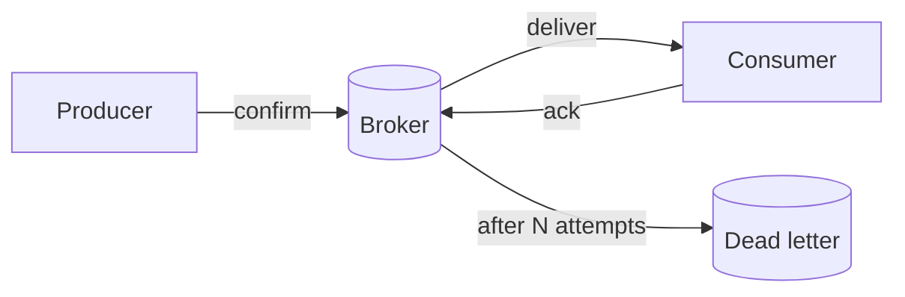

# Сообщения и события: экспертная теория

🌐 **Русский** · [English](expert.en.md)

**Уровни:** [обзор](overview.ru.md) · [1. Базовая](basics.ru.md) · [2. Продвинутая](advanced.ru.md) · **3. Экспертная** · [4. Квиз](quiz.ru.md)

## Под капотом

Надёжный путь состоит из трёх участков: отправитель → брокер, хранение в брокере, брокер → потребитель. Потеря возможна на каждом. У RabbitMQ первый участок закрывают publisher confirms, второй — долговечные очереди и репликация, третий — ручные подтверждения.



## Справочник

| Паттерн | Задача |
|---|---|
| Work queue / competing consumers | распределить работу: сообщение получает один |
| Publish/subscribe | доставить копию каждому подписчику |
| Request/reply | ответ через очередь с correlation id |
| Outbox | не потерять событие при записи в базу |
| Inbox | не обработать дважды |
| Saga | согласовать шаги нескольких сервисов |
| Claim check | большой объект хранить отдельно |

| Поле сообщения | Зачем |
|---|---|
| id | дедупликация |
| type, version | совместимость |
| correlation / causation id | трассировка цепочки |
| key | порядок и партиция |
| время события | аналитика, не порядок |

## Подвохи

### DropOldest сообщает об успехе, хотя данные потеряны

```csharp
var ch = Channel.CreateBounded<int>(
    new BoundedChannelOptions(1) { FullMode = BoundedChannelFullMode.DropOldest },
    dropped => Console.WriteLine($"dropped {dropped}"));
Console.WriteLine(ch.Writer.TryWrite(1));
Console.WriteLine(ch.Writer.TryWrite(2));
```

Результат: `True`, затем `dropped 1` и `True`. Узнать о потере можно только через callback `itemDropped`.

### Читатель ждёт, пока не закрыт писатель

```csharp
ch.Writer.Complete();
Console.WriteLine(ch.Writer.TryWrite(3));
await foreach (var x in ch.Reader.ReadAllAsync()) Console.WriteLine($"read {x}");
```

Результат: `False`, затем `read 2`. Без `Complete()` цикл `ReadAllAsync` не завершится.

## Компромиссы и альтернативы

| Выбор | Плюс | Минус |
|---|---|---|
| `Channel<T>` в процессе | быстро, без инфраструктуры | всё теряется при перезапуске |
| Брокер очередей | маршрутизация, подтверждения | ещё один сервис |
| Журнал | повтор истории, высокий поток | порядок и масштаб через партиции |
| Таблица в базе как очередь | одна транзакция с данными | ограниченный поток |
| Прямой вызов | простота | связанность по времени |

## Вопросы с собеседований

**1. Чем команда отличается от события?**

<details><summary>Ответ</summary>

Команда — просьба к одному владельцу, событие — факт для любых подписчиков.

</details>

**2. Как получить at-least-once?**

<details><summary>Ответ</summary>

Подтверждать после успешной обработки; отправителю нужны подтверждения брокера и повторы.

</details>

**3. Возможна ли доставка ровно один раз?**

<details><summary>Ответ</summary>

В общем случае с внешними эффектами добиваются однократного эффекта: повторяемая доставка плюс идемпотентность или транзакция.

</details>

**4. Как сохранить порядок событий заказа?**

<details><summary>Ответ</summary>

Один ключ — одна партиция, обработка по ней последовательная, повторы не обгоняют.

</details>

**5. Что такое poison message?**

<details><summary>Ответ</summary>

Сообщение, обработка которого всегда падает.

</details>

**6. Что такое backpressure?**

<details><summary>Ответ</summary>

Механизм, замедляющий или отклоняющий отправителя, когда получатель не успевает.

</details>

**7. Зачем outbox?**

<details><summary>Ответ</summary>

Запись в базу и публикацию в брокер нельзя сделать атомарно напрямую.

</details>

**8. Растёт лаг. Что делать?**

<details><summary>Ответ</summary>

Выяснить, что медленно, добавить потребителей в пределах числа партиций, оптимизировать обработку, ограничить входящий поток.

</details>

**9. Сколько хранить идентификаторы для дедупликации?**

<details><summary>Ответ</summary>

Дольше максимального срока, в течение которого возможна повторная доставка, включая ручной replay.

</details>

**10. Подвох: добавили 20 потребителей на тему с 4 партициями. Что будет?**

<details><summary>Ответ</summary>

В одной группе Kafka работать будут не более четырёх, остальные простаивают.

</details>

## Связанные материалы

- [Продвинутая теория](advanced.ru.md)
- [Квиз](quiz.ru.md) и [упражнения](exercises.ru.md)

## Источники

- [Channels в .NET](https://learn.microsoft.com/dotnet/core/extensions/channels)
- [RabbitMQ: подтверждения](https://www.rabbitmq.com/docs/confirms)
