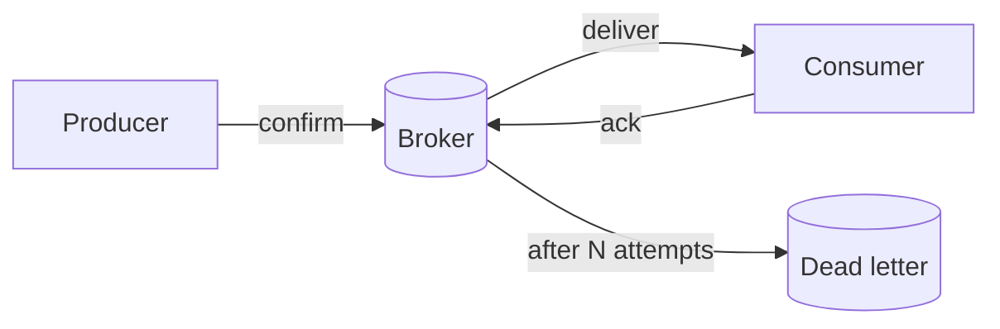

# Сообщения и события: экспертная теория

🌐 **Русский** · [English](expert.en.md)

**Уровни:** [обзор](overview.ru.md) · [1. Базовая](basics.ru.md) · [2. Продвинутая](advanced.ru.md) · **3. Экспертная** · [4. Квиз](quiz.ru.md)

## Под капотом

Надёжный путь состоит из трёх участков: отправитель → брокер, хранение в брокере, брокер → потребитель. Потеря возможна на каждом. У RabbitMQ первый участок закрывают publisher confirms, второй — долговечные очереди и репликация, третий — ручные подтверждения.



### Транзакции Kafka и «ровно один раз»

Идемпотентный producer не создаёт дубликатов в журнале при повторной отправке. Транзакция позволяет записать сообщения в несколько партиций атомарно, включая позицию потребителя. Consumer с `read_committed` видит только зафиксированное.

```csharp
public void Commit(long transaction)
{
    _outcome[transaction] = true;
    if (_pendingOffsets.TryGetValue(transaction, out int offset)) ConsumedOffset = offset;
}
```

Consumer с `read_committed` читает только до last stable offset (LSO) — перед первой открытой транзакцией, поэтому, пока ранняя транзакция открыта, он не продвигается дальше неё, даже если более поздняя уже зафиксирована. Гарантия «ровно один раз» относится к цепочке «прочитал из Kafka — обработал — записал в Kafka»; внешняя база или почта требуют своей идемпотентности. Файл: [Ex05_Transactions.cs](code/Examples/Ex05_Transactions.cs). Это модель идеи, а не протокол Kafka; подробности — в [треке Kafka](../../../kafka/modules/05-delivery-semantics/overview.ru.md).

### Quorum queues и streams в RabbitMQ

Quorum queue — долговечная реплицируемая очередь на Raft; publisher confirm приходит, когда сообщение записано на большинство. Начиная с 4.0 лимит доставок по умолчанию равен 20: превысившее его сообщение удаляется или уходит в dead-letter exchange, если он настроен. С 4.3 счётчик доставок растёт только при настоящих сбоях (например, упавший канал или `basic.reject`); возврат сообщения через `basic.nack` в лимит больше не идёт. Dead lettering по умолчанию at-most-once; для at-least-once нужны `dead-letter-strategy: at-least-once`, `overflow: reject-publish` (значение по умолчанию `drop-head` возвращает к at-most-once) и настроенный dead-letter exchange.

Stream — журнал: чтение не удаляет сообщения, потребитель выбирает начальную позицию (`first`, `last`, `next`, offset или время). Ограничения хранения (`max-age`, `max-length-bytes`) по умолчанию не заданы.

### Эволюция схем

```csharp
public static bool CanRead(IReadOnlyList<SchemaField> reader, IReadOnlyList<SchemaField> writer) =>
    reader.All(r => r.HasDefault || writer.Any(w => w.Name == r.Name));
```

Backward: новый читатель понимает старые данные. Forward: старый читатель понимает новые. Файл: [Ex06_SchemaCompatibility.cs](code/Examples/Ex06_SchemaCompatibility.cs). Модель учитывает только наличие полей и значения по умолчанию.

### Retry-очереди

Чтобы не блокировать поток, неудачное сообщение отправляют в очередь с задержкой, затем с большей, и наконец в dead-letter. Цена — порядок: в тесте `a`, упавшее один раз, обработано после `b` и `d`. Файл: [Ex07_RetryTiers.cs](code/Examples/Ex07_RetryTiers.cs).

### Ребалансировка

При изменении состава группы партиции переназначаются. Полный пересчёт перемещает больше, чем нужно: в тесте с 12 партициями и уходом одного из четырёх потребителей — 9 против 3 у «липкого» варианта. Файл: [Ex08_Assignment.cs](code/Examples/Ex08_Assignment.cs).

В Kafka новый протокол групп (KIP-848) доступен с 4.0 и включается на клиенте `group.protocol=consumer`; в нём назначение выполняет брокер (`uniform` по умолчанию или `range`).

## Справочник

| Паттерн | Задача |
|---|---|
| Work queue / competing consumers | распределить работу: сообщение получает один |
| Publish/subscribe | доставить копию каждому подписчику |
| Request/reply | ответ через очередь с correlation id |
| Outbox | не потерять событие при записи в базу |
| Inbox | не обработать дважды |
| Saga | согласовать шаги нескольких сервисов |
| Claim check | большой объект хранить отдельно |

| Поле сообщения | Зачем |
|---|---|
| id | дедупликация |
| type, version | совместимость |
| correlation / causation id | трассировка цепочки |
| key | порядок и партиция |
| время события | аналитика, не порядок |

| Совместимость в Schema Registry | Что гарантирует | Кого обновлять первым |
|---|---|---|
| `BACKWARD` (по умолчанию) | новые consumers читают старые данные | consumers |
| `FORWARD` | старые consumers читают новые данные | producers |
| `FULL` | оба направления | в любом порядке |
| `NONE` | проверок нет | с осторожностью |

Варианты с суффиксом `_TRANSITIVE` проверяют совместимость со всеми прежними версиями, а не только с последней.

| Изменение схемы | Backward | Forward |
|---|---|---|
| добавили поле со значением по умолчанию | да | да |
| добавили поле без значения по умолчанию | нет | да |
| удалили поле без значения по умолчанию | да | нет |

| RabbitMQ | Quorum queue | Stream |
|---|---|---|
| После чтения | удаляется после ack | остаётся |
| Повторное чтение | нет | да |
| Репликация | Raft | лидер и реплики |

## Подвохи

### DropOldest сообщает об успехе, хотя данные потеряны

```csharp
var ch = Channel.CreateBounded<int>(
    new BoundedChannelOptions(1) { FullMode = BoundedChannelFullMode.DropOldest },
    dropped => Console.WriteLine($"dropped {dropped}"));
Console.WriteLine(ch.Writer.TryWrite(1));
Console.WriteLine(ch.Writer.TryWrite(2));
```

Результат: `True`, затем `dropped 1` и `True`. Узнать о потере можно только через callback `itemDropped`.

### Читатель ждёт, пока не закрыт писатель

```csharp
ch.Writer.Complete();
Console.WriteLine(ch.Writer.TryWrite(3));
await foreach (var x in ch.Reader.ReadAllAsync()) Console.WriteLine($"read {x}");
```

Результат: `False`, затем `read 2`. Без `Complete()` цикл `ReadAllAsync` не завершится.

### Открытая транзакция задерживает читателей

Читатель `read_committed` в модели не видит зафиксированное `b`, пока открыта более ранняя транзакция с `a`. Долгие транзакции увеличивают задержку всех потребителей партиции.

### Retry-очередь ломает порядок

Результат теста: `b`, `d`, `a` вместо `a`, `b`, `d`. Если порядок по ключу важен, повторяйте на месте или откладывайте все сообщения этого ключа.

## Компромиссы и альтернативы

| Выбор | Плюс | Минус |
|---|---|---|
| `Channel<T>` в процессе | быстро, без инфраструктуры | всё теряется при перезапуске |
| Брокер очередей | маршрутизация, подтверждения | ещё один сервис |
| Журнал | повтор истории, высокий поток | порядок и масштаб через партиции |
| Таблица в базе как очередь | одна транзакция с данными | ограниченный поток |
| Прямой вызов | простота | связанность по времени |

## Вопросы с собеседований

**1. Чем команда отличается от события?**

<details><summary>Ответ</summary>

Команда — просьба к одному владельцу, событие — факт для любых подписчиков.

</details>

**2. Как получить at-least-once?**

<details><summary>Ответ</summary>

Подтверждать после успешной обработки; отправителю нужны подтверждения брокера и повторы.

</details>

**3. Возможна ли доставка ровно один раз?**

<details><summary>Ответ</summary>

В общем случае с внешними эффектами добиваются однократного эффекта: повторяемая доставка плюс идемпотентность или транзакция.

</details>

**4. Как сохранить порядок событий заказа?**

<details><summary>Ответ</summary>

Один ключ — одна партиция, обработка по ней последовательная, повторы не обгоняют.

</details>

**5. Что такое poison message?**

<details><summary>Ответ</summary>

Сообщение, обработка которого всегда падает.

</details>

**6. Что такое backpressure?**

<details><summary>Ответ</summary>

Механизм, замедляющий или отклоняющий отправителя, когда получатель не успевает.

</details>

**7. Зачем outbox?**

<details><summary>Ответ</summary>

Запись в базу и публикацию в брокер нельзя сделать атомарно напрямую.

</details>

**8. Растёт лаг. Что делать?**

<details><summary>Ответ</summary>

Выяснить, что медленно, добавить потребителей в пределах числа партиций, оптимизировать обработку, ограничить входящий поток.

</details>

**9. Сколько хранить идентификаторы для дедупликации?**

<details><summary>Ответ</summary>

Дольше максимального срока, в течение которого возможна повторная доставка, включая ручной replay.

</details>

**10. Подвох: добавили 20 потребителей на тему с 4 партициями. Что будет?**

<details><summary>Ответ</summary>

В одной группе Kafka работать будут не более четырёх, остальные простаивают.

</details>

**11. Что даёт идемпотентный producer, а что транзакции?**

<details><summary>Ответ</summary>

Первый устраняет дубликаты от повторной отправки; вторые делают запись в несколько партиций атомарной.

</details>

**12. Где кончается exactly-once в Kafka?**

<details><summary>Ответ</summary>

На границе Kafka: внешние системы требуют собственной идемпотентности или кооперации.

</details>

**13. Кого обновлять первым при `BACKWARD`?**

<details><summary>Ответ</summary>

Consumers, до появления новых событий.

</details>

**14. Что происходит с сообщением quorum queue после лимита доставок?**

<details><summary>Ответ</summary>

Удаляется или уходит в dead-letter exchange, если настроен.

</details>

**15. Подвох: настроили dead-letter exchange, значит такие сообщения не потеряются?**

<details><summary>Ответ</summary>

По умолчанию dead lettering в quorum queues at-most-once; для at-least-once нужны дополнительные настройки.

</details>

## Связанные материалы

- [Продвинутая теория](advanced.ru.md)
- [Квиз](quiz.ru.md) и [упражнения](exercises.ru.md)

## Источники

- [Channels в .NET](https://learn.microsoft.com/dotnet/core/extensions/channels)
- [RabbitMQ: подтверждения](https://www.rabbitmq.com/docs/confirms)
- [Kafka: design, семантика доставки и транзакции](https://kafka.apache.org/43/design/design/)
- [Kafka: протокол ребалансировки](https://kafka.apache.org/43/operations/consumer-rebalance-protocol/)
- [RabbitMQ: quorum queues](https://www.rabbitmq.com/docs/quorum-queues)
- [RabbitMQ: streams](https://www.rabbitmq.com/docs/streams)
- [Confluent: эволюция схем](https://docs.confluent.io/platform/current/schema-registry/fundamentals/schema-evolution.html)
- [Kafka: consumer configs](https://kafka.apache.org/43/configuration/consumer-configs/)
