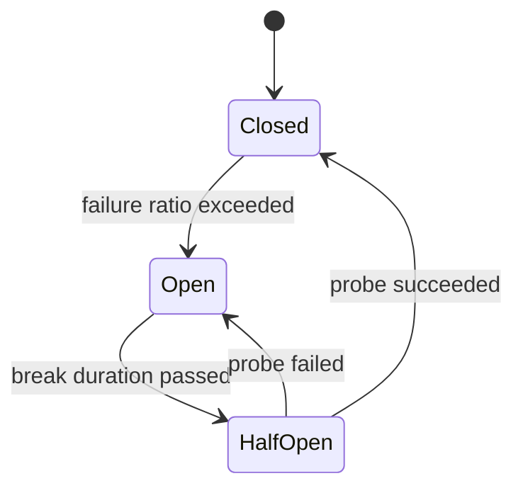

# Reliability patterns: advanced

🌐 [Русский](advanced.ru.md) · **English**

**Levels:** [overview](overview.en.md) · [1. Basics](basics.en.md) · **2. Advanced** · [3. Expert](expert.en.md) · [4. Quiz](quiz.en.md)

## Circuit breaker



```csharp
FailureRatio = 0.5,
MinimumThroughput = 4, // do not judge by one or two calls
SamplingDuration = TimeSpan.FromSeconds(10),
BreakDuration = TimeSpan.FromSeconds(5),
```

In the open state a call immediately gets `BrokenCircuitException` and the dependency is not called. The test drives time with `FakeTimeProvider`.

## Bulkhead

Each dependency gets its own limit of concurrent calls.

```csharp
public static ConcurrencyLimiter Bulkhead(int slots) =>
    new(new ConcurrencyLimiterOptions { PermitLimit = slots, QueueLimit = 0 });
```

Disposing the lease returns the slot. File: [Ex02_Limits.cs](code/Examples/Ex02_Limits.cs).

## Rate limiting

| Algorithm | Idea |
|---|---|
| Fixed window | a counter per interval; a burst at the boundary |
| Sliding window | an interval made of segments |
| Token bucket | a burst up to capacity, then the refill rate |
| Concurrency | limits concurrency, not rate |

## Load shedding

When there are no resources, extra work is rejected immediately (429 or 503) instead of being put into an endless queue. Drop the least important first.

## Order of strategies

The standard handler of `Microsoft.Extensions.Http.Resilience`, outermost to innermost: rate limiter, total timeout, retry, circuit breaker, attempt timeout. So each attempt has its own limit, and the whole operation is bounded by the total one.

## Best practices

- Pass the overall deadline down the chain.
- Retry at one layer.
- Plan degradation: a cached value, switching off secondary features.
- Return `Retry-After` when you reject.

## Common mistakes

- ❌ An attempt timeout larger than the total one → ✅ smaller.
- ❌ One breaker for different dependencies → ✅ one for each.
- ❌ A huge queue instead of rejection → ✅ a short one.
- ❌ Treating an in-memory limit as cluster-wide → ✅ it is per instance.

## Comparison with other tracks

- [Resilient HttpClient](../../../csharp/recipes/http-client-resilience/overview.en.md).
- [Rate limiting in ASP.NET Core](../../../csharp/recipes/rate-limiting/overview.en.md).

## Related materials

- [Basics](basics.en.md)
- [Expert theory](expert.en.md)

## Sources

- [Polly: circuit breaker](https://www.pollydocs.org/strategies/circuit-breaker.html)
- [.NET: HTTP resilience](https://learn.microsoft.com/dotnet/core/resilience/http-resilience)
- [ASP.NET Core: rate limiting](https://learn.microsoft.com/aspnet/core/performance/rate-limit)
- [Bulkhead pattern](https://learn.microsoft.com/azure/architecture/patterns/bulkhead)
