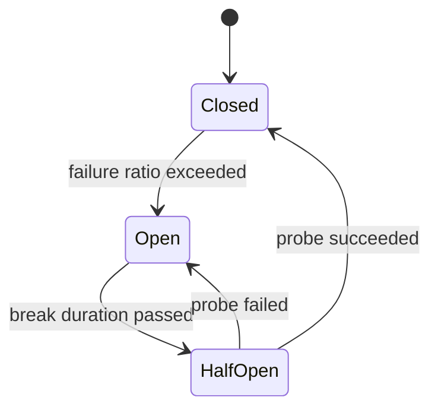

# Паттерны надёжности: продвинутая теория

🌐 **Русский** · [English](advanced.en.md)

**Уровни:** [обзор](overview.ru.md) · [1. Базовая](basics.ru.md) · **2. Продвинутая** · [3. Экспертная](expert.ru.md) · [4. Квиз](quiz.ru.md)

## Circuit breaker



```csharp
FailureRatio = 0.5,
MinimumThroughput = 4, // do not judge by one or two calls
SamplingDuration = TimeSpan.FromSeconds(10),
BreakDuration = TimeSpan.FromSeconds(5),
```

В открытом состоянии вызов сразу получает `BrokenCircuitException`, и зависимость не вызывается. Тест управляет временем через `FakeTimeProvider`.

## Bulkhead

Каждой зависимости — свой лимит одновременных вызовов.

```csharp
public static ConcurrencyLimiter Bulkhead(int slots) =>
    new(new ConcurrencyLimiterOptions { PermitLimit = slots, QueueLimit = 0 });
```

Освобождение lease возвращает слот. Файл: [Ex02_Limits.cs](code/Examples/Ex02_Limits.cs).

## Rate limiting

| Алгоритм | Идея |
|---|---|
| Fixed window | счётчик на интервал; всплеск на границе |
| Sliding window | интервал из сегментов |
| Token bucket | всплеск до ёмкости, затем скорость пополнения |
| Concurrency | ограничивает одновременность, а не скорость |

## Load shedding

Когда ресурсов нет, лишнюю работу отклоняют сразу (429 или 503), а не ставят в бесконечную очередь. Сначала отбрасывают наименее важное.

## Порядок стратегий

Стандартный обработчик `Microsoft.Extensions.Http.Resilience`, снаружи внутрь: rate limiter, общий таймаут, retry, circuit breaker, таймаут попытки. Поэтому у каждой попытки свой лимит, а вся операция ограничена общим.

## Лучшие практики

- Общий дедлайн передавайте дальше по цепочке.
- Повторяйте на одном уровне.
- Продумайте деградацию: значение из кэша, отключение второстепенного.
- Отдавайте `Retry-After`, когда отклоняете.

## Частые ошибки

- ❌ Таймаут попытки больше общего → ✅ меньше.
- ❌ Один breaker на разные зависимости → ✅ отдельный на каждую.
- ❌ Огромная очередь вместо отказа → ✅ короткая.
- ❌ Лимит в памяти считать общим для кластера → ✅ он на экземпляр.

## Сравнение с другими треками

- [Устойчивый HttpClient](../../../csharp/recipes/http-client-resilience/overview.ru.md).
- [Rate limiting в ASP.NET Core](../../../csharp/recipes/rate-limiting/overview.ru.md).

## Связанные материалы

- [Базовая теория](basics.ru.md)
- [Экспертная теория](expert.ru.md)

## Источники

- [Polly: circuit breaker](https://www.pollydocs.org/strategies/circuit-breaker.html)
- [.NET: HTTP resilience](https://learn.microsoft.com/dotnet/core/resilience/http-resilience)
- [ASP.NET Core: rate limiting](https://learn.microsoft.com/aspnet/core/performance/rate-limit)
- [Паттерн Bulkhead](https://learn.microsoft.com/azure/architecture/patterns/bulkhead)
