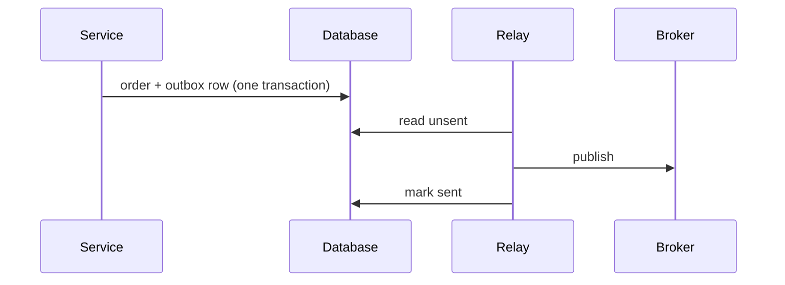

# Distributed transactions: expert

🌐 [Русский](expert.ru.md) · **English**

**Levels:** [overview](overview.en.md) · [1. Basics](basics.en.md) · [2. Advanced](advanced.en.md) · **3. Expert** · [4. Quiz](quiz.en.md)

## Under the hood

2PC is a participant's promise saved to disk. In PostgreSQL it corresponds to `PREPARE TRANSACTION` and `COMMIT PREPARED`. The documentation warns that a prepared transaction keeps holding locks and interferes with VACUUM; the feature is meant for external transaction managers.



## Reference

| Approach | Atomicity | Isolation | Blocks on failure |
|---|---|---|---|
| Local transaction | yes | per isolation level | no |
| 2PC | yes | depends on participants | yes |
| Saga | eventual | none | no |
| Outbox | write + intent to publish | local | no |

| Relay implementation | Feature |
|---|---|
| Polling the table | simple, latency and database load |
| Reading the database log (CDC) | lower latency, more infrastructure |

## Gotchas

### A failing compensation breaks off the rollback

```csharp
var broken = new SagaStep("stock", () => Task.CompletedTask,
    () => Task.FromException(new TimeoutException()));
await Saga.RunAsync([Ok("order"), broken, Fails("payment")], journal);
```

Here `Ok` and `Fails` are test helpers. Result: a `TimeoutException`, and there is no `undo order` in the journal. Compensations have to be retried, and the point reached has to be saved.

### A relay does not guarantee there are no duplicates

In the test a crash after publishing but before marking gives two deliveries; the inbox keeps one handled item.

## Trade-offs and alternatives

| Choice | Pro | Con |
|---|---|---|
| Merge services and database | an ordinary transaction | less independence |
| 2PC | strict atomicity | availability and participant support |
| Saga | availability | compensations and anomalies |
| Workflow engine | state and retries out of the box | a new dependency |

Often the best solution is to draw boundaries so that the invariant stays inside one service.

## Interview questions

**1. What is the dual write problem?**

<details><summary>Answer</summary>

Two systems are updated separately, and a failure between them leaves them inconsistent.

</details>

**2. Why is 2PC called blocking?**

<details><summary>Answer</summary>

A prepared participant cannot decide on its own and waits for the coordinator.

</details>

**3. How does a compensation differ from a rollback?**

<details><summary>Answer</summary>

It is a new transaction with the opposite effect; the intermediate state has already been seen.

</details>

**4. What is a pivot transaction?**

<details><summary>Answer</summary>

The point of no return: after it the saga is driven forward.

</details>

**5. Choreography or orchestration?**

<details><summary>Answer</summary>

The first for short simple processes, the second when there are many steps and branches.

</details>

**6. What does an outbox give?**

<details><summary>Answer</summary>

Atomicity of the data change and the intent to publish; delivery may repeat.

</details>

**7. Where do you keep inbox identifiers?**

<details><summary>Answer</summary>

In the same database and transaction as the effect of processing.

</details>

**8. Which anomalies does a saga have?**

<details><summary>Answer</summary>

Lost updates, dirty and nonrepeatable reads.

</details>

**9. What if a compensation does not go through?**

<details><summary>Answer</summary>

Retry with a delay, record the state, call a human.

</details>

**10. Trick question: the broker supports transactions. Is an outbox unnecessary?**

<details><summary>Answer</summary>

A broker transaction does not cover your database; the dual write remains.

</details>

## Related materials

- [Advanced theory](advanced.en.md)
- [Quiz](quiz.en.md) and [exercises](exercises.en.md)

## Sources

- [PostgreSQL: PREPARE TRANSACTION](https://www.postgresql.org/docs/current/sql-prepare-transaction.html)
- [Saga pattern](https://learn.microsoft.com/azure/architecture/patterns/saga)
