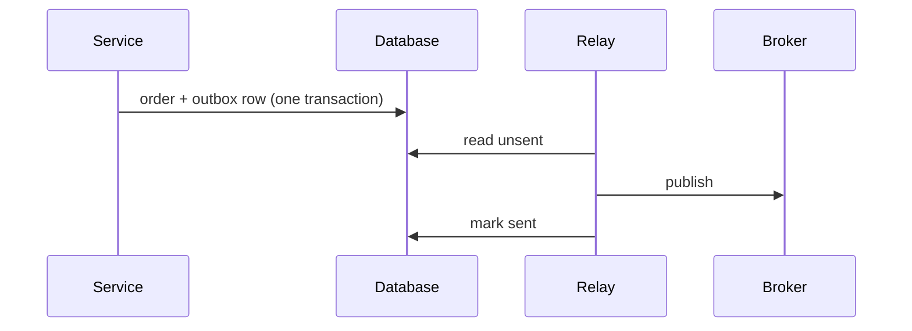

# Distributed transactions: expert

🌐 [Русский](expert.ru.md) · **English**

**Levels:** [overview](overview.en.md) · [1. Basics](basics.en.md) · [2. Advanced](advanced.en.md) · **3. Expert** · [4. Quiz](quiz.en.md)

## Under the hood

2PC is a participant's promise saved to disk. In PostgreSQL it corresponds to `PREPARE TRANSACTION` and `COMMIT PREPARED`. The documentation warns that a prepared transaction keeps holding locks and interferes with VACUUM; the feature is meant for external transaction managers.



### TCC: Try, Confirm, Cancel

A participant first reserves a resource (Try), then confirms or releases it. Requirements: repeating any step is safe, `Cancel` works even if `Try` never arrived, and a reservation expires by itself.

```csharp
if (_confirmed.Contains(id)) return true;
if (!_holds.Remove(id, out var hold)) return false;
```

`Confirm` after the hold has expired returns `false`: the caller may not consider the operation done. File: [Ex04_Tcc.cs](code/Examples/Ex04_Tcc.cs). The example does not guard against a `Try` arriving after `Cancel`: for that you remember cancelled identifiers.

### Workflow engines and replay

An engine such as Durable Functions saves the history of steps and after a restart runs the orchestrator code again, substituting the recorded results.

```csharp
if (recorded.Step != step)
    throw new InvalidOperationException($"Non-deterministic workflow: expected {recorded.Step}, got {step}.");
return recorded.Result; // the activity is not executed again
```

That is why an orchestrator must be deterministic: no `DateTime.UtcNow`, `Guid.NewGuid()`, random numbers, I/O or `Task.Delay` — there are `context.CurrentUtcDateTime`, `context.NewGuid()`, activities and timers for that. File: [Ex05_Replay.cs](code/Examples/Ex05_Replay.cs).

### Versions and timeouts

Adding, removing or reordering calls in an orchestrator breaks unfinished instances. Durable Functions recommends built-in orchestration versioning; another way is to deploy the new version alongside with a separate task hub. A saga needs a timeout on every wait: what to do if no answer comes.

### CDC for the outbox

Instead of polling the table, the database log is read. Debezium has an Outbox Event Router: the default columns are `id`, `aggregatetype`, `aggregateid`, `type`, `payload`; `aggregateid` becomes the message key and preserves order within a partition, and `id` allows duplicates to be dropped. The table is meant for inserts only.

## Reference

| Approach | Atomicity | Isolation | Blocks on failure |
|---|---|---|---|
| Local transaction | yes | per isolation level | no |
| 2PC | yes | depends on participants | yes |
| Saga | eventual | none | no |
| Outbox | write + intent to publish | local | no |

| Relay implementation | Feature |
|---|---|
| Polling the table | simple, latency and database load |
| Reading the database log (CDC) | lower latency, more infrastructure |

| Approach | Isolation | What it requires of a participant |
|---|---|---|
| 2PC | depends on participants | protocol support |
| TCC | a hold shows as taken | three idempotent operations |
| Saga | none | an action and a compensation |

| An orchestrator must not | Instead |
|---|---|
| `DateTime.UtcNow` | `context.CurrentUtcDateTime` |
| `Guid.NewGuid()` | `context.NewGuid()` |
| HTTP and database | activities |
| `Task.Delay` | `CreateTimer` |
| `Task.Run` | calls through the context |

| `System.Transactions` in modern .NET | |
|---|---|
| `TransactionManager.ImplicitDistributedTransactions` | `false` by default |
| setting the property | supported on Windows only |

## Gotchas

### A failing compensation breaks off the rollback

```csharp
var broken = new SagaStep("stock", () => Task.CompletedTask,
    () => Task.FromException(new TimeoutException()));
await Saga.RunAsync([Ok("order"), broken, Fails("payment")], journal);
```

Here `Ok` and `Fails` are test helpers. Result: a `TimeoutException`, and there is no `undo order` in the journal. Compensations have to be retried, and the point reached has to be saved.

### A relay does not guarantee there are no duplicates

In the test a crash after publishing but before marking gives two deliveries; the inbox keeps one handled item.

### A second resource in a TransactionScope

```csharp
using var scope = new TransactionScope();
Transaction.Current!.EnlistDurable(Guid.NewGuid(), new Resource(), EnlistmentOptions.None);
Transaction.Current!.EnlistDurable(Guid.NewGuid(), new Resource(), EnlistmentOptions.None);
```

`Resource` here is a test participant. The first enlistment succeeds, the second throws `NotSupportedException`: the transaction would have to become distributed, and that is off by default.

### Changed code breaks unfinished workflows

In the test the history contains the step `charge`, and the new code calls `reserve` first: replay stops with a non-determinism error.

## Trade-offs and alternatives

| Choice | Pro | Con |
|---|---|---|
| Merge services and database | an ordinary transaction | less independence |
| 2PC | strict atomicity | availability and participant support |
| Saga | availability | compensations and anomalies |
| Workflow engine | state and retries out of the box | a new dependency |

Often the best solution is to draw boundaries so that the invariant stays inside one service.

## Interview questions

**1. What is the dual write problem?**

<details><summary>Answer</summary>

Two systems are updated separately, and a failure between them leaves them inconsistent.

</details>

**2. Why is 2PC called blocking?**

<details><summary>Answer</summary>

A prepared participant cannot decide on its own and waits for the coordinator.

</details>

**3. How does a compensation differ from a rollback?**

<details><summary>Answer</summary>

It is a new transaction with the opposite effect; the intermediate state has already been seen.

</details>

**4. What is a pivot transaction?**

<details><summary>Answer</summary>

The point of no return: after it the saga is driven forward.

</details>

**5. Choreography or orchestration?**

<details><summary>Answer</summary>

The first for short simple processes, the second when there are many steps and branches.

</details>

**6. What does an outbox give?**

<details><summary>Answer</summary>

Atomicity of the data change and the intent to publish; delivery may repeat.

</details>

**7. Where do you keep inbox identifiers?**

<details><summary>Answer</summary>

In the same database and transaction as the effect of processing.

</details>

**8. Which anomalies does a saga have?**

<details><summary>Answer</summary>

Lost updates, dirty and nonrepeatable reads.

</details>

**9. What if a compensation does not go through?**

<details><summary>Answer</summary>

Retry with a delay, record the state, call a human.

</details>

**10. Trick question: the broker supports transactions. Is an outbox unnecessary?**

<details><summary>Answer</summary>

A broker transaction does not cover your database; the dual write remains.

</details>

**11. The three TCC operations and their requirements?**

<details><summary>Answer</summary>

Try, Confirm, Cancel; idempotency, empty cancellation and expiry of the hold.

</details>

**12. Why must an orchestrator be deterministic?**

<details><summary>Answer</summary>

The engine restores state by running the code again against the history.

</details>

**13. How do you release a new version of a long workflow?**

<details><summary>Answer</summary>

Version the orchestrations or deploy the new version alongside and let the old ones finish.

</details>

**14. Why is CDC better than polling the outbox?**

<details><summary>Answer</summary>

Lower latency and query load, at the price of extra infrastructure.

</details>

**15. Trick question: two `SaveChanges` calls to different databases inside one `TransactionScope`. Will it work?**

<details><summary>Answer</summary>

It usually needs a distributed transaction, which is off by default and not available everywhere; an outbox or a saga is more often needed.

</details>

## Related materials

- [Advanced theory](advanced.en.md)
- [Quiz](quiz.en.md) and [exercises](exercises.en.md)

## Sources

- [PostgreSQL: PREPARE TRANSACTION](https://www.postgresql.org/docs/current/sql-prepare-transaction.html)
- [Saga pattern](https://learn.microsoft.com/azure/architecture/patterns/saga)
- [Durable Functions: orchestrator code constraints](https://learn.microsoft.com/azure/azure-functions/durable/durable-functions-code-constraints)
- [Durable Functions: versioning](https://learn.microsoft.com/azure/azure-functions/durable/durable-functions-versioning)
- [Debezium: Outbox Event Router](https://debezium.io/documentation/reference/stable/transformations/outbox-event-router.html)
- [.NET: ImplicitDistributedTransactions](https://learn.microsoft.com/dotnet/api/system.transactions.transactionmanager.implicitdistributedtransactions)
