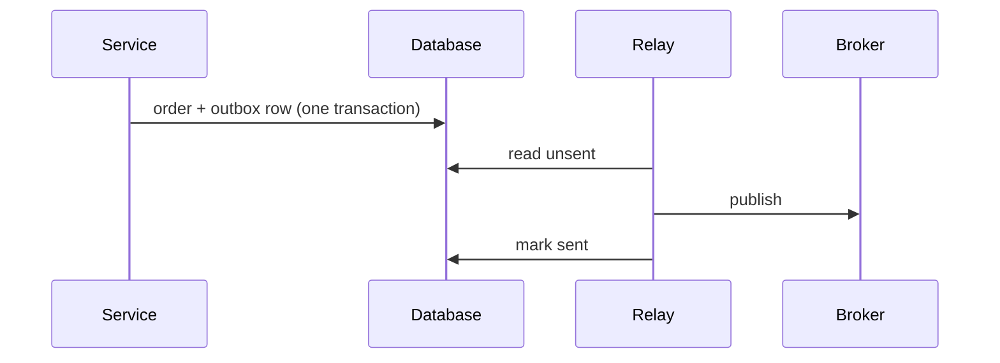

# Распределённые транзакции: экспертная теория

🌐 **Русский** · [English](expert.en.md)

**Уровни:** [обзор](overview.ru.md) · [1. Базовая](basics.ru.md) · [2. Продвинутая](advanced.ru.md) · **3. Экспертная** · [4. Квиз](quiz.ru.md)

## Под капотом

2PC — это обещание участника, сохранённое на диск. В PostgreSQL ему соответствуют `PREPARE TRANSACTION` и `COMMIT PREPARED`. Документация предупреждает: подготовленная транзакция продолжает держать блокировки и мешает VACUUM; функция предназначена для внешних менеджеров транзакций.



### TCC: Try, Confirm, Cancel

Участник сначала резервирует ресурс (Try), потом подтверждает или освобождает. Требования: повтор любого шага безопасен, `Cancel` работает, даже если `Try` не дошёл, а резерв истекает сам.

```csharp
if (_confirmed.Contains(id)) return true;
if (!_holds.Remove(id, out var hold)) return false;
```

`Confirm` после истечения резерва возвращает `false`: вызывающий не вправе считать операцию выполненной. Файл: [Ex04_Tcc.cs](code/Examples/Ex04_Tcc.cs). Пример не защищает от `Try`, пришедшего после `Cancel`: для этого запоминают отменённые идентификаторы.

### Workflow-движки и воспроизведение

Движок вроде Durable Functions сохраняет историю шагов и после перезапуска выполняет код оркестратора заново, подставляя записанные результаты.

```csharp
if (recorded.Step != step)
    throw new InvalidOperationException($"Non-deterministic workflow: expected {recorded.Step}, got {step}.");
return recorded.Result; // the activity is not executed again
```

Поэтому оркестратор обязан быть детерминированным: никаких `DateTime.UtcNow`, `Guid.NewGuid()`, случайных чисел, ввода-вывода и `Task.Delay` — для этого есть `context.CurrentUtcDateTime`, `context.NewGuid()`, активности и таймеры. Файл: [Ex05_Replay.cs](code/Examples/Ex05_Replay.cs).

### Версии и таймауты

Добавление, удаление или перестановка вызовов в оркестраторе ломают незавершённые экземпляры. Durable Functions рекомендует встроенное версионирование оркестраций; другой путь — развернуть новую версию рядом с отдельным task hub. У саги должен быть таймаут на каждом ожидании: что делать, если ответ не пришёл.

### CDC для outbox

Вместо опроса таблицы читают журнал базы. У Debezium есть Outbox Event Router: по умолчанию колонки `id`, `aggregatetype`, `aggregateid`, `type`, `payload`; `aggregateid` становится ключом сообщения и сохраняет порядок в партиции, а `id` позволяет отбрасывать дубликаты. Таблица рассчитана только на вставки.

## Справочник

| Подход | Атомарность | Изоляция | Блокирует при сбое |
|---|---|---|---|
| Локальная транзакция | да | по уровню изоляции | нет |
| 2PC | да | зависит от участников | да |
| Saga | «в конечном счёте» | нет | нет |
| Outbox | запись + намерение опубликовать | локальная | нет |

| Реализация relay | Особенность |
|---|---|
| Опрос таблицы | просто, задержка и нагрузка на базу |
| Чтение журнала базы (CDC) | меньше задержка, больше инфраструктуры |

| Подход | Изоляция | Что требует от участника |
|---|---|---|
| 2PC | да | поддержка протокола |
| TCC | резерв виден как занятое | три идемпотентные операции |
| Saga | нет | действие и компенсация |

| Оркестратор нельзя | Вместо этого |
|---|---|
| `DateTime.UtcNow` | `context.CurrentUtcDateTime` |
| `Guid.NewGuid()` | `context.NewGuid()` |
| HTTP и база | активности |
| `Task.Delay` | `CreateTimer` |
| `Task.Run` | вызовы через контекст |

| `System.Transactions` в современном .NET | |
|---|---|
| `TransactionManager.ImplicitDistributedTransactions` | по умолчанию `false` |
| установка свойства | поддерживается только на Windows |

## Подвохи

### Упавшая компенсация обрывает откат

```csharp
var broken = new SagaStep("stock", () => Task.CompletedTask,
    () => Task.FromException(new TimeoutException()));
await Saga.RunAsync([Ok("order"), broken, Fails("payment")], journal);
```

Здесь `Ok` и `Fails` — помощники из теста. Результат: `TimeoutException`, и `undo order` в журнале нет. Компенсации нужно повторять и сохранять, на чём остановились.

### Relay не гарантирует отсутствие повторов

В тесте сбой после публикации, но до отметки даёт две доставки; inbox оставляет один обработанный элемент.

### Второй ресурс в TransactionScope

```csharp
using var scope = new TransactionScope();
Transaction.Current!.EnlistDurable(Guid.NewGuid(), new Resource(), EnlistmentOptions.None);
Transaction.Current!.EnlistDurable(Guid.NewGuid(), new Resource(), EnlistmentOptions.None);
```

`Resource` здесь — тестовый участник транзакции. Первая регистрация проходит, вторая бросает `NotSupportedException`: транзакция должна стать распределённой, а это по умолчанию выключено.

### Изменённый код ломает незавершённые workflow

В тесте история содержит шаг `charge`, а новый код первым вызывает `reserve`: воспроизведение останавливается с ошибкой недетерминизма.

## Компромиссы и альтернативы

| Выбор | Плюс | Минус |
|---|---|---|
| Объединить сервисы и базу | обычная транзакция | меньше независимости |
| 2PC | строгая атомарность | доступность и поддержка участниками |
| Saga | доступность | компенсации и аномалии |
| Workflow-движок | состояние и повторы из коробки | новая зависимость |

Часто лучшее решение — провести границы так, чтобы инвариант оставался внутри одного сервиса.

## Вопросы с собеседований

**1. Что такое проблема двойной записи?**

<details><summary>Ответ</summary>

Две системы обновляются по отдельности, и сбой между ними оставляет их несогласованными.

</details>

**2. Почему 2PC называют блокирующим?**

<details><summary>Ответ</summary>

Подготовившийся участник не может решить сам и ждёт координатора.

</details>

**3. Чем компенсация отличается от rollback?**

<details><summary>Ответ</summary>

Это новая транзакция с противоположным эффектом; промежуточное состояние уже видели.

</details>

**4. Что такое pivot transaction?**

<details><summary>Ответ</summary>

Точка невозврата: после неё сага доводится вперёд.

</details>

**5. Хореография или оркестрация?**

<details><summary>Ответ</summary>

Первая для коротких простых процессов, вторая — когда шагов и ветвлений много.

</details>

**6. Что даёт outbox?**

<details><summary>Ответ</summary>

Атомарность изменения данных и намерения опубликовать; доставка может повторяться.

</details>

**7. Где хранить идентификаторы inbox?**

<details><summary>Ответ</summary>

В той же базе и транзакции, что и эффект обработки.

</details>

**8. Какие аномалии есть у саги?**

<details><summary>Ответ</summary>

Потерянные обновления, грязные и неповторяющиеся чтения.

</details>

**9. Что делать, если компенсация не проходит?**

<details><summary>Ответ</summary>

Повторять с задержкой, фиксировать состояние, звать человека.

</details>

**10. Подвох: брокер поддерживает транзакции. Outbox не нужен?**

<details><summary>Ответ</summary>

Транзакция брокера не охватывает вашу базу данных; двойная запись остаётся.

</details>

**11. Три операции TCC и требования к ним?**

<details><summary>Ответ</summary>

Try, Confirm, Cancel; идемпотентность, пустая отмена и истечение резерва.

</details>

**12. Почему оркестратор должен быть детерминированным?**

<details><summary>Ответ</summary>

Движок восстанавливает состояние повторным выполнением кода по истории.

</details>

**13. Как выпускать новую версию длинного workflow?**

<details><summary>Ответ</summary>

Версионировать оркестрации или разворачивать новую версию рядом, давая старым завершиться.

</details>

**14. Чем CDC лучше опроса outbox?**

<details><summary>Ответ</summary>

Меньше задержка и нагрузка запросами; ценой дополнительной инфраструктуры.

</details>

**15. Подвох: два `SaveChanges` в разные базы внутри одного `TransactionScope`. Сработает?**

<details><summary>Ответ</summary>

Обычно потребуется распределённая транзакция, которая по умолчанию выключена и доступна не везде; чаще нужен outbox или сага.

</details>

## Связанные материалы

- [Продвинутая теория](advanced.ru.md)
- [Квиз](quiz.ru.md) и [упражнения](exercises.ru.md)

## Источники

- [PostgreSQL: PREPARE TRANSACTION](https://www.postgresql.org/docs/current/sql-prepare-transaction.html)
- [Паттерн Saga](https://learn.microsoft.com/azure/architecture/patterns/saga)
- [Durable Functions: ограничения кода оркестратора](https://learn.microsoft.com/azure/azure-functions/durable/durable-functions-code-constraints)
- [Durable Functions: версионирование](https://learn.microsoft.com/azure/azure-functions/durable/durable-functions-versioning)
- [Debezium: Outbox Event Router](https://debezium.io/documentation/reference/stable/transformations/outbox-event-router.html)
- [.NET: ImplicitDistributedTransactions](https://learn.microsoft.com/dotnet/api/system.transactions.transactionmanager.implicitdistributedtransactions)
