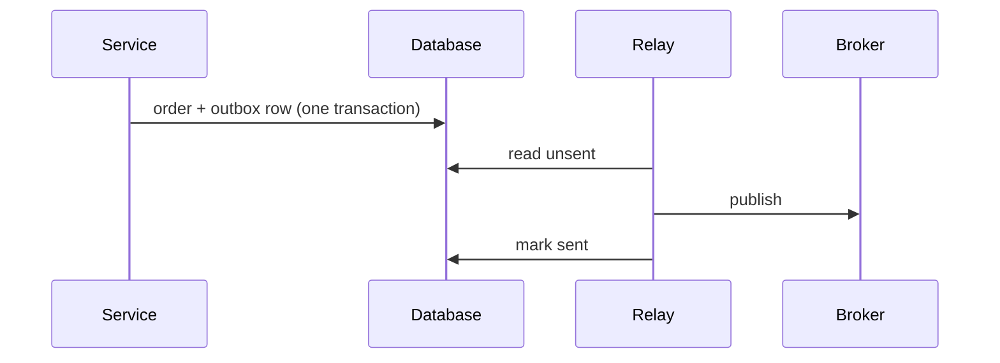

# Распределённые транзакции: экспертная теория

🌐 **Русский** · [English](expert.en.md)

**Уровни:** [обзор](overview.ru.md) · [1. Базовая](basics.ru.md) · [2. Продвинутая](advanced.ru.md) · **3. Экспертная** · [4. Квиз](quiz.ru.md)

## Под капотом

2PC — это обещание участника, сохранённое на диск. В PostgreSQL ему соответствуют `PREPARE TRANSACTION` и `COMMIT PREPARED`. Документация предупреждает: подготовленная транзакция продолжает держать блокировки и мешает VACUUM; функция предназначена для внешних менеджеров транзакций.



## Справочник

| Подход | Атомарность | Изоляция | Блокирует при сбое |
|---|---|---|---|
| Локальная транзакция | да | по уровню изоляции | нет |
| 2PC | да | зависит от участников | да |
| Saga | «в конечном счёте» | нет | нет |
| Outbox | запись + намерение опубликовать | локальная | нет |

| Реализация relay | Особенность |
|---|---|
| Опрос таблицы | просто, задержка и нагрузка на базу |
| Чтение журнала базы (CDC) | меньше задержка, больше инфраструктуры |

## Подвохи

### Упавшая компенсация обрывает откат

```csharp
var broken = new SagaStep("stock", () => Task.CompletedTask,
    () => Task.FromException(new TimeoutException()));
await Saga.RunAsync([Ok("order"), broken, Fails("payment")], journal);
```

Здесь `Ok` и `Fails` — помощники из теста. Результат: `TimeoutException`, и `undo order` в журнале нет. Компенсации нужно повторять и сохранять, на чём остановились.

### Relay не гарантирует отсутствие повторов

В тесте сбой после публикации, но до отметки даёт две доставки; inbox оставляет один обработанный элемент.

## Компромиссы и альтернативы

| Выбор | Плюс | Минус |
|---|---|---|
| Объединить сервисы и базу | обычная транзакция | меньше независимости |
| 2PC | строгая атомарность | доступность и поддержка участниками |
| Saga | доступность | компенсации и аномалии |
| Workflow-движок | состояние и повторы из коробки | новая зависимость |

Часто лучшее решение — провести границы так, чтобы инвариант оставался внутри одного сервиса.

## Вопросы с собеседований

**1. Что такое проблема двойной записи?**

<details><summary>Ответ</summary>

Две системы обновляются по отдельности, и сбой между ними оставляет их несогласованными.

</details>

**2. Почему 2PC называют блокирующим?**

<details><summary>Ответ</summary>

Подготовившийся участник не может решить сам и ждёт координатора.

</details>

**3. Чем компенсация отличается от rollback?**

<details><summary>Ответ</summary>

Это новая транзакция с противоположным эффектом; промежуточное состояние уже видели.

</details>

**4. Что такое pivot transaction?**

<details><summary>Ответ</summary>

Точка невозврата: после неё сага доводится вперёд.

</details>

**5. Хореография или оркестрация?**

<details><summary>Ответ</summary>

Первая для коротких простых процессов, вторая — когда шагов и ветвлений много.

</details>

**6. Что даёт outbox?**

<details><summary>Ответ</summary>

Атомарность изменения данных и намерения опубликовать; доставка может повторяться.

</details>

**7. Где хранить идентификаторы inbox?**

<details><summary>Ответ</summary>

В той же базе и транзакции, что и эффект обработки.

</details>

**8. Какие аномалии есть у саги?**

<details><summary>Ответ</summary>

Потерянные обновления, грязные и неповторяющиеся чтения.

</details>

**9. Что делать, если компенсация не проходит?**

<details><summary>Ответ</summary>

Повторять с задержкой, фиксировать состояние, звать человека.

</details>

**10. Подвох: брокер поддерживает транзакции. Outbox не нужен?**

<details><summary>Ответ</summary>

Транзакция брокера не охватывает вашу базу данных; двойная запись остаётся.

</details>

## Связанные материалы

- [Продвинутая теория](advanced.ru.md)
- [Квиз](quiz.ru.md) и [упражнения](exercises.ru.md)

## Источники

- [PostgreSQL: PREPARE TRANSACTION](https://www.postgresql.org/docs/current/sql-prepare-transaction.html)
- [Паттерн Saga](https://learn.microsoft.com/azure/architecture/patterns/saga)
