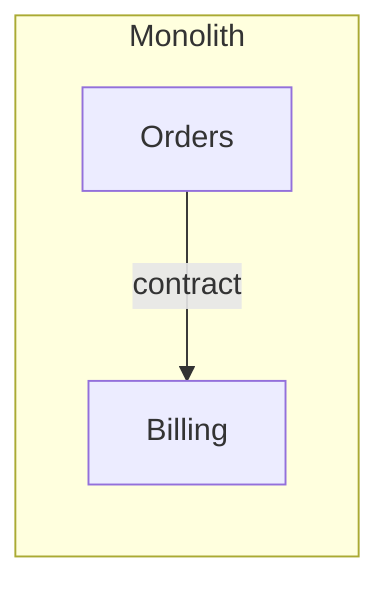

# Architecture styles: expert

🌐 [Русский](expert.ru.md) · **English**

**Levels:** [overview](overview.en.md) · [1. Basics](basics.en.md) · [2. Advanced](advanced.en.md) · **3. Expert** · [4. Quiz](quiz.en.md)

## Under the hood

By splitting a process you turn a method call into a network call: latency, partial failures, serialization and versions are added.

```csharp
public static (TimeSpan Latency, double Availability) Chain(int hops, TimeSpan perHop, double hopAvailability) =>
    (perHop * hops, Math.Pow(hopAvailability, hops));
```

Five sequential hops of 20 ms and 99.9% give 100 ms and 99.5%. File: [Ex03_NetworkCost.cs](code/Examples/Ex03_NetworkCost.cs).



### Strategic DDD and the context map

A bounded context is a boundary within which one model and one language apply: the word "customer" may mean different things in sales and in support. A context map records the relationships between them.

| Relationship | Meaning |
|---|---|
| Customer–Supplier | supplier and consumer negotiate a contract |
| Open Host Service + Published Language | a common published protocol for many |
| Anti-corruption Layer | the consumer translates a foreign model into its own |
| Separate Ways | no integration |

```csharp
public static Customer ToDomain(LegacyCustomer c) => new(
    c.CUST_NO.Trim(),
    c.BAL_CENTS / 100m,
```

The translator is the only place that knows the old shape; it rejects an unknown status code instead of guessing. File: [Ex04_Migration.cs](code/Examples/Ex04_Migration.cs).

### Branch by abstraction

A large replacement is done without a long-lived branch: introduce an abstraction over the old module, move clients to it, write a new implementation behind the same interface, switch gradually and remove the old one. A useful technique during the transition is a parallel run: answer with the old result and record the differences.

```csharp
decimal other = candidate.Price(quantity);
if (other != result) Differences.Add((quantity, result, other));
```

A failing candidate must not break the caller. A parallel run suits only computations without side effects.

### BFF and API gateway

A BFF (backend for frontend) is a separate backend for a particular interface, owned by that interface's team. It aggregates calls and decides what may be lost.

```csharp
Task<string> name = profile();
Task<IReadOnlyList<string>> extras = Optional(recommendations); // both run in parallel
```

The price is more services, an extra hop and duplication. It is not needed if there is one interface or all of them ask for the same. A gateway, by contrast, is a common entry point that knows nothing about screens. File: [Ex05_Bff.cs](code/Examples/Ex05_Bff.cs).

### Service mesh

An infrastructure layer giving mTLS and access policies, telemetry and traffic management without code changes. Istio has two modes:

| | Sidecar | Ambient |
|---|---|---|
| Where the proxy is | Envoy next to every pod | an L4 proxy per node, a waypoint per namespace for L7 |
| Joining | pods restart | a namespace label |
| Price | resources per pod | fewer resources, some features need a waypoint |

### Micro frontends

A frontend is assembled from independently released applications: a container handles the shell, sign-in and routing, the parts communicate minimally (events, URL). Integration happens on the server, at run time (JavaScript, Web Components, iframes) or at build time; the last brings back joint releases. The downsides are duplicated dependencies, payload size and operational complexity.

## Reference

| Quality | What helps | What you pay |
|---|---|---|
| Deployability | services | infrastructure |
| Simplicity | monolith | a shared release |
| Failure isolation | services, bulkhead | communication complexity |
| Independent scaling | services, workers | operations |
| Consistency | one database | coupling |

| Questions before extracting a service | |
|---|---|
| Does it have its own team and data? | |
| A different load profile? | |
| Can it be released independently? | |
| Will the caller survive its failure? | |

| Migration technique | Where the boundary is | When |
|---|---|---|
| Strangler fig | in front of the system (a facade) | external paths are being replaced |
| Branch by abstraction | inside the code | an internal module is replaced |
| Anti-corruption layer | between models | the old model must not leak into the new one |
| Parallel run | beside the old one | the new one has to be checked on real data |

| Where to solve it | A library in the service | Mesh | Gateway |
|---|---|---|---|
| mTLS between services | possible | yes | no |
| Retries and timeouts | yes, with operation context | yes | for incoming calls |
| Object authorization | yes | no | no |

## Gotchas

### Subscribing an async lambda to Action makes it async void

```csharp
var done = new TaskCompletionSource();
var log = new List<string>();
Action<int> handler = async x => { await Task.Delay(50); log.Add("handled"); done.SetResult(); };
handler(1);
log.Add("publish returned");
await done.Task;
Console.WriteLine(string.Join(", ", log));
```

Result: `publish returned, handled`. The publisher does not wait for the handler, and an exception from it cannot be caught on the publisher's side. The bus needs `Func<T, Task>`.

### One failing handler stops the rest

```csharp
Action handlers = () => Console.WriteLine("first");
handlers += () => throw new InvalidOperationException();
handlers += () => Console.WriteLine("third");
try { handlers(); } catch (InvalidOperationException) { Console.WriteLine("caught"); }
```

Result: `first`, `caught`; the third was not called.

### A signature check does not see method bodies

`BoundaryRules` finds a field or parameter from another module, but not `new Billing.InvoiceService(...)` inside a method: the code comment says so. A full check needs IL analysis or project references.

### A parallel run with side effects

If the new implementation writes to the database or sends emails, comparing doubles the effect. Compare computations only, or redirect effects to a test environment.

### A translator that guesses

A default value for an unknown status code turns an integration error into silent data corruption. The test requires an exception for the code `X`.

## Trade-offs and alternatives

| Module isolation | Strength | Price |
|---|---|---|
| Folders and conventions | weak | almost none |
| Architecture tests | medium | maintaining rules |
| Separate projects and `internal` | strong | solution structure |
| Separate processes | strongest | distribution |

## Interview questions

**1. What is a modular monolith?**

<details><summary>Answer</summary>

One deployment unit with explicit module boundaries.

</details>

**2. Signs of a distributed monolith?**

<details><summary>Answer</summary>

Services release together, share a database, call each other in long chains.

</details>

**3. Why should a service own its data?**

<details><summary>Answer</summary>

Otherwise a schema change touches everyone and there is no independence.

</details>

**4. When do you extract a service?**

<details><summary>Answer</summary>

When there is a reason: independent releases, scaling, failure isolation, a separate team.

</details>

**5. What is a strangler fig?**

<details><summary>Answer</summary>

Gradual replacement of a system behind a facade.

</details>

**6. What is a fitness function?**

<details><summary>Answer</summary>

An automated check of an architectural property.

</details>

**7. What is Conway's law?**

<details><summary>Answer</summary>

A system's structure mirrors the organization's communication structure.

</details>

**8. What is inconvenient about serverless?**

<details><summary>Answer</summary>

Cold starts, limits on time and state, platform lock-in.

</details>

**9. Why ADRs?**

<details><summary>Answer</summary>

To preserve the reasons for a decision and the conditions for revisiting it.

</details>

**10. Trick question: are microservices faster than a monolith?**

<details><summary>Answer</summary>

Not by themselves: the network is added. A gain is possible from independent scaling.

</details>

**11. What is a bounded context?**

<details><summary>Answer</summary>

A boundary within which a particular domain model with its own language applies.

</details>

**12. When is an anti-corruption layer needed?**

<details><summary>Answer</summary>

When a foreign model must not shape yours: translation is concentrated in one layer.

</details>

**13. The steps of branch by abstraction?**

<details><summary>Answer</summary>

Find the clients, introduce an abstraction, move them to it, build a new implementation, switch, remove the old one.

</details>

**14. What does a service mesh give and what not?**

<details><summary>Answer</summary>

It gives secured communication, telemetry and traffic management; it knows no business rules or object permissions.

</details>

**15. Trick question: you added a mesh with retries, and the code already retries. What happens?**

<details><summary>Answer</summary>

Retries multiply; choose one layer.

</details>

## Related materials

- [Advanced theory](advanced.en.md)
- [Quiz](quiz.en.md) and [exercises](exercises.en.md)

## Sources

- [Azure: architecture styles](https://learn.microsoft.com/azure/architecture/guide/architecture-styles/)
- [Azure: domain analysis](https://learn.microsoft.com/azure/architecture/microservices/model/domain-analysis)
- [Istio: data plane modes](https://istio.io/latest/docs/overview/dataplane-modes/)
- [Backends for Frontends pattern](https://learn.microsoft.com/azure/architecture/patterns/backends-for-frontends)
- [Fowler: Branch by Abstraction](https://martinfowler.com/bliki/BranchByAbstraction.html)
- [Fowler: Micro Frontends](https://martinfowler.com/articles/micro-frontends.html)
