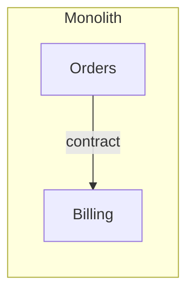

# Architecture styles: expert

🌐 [Русский](expert.ru.md) · **English**

**Levels:** [overview](overview.en.md) · [1. Basics](basics.en.md) · [2. Advanced](advanced.en.md) · **3. Expert** · [4. Quiz](quiz.en.md)

## Under the hood

By splitting a process you turn a method call into a network call: latency, partial failures, serialization and versions are added.

```csharp
public static (TimeSpan Latency, double Availability) Chain(int hops, TimeSpan perHop, double hopAvailability) =>
    (perHop * hops, Math.Pow(hopAvailability, hops));
```

Five sequential hops of 20 ms and 99.9% give 100 ms and 99.5%. File: [Ex03_NetworkCost.cs](code/Examples/Ex03_NetworkCost.cs).



## Reference

| Quality | What helps | What you pay |
|---|---|---|
| Deployability | services | infrastructure |
| Simplicity | monolith | a shared release |
| Failure isolation | services, bulkhead | communication complexity |
| Independent scaling | services, workers | operations |
| Consistency | one database | coupling |

| Questions before extracting a service | |
|---|---|
| Does it have its own team and data? | |
| A different load profile? | |
| Can it be released independently? | |
| Will the caller survive its failure? | |

## Gotchas

### Subscribing an async lambda to Action makes it async void

```csharp
var done = new TaskCompletionSource();
var log = new List<string>();
Action<int> handler = async x => { await Task.Delay(50); log.Add("handled"); done.SetResult(); };
handler(1);
log.Add("publish returned");
await done.Task;
Console.WriteLine(string.Join(", ", log));
```

Result: `publish returned, handled`. The publisher does not wait for the handler, and an exception from it cannot be caught on the publisher's side. The bus needs `Func<T, Task>`.

### One failing handler stops the rest

```csharp
Action handlers = () => Console.WriteLine("first");
handlers += () => throw new InvalidOperationException();
handlers += () => Console.WriteLine("third");
try { handlers(); } catch (InvalidOperationException) { Console.WriteLine("caught"); }
```

Result: `first`, `caught`; the third was not called.

### A signature check does not see method bodies

`BoundaryRules` finds a field or parameter from another module, but not `new Billing.InvoiceService(...)` inside a method: the code comment says so. A full check needs IL analysis or project references.

## Trade-offs and alternatives

| Module isolation | Strength | Price |
|---|---|---|
| Folders and conventions | weak | almost none |
| Architecture tests | medium | maintaining rules |
| Separate projects and `internal` | strong | solution structure |
| Separate processes | strongest | distribution |

## Interview questions

**1. What is a modular monolith?**

<details><summary>Answer</summary>

One deployment unit with explicit module boundaries.

</details>

**2. Signs of a distributed monolith?**

<details><summary>Answer</summary>

Services release together, share a database, call each other in long chains.

</details>

**3. Why should a service own its data?**

<details><summary>Answer</summary>

Otherwise a schema change touches everyone and there is no independence.

</details>

**4. When do you extract a service?**

<details><summary>Answer</summary>

When there is a reason: independent releases, scaling, failure isolation, a separate team.

</details>

**5. What is a strangler fig?**

<details><summary>Answer</summary>

Gradual replacement of a system behind a facade.

</details>

**6. What is a fitness function?**

<details><summary>Answer</summary>

An automated check of an architectural property.

</details>

**7. What is Conway's law?**

<details><summary>Answer</summary>

A system's structure mirrors the organization's communication structure.

</details>

**8. What is inconvenient about serverless?**

<details><summary>Answer</summary>

Cold starts, limits on time and state, platform lock-in.

</details>

**9. Why ADRs?**

<details><summary>Answer</summary>

To preserve the reasons for a decision and the conditions for revisiting it.

</details>

**10. Trick question: are microservices faster than a monolith?**

<details><summary>Answer</summary>

Not by themselves: the network is added. A gain is possible from independent scaling.

</details>

## Related materials

- [Advanced theory](advanced.en.md)
- [Quiz](quiz.en.md) and [exercises](exercises.en.md)

## Sources

- [Azure: architecture styles](https://learn.microsoft.com/azure/architecture/guide/architecture-styles/)
