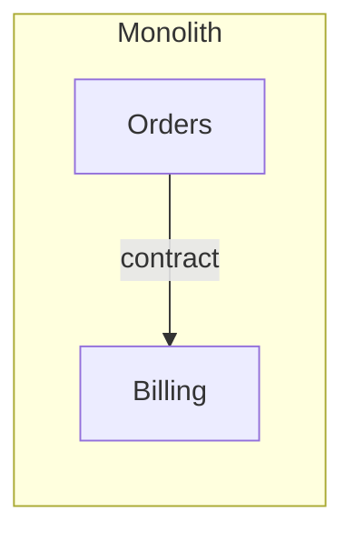

# Архитектурные стили: экспертная теория

🌐 **Русский** · [English](expert.en.md)

**Уровни:** [обзор](overview.ru.md) · [1. Базовая](basics.ru.md) · [2. Продвинутая](advanced.ru.md) · **3. Экспертная** · [4. Квиз](quiz.ru.md)

## Под капотом

Разделяя процесс, вы превращаете вызов метода в сетевой: добавляются задержка, частичные отказы, сериализация и версии.

```csharp
public static (TimeSpan Latency, double Availability) Chain(int hops, TimeSpan perHop, double hopAvailability) =>
    (perHop * hops, Math.Pow(hopAvailability, hops));
```

Пять последовательных прыжков по 20 мс и 99,9% дают 100 мс и 99,5%. Файл: [Ex03_NetworkCost.cs](code/Examples/Ex03_NetworkCost.cs).



### Стратегический DDD и карта контекстов

Bounded context — граница, внутри которой действует одна модель и один язык: слово «клиент» в продажах и в поддержке может значить разное. Карта контекстов фиксирует отношения между ними.

| Отношение | Смысл |
|---|---|
| Customer–Supplier | поставщик и потребитель договариваются о контракте |
| Open Host Service + Published Language | общий опубликованный протокол для многих |
| Anti-corruption Layer | потребитель переводит чужую модель в свою |
| Separate Ways | интеграции нет |

```csharp
public static Customer ToDomain(LegacyCustomer c) => new(
    c.CUST_NO.Trim(),
    c.BAL_CENTS / 100m,
```

Переводчик — единственное место, знающее старую форму; незнакомый код статуса он отвергает, а не угадывает. Файл: [Ex04_Migration.cs](code/Examples/Ex04_Migration.cs).

### Branch by abstraction

Крупную замену делают, не уходя в долгую ветку: вводят абстракцию над старым модулем, переводят на неё клиентов, пишут новую реализацию за тем же интерфейсом, переключают постепенно и удаляют старую. Полезный приём на переходе — параллельный прогон: отвечать старым результатом и записывать расхождения.

```csharp
decimal other = candidate.Price(quantity);
if (other != result) Differences.Add((quantity, result, other));
```

Сбой кандидата не должен ломать вызывающего. Параллельный прогон годится только для вычислений без побочных эффектов.

### BFF и API-шлюз

BFF (backend for frontend) — отдельный бэкенд под конкретный интерфейс, которым владеет команда этого интерфейса. Он агрегирует вызовы и решает, что можно потерять.

```csharp
Task<string> name = profile();
Task<IReadOnlyList<string>> extras = Optional(recommendations); // both run in parallel
```

Цена — ещё сервисы, лишний прыжок и дублирование. Не нужен, если интерфейс один или все спрашивают одно и то же. Шлюз же — общая точка входа без знания экранов. Файл: [Ex05_Bff.cs](code/Examples/Ex05_Bff.cs).

### Service mesh

Инфраструктурный слой, дающий mTLS и политики доступа, телеметрию и управление трафиком без изменения кода. В Istio два режима:

| | Sidecar | Ambient |
|---|---|---|
| Где прокси | Envoy рядом с каждым pod | L4-прокси на узле, для L7 — waypoint на namespace |
| Подключение | перезапуск pod | метка namespace |
| Цена | ресурсы на каждый pod | меньше ресурсов, часть возможностей требует waypoint |

### Micro frontends

Фронтенд собирают из независимо выпускаемых приложений: контейнер отвечает за каркас, вход и маршрутизацию, части общаются минимально (события, URL). Интегрируют на сервере, во время выполнения (JavaScript, Web Components, iframe) или при сборке; последнее возвращает совместные релизы. Минусы — дублирование зависимостей, вес загрузки и сложность эксплуатации.

## Справочник

| Качество | Чему помогает | Чем платят |
|---|---|---|
| Развёртываемость | сервисы | инфраструктура |
| Простота | монолит | общий релиз |
| Изоляция отказов | сервисы, bulkhead | сложность связи |
| Независимое масштабирование | сервисы, воркеры | эксплуатация |
| Согласованность | одна база | связанность |

| Вопрос перед выделением сервиса | |
|---|---|
| Есть своя команда и свои данные? | |
| Другой профиль нагрузки? | |
| Можно ли выпускать независимо? | |
| Переживёт ли вызывающий его отказ? | |

| Приём миграции | Где граница | Когда |
|---|---|---|
| Strangler fig | перед системой (фасад) | заменяют внешние пути |
| Branch by abstraction | внутри кода | заменяют внутренний модуль |
| Anti-corruption layer | между моделями | старая модель не должна проникнуть в новую |
| Параллельный прогон | рядом со старым | нужно проверить новое на реальных данных |

| Где решать задачу | Библиотека в сервисе | Mesh | Шлюз |
|---|---|---|---|
| mTLS между сервисами | возможно | да | нет |
| Повторы и таймауты | да, с контекстом операции | да | для входящих |
| Авторизация объекта | да | нет | нет |

## Подвохи

### Подписка async-лямбды на Action становится async void

```csharp
var done = new TaskCompletionSource();
var log = new List<string>();
Action<int> handler = async x => { await Task.Delay(50); log.Add("handled"); done.SetResult(); };
handler(1);
log.Add("publish returned");
await done.Task;
Console.WriteLine(string.Join(", ", log));
```

Результат: `publish returned, handled`. Издатель не ждёт обработчик, а исключение из него нельзя поймать на стороне издателя. Шине нужен `Func<T, Task>`.

### Сбой одного обработчика останавливает остальных

```csharp
Action handlers = () => Console.WriteLine("first");
handlers += () => throw new InvalidOperationException();
handlers += () => Console.WriteLine("third");
try { handlers(); } catch (InvalidOperationException) { Console.WriteLine("caught"); }
```

Результат: `first`, `caught`; третий не вызван.

### Проверка сигнатур не видит тела методов

`BoundaryRules` найдёт поле или параметр чужого модуля, но не `new Billing.InvoiceService(...)` внутри метода: это сказано в комментарии к коду. Для полной проверки нужен анализ IL или ссылки между проектами.

### Параллельный прогон с побочными эффектами

Если новая реализация пишет в базу или отправляет письма, сравнение удвоит эффект. Сравнивайте только вычисления или перенаправляйте эффекты в тестовое окружение.

### Переводчик, который угадывает

Значение по умолчанию для незнакомого кода статуса превращает ошибку интеграции в тихую порчу данных. Тест требует исключения на коде `X`.

## Компромиссы и альтернативы

| Изоляция модулей | Сила | Цена |
|---|---|---|
| Папки и соглашения | слабая | почти нет |
| Тесты архитектуры | средняя | поддержка правил |
| Отдельные проекты и `internal` | сильная | структура решения |
| Отдельные процессы | самая сильная | распределённость |

## Вопросы с собеседований

**1. Что такое модульный монолит?**

<details><summary>Ответ</summary>

Одна единица развёртывания с явными границами модулей.

</details>

**2. Признаки распределённого монолита?**

<details><summary>Ответ</summary>

Сервисы выпускаются вместе, делят базу, вызывают друг друга длинными цепочками.

</details>

**3. Почему сервис должен владеть данными?**

<details><summary>Ответ</summary>

Иначе изменение схемы затрагивает всех и независимости нет.

</details>

**4. Когда выделять сервис?**

<details><summary>Ответ</summary>

Когда есть причина: независимые релизы, масштабирование, изоляция отказов, отдельная команда.

</details>

**5. Что такое strangler fig?**

<details><summary>Ответ</summary>

Постепенная замена системы за фасадом.

</details>

**6. Что такое fitness function?**

<details><summary>Ответ</summary>

Автоматическая проверка свойства архитектуры.

</details>

**7. Что такое закон Конвея?**

<details><summary>Ответ</summary>

Структура системы повторяет структуру коммуникаций организации.

</details>

**8. Чем serverless неудобен?**

<details><summary>Ответ</summary>

Холодный старт, ограничения времени и состояния, привязка к платформе.

</details>

**9. Зачем ADR?**

<details><summary>Ответ</summary>

Сохранить причины решения и условия его пересмотра.

</details>

**10. Подвох: микросервисы быстрее монолита?**

<details><summary>Ответ</summary>

Сами по себе нет: добавляется сеть. Выигрыш возможен от независимого масштабирования.

</details>

**11. Что такое bounded context?**

<details><summary>Ответ</summary>

Граница, в пределах которой действует конкретная модель предметной области со своим языком.

</details>

**12. Когда нужен anti-corruption layer?**

<details><summary>Ответ</summary>

Когда чужая модель не должна определять вашу: перевод сосредоточен в одном слое.

</details>

**13. Шаги branch by abstraction?**

<details><summary>Ответ</summary>

Найти клиентов, ввести абстракцию, перевести на неё, сделать новую реализацию, переключить, удалить старую.

</details>

**14. Что даёт service mesh, а что нет?**

<details><summary>Ответ</summary>

Даёт защиту связи, телеметрию и управление трафиком; не знает бизнес-правил и прав на объекты.

</details>

**15. Подвох: добавили mesh с повторами, а в коде повторы уже есть. Что будет?**

<details><summary>Ответ</summary>

Повторы умножатся; выберите один уровень.

</details>

## Связанные материалы

- [Продвинутая теория](advanced.ru.md)
- [Квиз](quiz.ru.md) и [упражнения](exercises.ru.md)

## Источники

- [Azure: архитектурные стили](https://learn.microsoft.com/azure/architecture/guide/architecture-styles/)
- [Azure: анализ предметной области](https://learn.microsoft.com/azure/architecture/microservices/model/domain-analysis)
- [Istio: режимы data plane](https://istio.io/latest/docs/overview/dataplane-modes/)
- [Паттерн Backends for Frontends](https://learn.microsoft.com/azure/architecture/patterns/backends-for-frontends)
- [Fowler: Branch by Abstraction](https://martinfowler.com/bliki/BranchByAbstraction.html)
- [Fowler: Micro Frontends](https://martinfowler.com/articles/micro-frontends.html)
