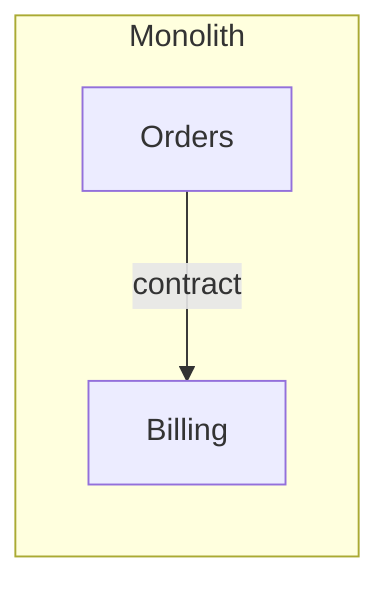

# Архитектурные стили: экспертная теория

🌐 **Русский** · [English](expert.en.md)

**Уровни:** [обзор](overview.ru.md) · [1. Базовая](basics.ru.md) · [2. Продвинутая](advanced.ru.md) · **3. Экспертная** · [4. Квиз](quiz.ru.md)

## Под капотом

Разделяя процесс, вы превращаете вызов метода в сетевой: добавляются задержка, частичные отказы, сериализация и версии.

```csharp
public static (TimeSpan Latency, double Availability) Chain(int hops, TimeSpan perHop, double hopAvailability) =>
    (perHop * hops, Math.Pow(hopAvailability, hops));
```

Пять последовательных прыжков по 20 мс и 99,9% дают 100 мс и 99,5%. Файл: [Ex03_NetworkCost.cs](code/Examples/Ex03_NetworkCost.cs).



## Справочник

| Качество | Чему помогает | Чем платят |
|---|---|---|
| Развёртываемость | сервисы | инфраструктура |
| Простота | монолит | общий релиз |
| Изоляция отказов | сервисы, bulkhead | сложность связи |
| Независимое масштабирование | сервисы, воркеры | эксплуатация |
| Согласованность | одна база | связанность |

| Вопрос перед выделением сервиса | |
|---|---|
| Есть своя команда и свои данные? | |
| Другой профиль нагрузки? | |
| Можно ли выпускать независимо? | |
| Переживёт ли вызывающий его отказ? | |

## Подвохи

### Подписка async-лямбды на Action становится async void

```csharp
var done = new TaskCompletionSource();
var log = new List<string>();
Action<int> handler = async x => { await Task.Delay(50); log.Add("handled"); done.SetResult(); };
handler(1);
log.Add("publish returned");
await done.Task;
Console.WriteLine(string.Join(", ", log));
```

Результат: `publish returned, handled`. Издатель не ждёт обработчик, а исключение из него нельзя поймать на стороне издателя. Шине нужен `Func<T, Task>`.

### Сбой одного обработчика останавливает остальных

```csharp
Action handlers = () => Console.WriteLine("first");
handlers += () => throw new InvalidOperationException();
handlers += () => Console.WriteLine("third");
try { handlers(); } catch (InvalidOperationException) { Console.WriteLine("caught"); }
```

Результат: `first`, `caught`; третий не вызван.

### Проверка сигнатур не видит тела методов

`BoundaryRules` найдёт поле или параметр чужого модуля, но не `new Billing.InvoiceService(...)` внутри метода: это сказано в комментарии к коду. Для полной проверки нужен анализ IL или ссылки между проектами.

## Компромиссы и альтернативы

| Изоляция модулей | Сила | Цена |
|---|---|---|
| Папки и соглашения | слабая | почти нет |
| Тесты архитектуры | средняя | поддержка правил |
| Отдельные проекты и `internal` | сильная | структура решения |
| Отдельные процессы | самая сильная | распределённость |

## Вопросы с собеседований

**1. Что такое модульный монолит?**

<details><summary>Ответ</summary>

Одна единица развёртывания с явными границами модулей.

</details>

**2. Признаки распределённого монолита?**

<details><summary>Ответ</summary>

Сервисы выпускаются вместе, делят базу, вызывают друг друга длинными цепочками.

</details>

**3. Почему сервис должен владеть данными?**

<details><summary>Ответ</summary>

Иначе изменение схемы затрагивает всех и независимости нет.

</details>

**4. Когда выделять сервис?**

<details><summary>Ответ</summary>

Когда есть причина: независимые релизы, масштабирование, изоляция отказов, отдельная команда.

</details>

**5. Что такое strangler fig?**

<details><summary>Ответ</summary>

Постепенная замена системы за фасадом.

</details>

**6. Что такое fitness function?**

<details><summary>Ответ</summary>

Автоматическая проверка свойства архитектуры.

</details>

**7. Что такое закон Конвея?**

<details><summary>Ответ</summary>

Структура системы повторяет структуру коммуникаций организации.

</details>

**8. Чем serverless неудобен?**

<details><summary>Ответ</summary>

Холодный старт, ограничения времени и состояния, привязка к платформе.

</details>

**9. Зачем ADR?**

<details><summary>Ответ</summary>

Сохранить причины решения и условия его пересмотра.

</details>

**10. Подвох: микросервисы быстрее монолита?**

<details><summary>Ответ</summary>

Сами по себе нет: добавляется сеть. Выигрыш возможен от независимого масштабирования.

</details>

## Связанные материалы

- [Продвинутая теория](advanced.ru.md)
- [Квиз](quiz.ru.md) и [упражнения](exercises.ru.md)

## Источники

- [Azure: архитектурные стили](https://learn.microsoft.com/azure/architecture/guide/architecture-styles/)
