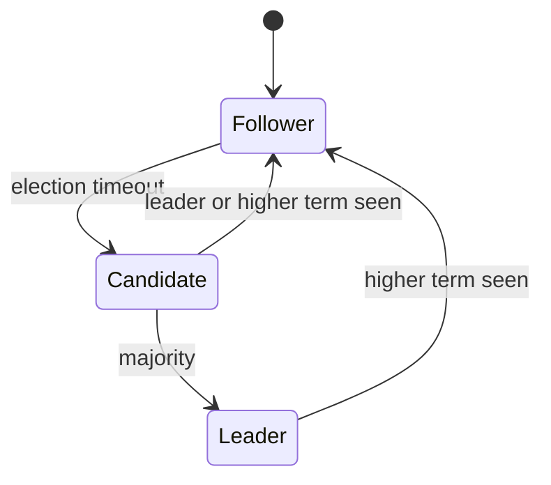

# Consensus and coordination: expert

🌐 [Русский](expert.ru.md) · **English**

**Levels:** [overview](overview.en.md) · [1. Basics](basics.en.md) · [2. Advanced](advanced.en.md) · **3. Expert** · [4. Quiz](quiz.en.md)

## Under the hood

Lamport clocks order cause and effect without synchronizing time: the counter grows before an event, and on receipt you take the maximum plus one.

```csharp
public long Tick() => ++Time; // a local event or a send

public long Receive(long remote) => Time = Math.Max(Time, remote) + 1;
```

If A causally precedes B, A's mark is smaller. The converse is false. File: [Ex03_LamportClock.cs](code/Examples/Ex03_LamportClock.cs).



### Paxos

Single-decree Paxos from "Paxos Made Simple" runs in two phases. Prepare: a proposer picks a number and asks a majority of acceptors not to accept lower ones; they report what they have already accepted. Accept: if something was accepted before, the proposer must propose the value with the highest number.

```csharp
string proposed = earlier.Count > 0 ? earlier[0].Value : value;

int accepted = promises.Count(p => p.a.Accept(n, proposed));
return accepted > clusterSize / 2 ? proposed : null;
```

So a chosen value survives the next proposer: it proposed `y` but got `x`. File: [Ex04_Paxos.cs](code/Examples/Ex04_Paxos.cs). Two competing proposers may pre-empt each other forever, so in practice a leader is chosen; for a sequence of commands Multi-Paxos is used. Raft solves the same task and describes the leader and the log from the start.

### Membership changes and snapshots in Raft

Switching everyone to a new configuration at once is unsafe: two disjoint majorities are possible. Raft first moves to joint consensus, where decisions need majorities of both the old and the new configuration.

```csharp
public static bool JointMajority(IReadOnlySet<int> votes, IReadOnlySet<int> oldOne, IReadOnlySet<int> newOne) =>
    HasMajority(votes, oldOne) && HasMajority(votes, newOne);
```

So that the log does not grow forever, committed entries are replaced by a state snapshot with the index and term of the last included entry; a lagging node receives the whole snapshot. File: [Ex06_Membership.cs](code/Examples/Ex06_Membership.cs).

### Hybrid logical clocks

HLC keeps `l`, the largest physical time heard of, and a counter `c` for events with the same `l`. Marks respect causality and stay close to physical time.

```csharp
_c = (_l == previous, _l == message.L) switch
{
    (true, true) => Math.Max(_c, message.C) + 1,
    (true, false) => _c + 1,
    (false, true) => message.C + 1,
    _ => 0,
};
```

A receiver with a slow clock still gets a mark later than the send. File: [Ex05_HybridClock.cs](code/Examples/Ex05_HybridClock.cs).

### ZooKeeper and etcd primitives

In ZooKeeper locks and elections are built from ephemeral sequential nodes: a node disappears with the client session, and each waits only for the previous one by number, to avoid a "herd effect". etcd has revisions (a growing counter of the whole key space), leases with a TTL (keys are deleted when it expires), watches from a given revision and If/Then/Else transactions. A read is linearizable by default; `serializable` answers from one member faster but may be stale. A revision can serve as a fencing token, but only if the protected resource checks it and rejects older values.

## Reference

| Clock | What it gives |
|---|---|
| Physical | time of day, may drift and be adjusted |
| Monotonic | durations on one machine |
| Lamport | an order consistent with causality |
| Vector | tells "earlier" from "concurrent" |

| Task | Usual means |
|---|---|
| leader election | a consensus system or a platform lease |
| cluster metadata | a replicated log |
| a single worker | lease + idempotency |
| protecting a write | fencing token or version |

| | Paxos (single-decree) | Raft |
|---|---|---|
| What it decides | one value | a replicated log |
| Leader | not required | central |
| Numbers | proposal numbers | terms |
| Membership change | outside the basic algorithm | described (joint consensus) |

| Recipe on a coordinator | Built from |
|---|---|
| leader election | an ephemeral node or a lease plus watching |
| lock | sequential nodes or a key under a lease |
| group membership | ephemeral nodes |
| configuration | a key plus a watch |

## Gotchas

### A smaller Lamport mark does not mean "earlier"

Node B had five local events (mark 5), node A one (mark 1). They are independent: from `1 < 5` you cannot conclude that A's event happened earlier.

### A lease by the wall clock

For simplicity the `LeaseService` example uses `GetUtcNow`. The wall clock can be adjusted, making the lifetime shorter or longer. To measure a duration on one machine use `TimeProvider.GetTimestamp`.

### lock does not work across processes

`lock` synchronizes the threads of one process; two service instances will enter the "critical section" at the same time.

### An instant configuration switch

Old configuration {1,2,3}, new {1,...,5}: nodes {1,2} are a majority of the old one, {3,4,5} of the new one. They do not intersect, and two leaders are possible.

### A proposer gets a value that is not its own

If `Propose` returned a value, it is not necessarily the one proposed: check the result.

## Trade-offs and alternatives

| Instead of a lock | When |
|---|---|
| A unique index | to forbid a duplicate |
| A conditional update by version | rare conflicts |
| Partitioning by key | one processor per key |
| Idempotency | a repeat is acceptable |

Consensus costs latency: every write waits for a majority.

## Interview questions

**1. Why a majority?**

<details><summary>Answer</summary>

Any two majorities intersect.

</details>

**2. How many failures does a cluster of 5 survive?**

<details><summary>Answer</summary>

Two.

</details>

**3. What is a term?**

<details><summary>Answer</summary>

A monotonically growing period number with at most one leader in each.

</details>

**4. When does a node refuse its vote?**

<details><summary>Answer</summary>

A stale term, it already voted for another, or the candidate's log is less up to date.

</details>

**5. Why a randomized timeout?**

<details><summary>Answer</summary>

So that split votes are rare.

</details>

**6. What is split brain?**

<details><summary>Answer</summary>

Two active leaders because of a partition.

</details>

**7. What does a fencing token solve?**

<details><summary>Answer</summary>

It rejects requests of a former lock holder.

</details>

**8. Can you do without storage support?**

<details><summary>Answer</summary>

No: it is the resource that checks the token.

</details>

**9. What do Lamport clocks guarantee?**

<details><summary>Answer</summary>

If A causally precedes B, A's mark is smaller.

</details>

**10. Trick question: you added a fourth node to three. Is it more reliable?**

<details><summary>Answer</summary>

It still survives one failure, and the majority got larger.

</details>

**11. The two phases of Paxos?**

<details><summary>Answer</summary>

Prepare/promise and accept/accepted, each with a majority.

</details>

**12. Why must a proposer take a previously accepted value?**

<details><summary>Answer</summary>

It may already be chosen; otherwise agreement is violated.

</details>

**13. What is joint consensus?**

<details><summary>Answer</summary>

A transitional configuration that needs majorities of both.

</details>

**14. Why log snapshots?**

<details><summary>Answer</summary>

To bound the size and let lagging and new nodes catch up quickly.

</details>

**15. Trick question: in etcd a `serializable` read returned an old value. Is it an etcd bug?**

<details><summary>Answer</summary>

No: one member answers such a read and may lag.

</details>

## Related materials

- [Advanced theory](advanced.en.md)
- [Quiz](quiz.en.md) and [exercises](exercises.en.md)

## Sources

- [Raft](https://raft.github.io/raft.pdf)
- [Kleppmann: How to do distributed locking](https://martin.kleppmann.com/2016/02/08/how-to-do-distributed-locking.html)
- [Lamport: Paxos Made Simple](https://lamport.azurewebsites.net/pubs/paxos-simple.pdf)
- [Raft](https://raft.github.io/raft.pdf)
- [Kulkarni et al.: Hybrid Logical Clocks](https://cse.buffalo.edu/tech-reports/2014-04.pdf)
- [ZooKeeper: recipes](https://zookeeper.apache.org/doc/r3.9.3/recipes.html)
- [etcd: API](https://etcd.io/docs/v3.6/learning/api/)
