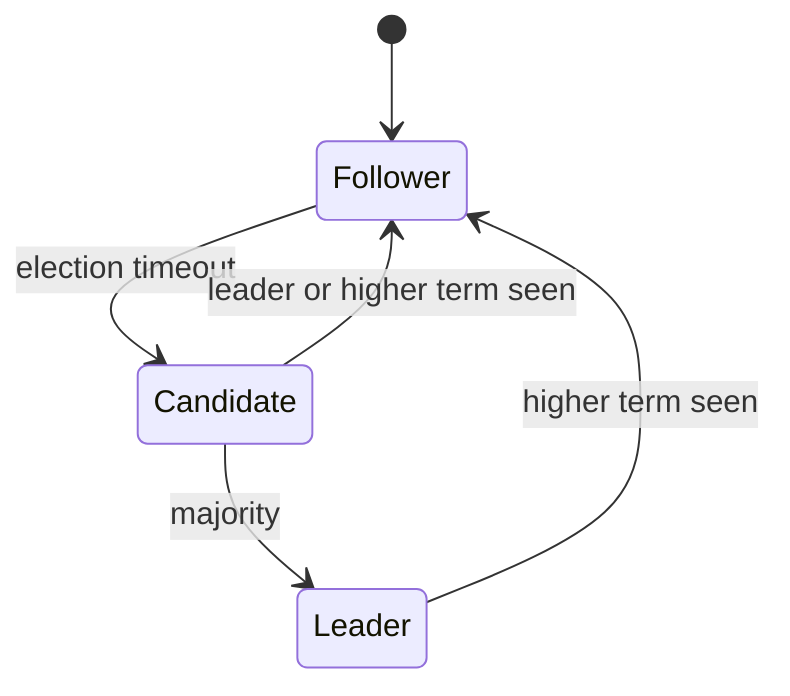

# Consensus and coordination: expert

🌐 [Русский](expert.ru.md) · **English**

**Levels:** [overview](overview.en.md) · [1. Basics](basics.en.md) · [2. Advanced](advanced.en.md) · **3. Expert** · [4. Quiz](quiz.en.md)

## Under the hood

Lamport clocks order cause and effect without synchronizing time: the counter grows before an event, and on receipt you take the maximum plus one.

```csharp
public long Tick() => ++Time; // a local event or a send

public long Receive(long remote) => Time = Math.Max(Time, remote) + 1;
```

If A causally precedes B, A's mark is smaller. The converse is false. File: [Ex03_LamportClock.cs](code/Examples/Ex03_LamportClock.cs).



## Reference

| Clock | What it gives |
|---|---|
| Physical | time of day, may drift and be adjusted |
| Monotonic | durations on one machine |
| Lamport | an order consistent with causality |
| Vector | tells "earlier" from "concurrent" |

| Task | Usual means |
|---|---|
| leader election | a consensus system or a platform lease |
| cluster metadata | a replicated log |
| a single worker | lease + idempotency |
| protecting a write | fencing token or version |

## Gotchas

### A smaller Lamport mark does not mean "earlier"

Node B had five local events (mark 5), node A one (mark 1). They are independent: from `1 < 5` you cannot conclude that A's event happened earlier.

### A lease by the wall clock

For simplicity the `LeaseService` example uses `GetUtcNow`. The wall clock can be adjusted, making the lifetime shorter or longer. To measure a duration on one machine use `TimeProvider.GetTimestamp`.

### lock does not work across processes

`lock` synchronizes the threads of one process; two service instances will enter the "critical section" at the same time.

## Trade-offs and alternatives

| Instead of a lock | When |
|---|---|
| A unique index | to forbid a duplicate |
| A conditional update by version | rare conflicts |
| Partitioning by key | one processor per key |
| Idempotency | a repeat is acceptable |

Consensus costs latency: every write waits for a majority.

## Interview questions

**1. Why a majority?**

<details><summary>Answer</summary>

Any two majorities intersect.

</details>

**2. How many failures does a cluster of 5 survive?**

<details><summary>Answer</summary>

Two.

</details>

**3. What is a term?**

<details><summary>Answer</summary>

A monotonically growing period number with at most one leader in each.

</details>

**4. When does a node refuse its vote?**

<details><summary>Answer</summary>

A stale term, it already voted for another, or the candidate's log is less up to date.

</details>

**5. Why a randomized timeout?**

<details><summary>Answer</summary>

So that split votes are rare.

</details>

**6. What is split brain?**

<details><summary>Answer</summary>

Two active leaders because of a partition.

</details>

**7. What does a fencing token solve?**

<details><summary>Answer</summary>

It rejects requests of a former lock holder.

</details>

**8. Can you do without storage support?**

<details><summary>Answer</summary>

No: it is the resource that checks the token.

</details>

**9. What do Lamport clocks guarantee?**

<details><summary>Answer</summary>

If A causally precedes B, A's mark is smaller.

</details>

**10. Trick question: you added a fourth node to three. Is it more reliable?**

<details><summary>Answer</summary>

It still survives one failure, and the majority got larger.

</details>

## Related materials

- [Advanced theory](advanced.en.md)
- [Quiz](quiz.en.md) and [exercises](exercises.en.md)

## Sources

- [Raft](https://raft.github.io/raft.pdf)
- [Kleppmann: How to do distributed locking](https://martin.kleppmann.com/2016/02/08/how-to-do-distributed-locking.html)
