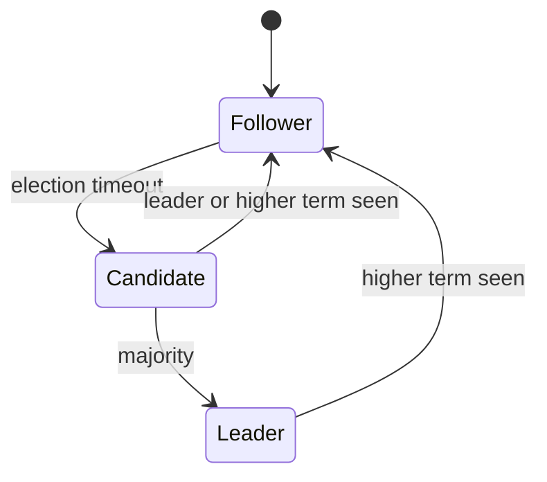

# Консенсус и координация: экспертная теория

🌐 **Русский** · [English](expert.en.md)

**Уровни:** [обзор](overview.ru.md) · [1. Базовая](basics.ru.md) · [2. Продвинутая](advanced.ru.md) · **3. Экспертная** · [4. Квиз](quiz.ru.md)

## Под капотом

Часы Лэмпорта упорядочивают причину и следствие без синхронизации времени: перед событием счётчик растёт, при получении берётся максимум плюс один.

```csharp
public long Tick() => ++Time; // a local event or a send

public long Receive(long remote) => Time = Math.Max(Time, remote) + 1;
```

Если A причинно раньше B, то метка A меньше. Обратное неверно. Файл: [Ex03_LamportClock.cs](code/Examples/Ex03_LamportClock.cs).



## Справочник

| Часы | Что дают |
|---|---|
| Физические | время суток, могут расходиться и подводиться |
| Монотонные | длительности на одной машине |
| Лэмпорта | порядок, согласованный с причинностью |
| Векторные | различают «раньше» и «одновременно» |

| Задача | Обычное средство |
|---|---|
| выбор лидера | система консенсуса или lease платформы |
| метаданные кластера | реплицированный журнал |
| единственный исполнитель | lease + идемпотентность |
| защита записи | fencing token или версия |

## Подвохи

### Меньшая метка Лэмпорта не означает «раньше»

Узел B сделал пять локальных событий (метка 5), узел A — одно (метка 1). Они независимы: из `1 < 5` нельзя заключить, что событие A произошло раньше.

### Lease по настенным часам

Пример `LeaseService` для простоты использует `GetUtcNow`. Настенные часы могут быть подведены, и срок станет короче или длиннее. Для измерения длительности на одной машине берут `TimeProvider.GetTimestamp`.

### lock не действует между процессами

`lock` синхронизирует потоки одного процесса; два экземпляра сервиса войдут в «критическую секцию» одновременно.

## Компромиссы и альтернативы

| Вместо блокировки | Когда |
|---|---|
| Уникальный индекс | не допустить дубликата |
| Условное обновление по версии | редкие конфликты |
| Партиционирование по ключу | один обработчик на ключ |
| Идемпотентность | повтор допустим |

Консенсус стоит задержки: каждая запись ждёт большинства.

## Вопросы с собеседований

**1. Зачем большинство?**

<details><summary>Ответ</summary>

Любые два большинства пересекаются.

</details>

**2. Сколько отказов переживёт кластер из 5?**

<details><summary>Ответ</summary>

Два.

</details>

**3. Что такое терм?**

<details><summary>Ответ</summary>

Монотонно растущий номер периода, не более одного лидера в каждом.

</details>

**4. Когда узел откажет в голосе?**

<details><summary>Ответ</summary>

Устаревший терм, уже проголосовал за другого или журнал кандидата менее актуален.

</details>

**5. Зачем случайный таймаут?**

<details><summary>Ответ</summary>

Чтобы редко возникало разделение голосов.

</details>

**6. Что такое split brain?**

<details><summary>Ответ</summary>

Два активных лидера из-за разделения.

</details>

**7. Что решает fencing token?**

<details><summary>Ответ</summary>

Отвергает запросы бывшего владельца блокировки.

</details>

**8. Можно ли обойтись без поддержки хранилища?**

<details><summary>Ответ</summary>

Нет: токен проверяет именно ресурс.

</details>

**9. Что гарантируют часы Лэмпорта?**

<details><summary>Ответ</summary>

Если A причинно раньше B, метка A меньше.

</details>

**10. Подвох: добавили четвёртый узел к трём. Стало надёжнее?**

<details><summary>Ответ</summary>

Переживается по-прежнему один отказ, а большинство стало больше.

</details>

## Связанные материалы

- [Продвинутая теория](advanced.ru.md)
- [Квиз](quiz.ru.md) и [упражнения](exercises.ru.md)

## Источники

- [Raft](https://raft.github.io/raft.pdf)
- [Kleppmann: How to do distributed locking](https://martin.kleppmann.com/2016/02/08/how-to-do-distributed-locking.html)
