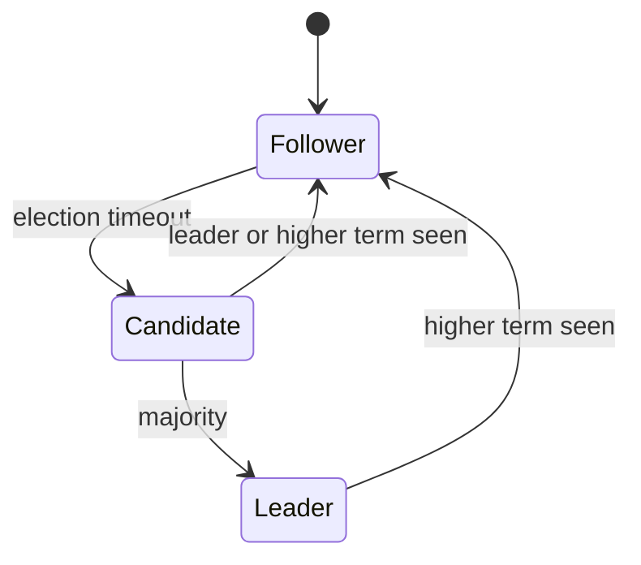

# Консенсус и координация: экспертная теория

🌐 **Русский** · [English](expert.en.md)

**Уровни:** [обзор](overview.ru.md) · [1. Базовая](basics.ru.md) · [2. Продвинутая](advanced.ru.md) · **3. Экспертная** · [4. Квиз](quiz.ru.md)

## Под капотом

Часы Лэмпорта упорядочивают причину и следствие без синхронизации времени: перед событием счётчик растёт, при получении берётся максимум плюс один.

```csharp
public long Tick() => ++Time; // a local event or a send

public long Receive(long remote) => Time = Math.Max(Time, remote) + 1;
```

Если A причинно раньше B, то метка A меньше. Обратное неверно. Файл: [Ex03_LamportClock.cs](code/Examples/Ex03_LamportClock.cs).



### Paxos

Однозначный (single-decree) Paxos из «Paxos Made Simple» идёт в две фазы. Prepare: proposer выбирает номер и просит большинство acceptors не принимать меньшие; они сообщают, что уже приняли. Accept: если ранее что-то принято, proposer обязан предложить значение с наибольшим номером.

```csharp
string proposed = earlier.Count > 0 ? earlier[0].Value : value;

int accepted = promises.Count(p => p.a.Accept(n, proposed));
return accepted > clusterSize / 2 ? proposed : null;
```

Поэтому выбранное значение переживает следующего proposer: тот предлагал `y`, но получил `x`. Файл: [Ex04_Paxos.cs](code/Examples/Ex04_Paxos.cs). Два соперничающих proposer могут бесконечно перебивать друг друга, поэтому на практике выбирают лидера; для последовательности команд применяют Multi-Paxos. Raft решает ту же задачу и сразу описывает лидера и журнал.

### Смена состава и снимки в Raft

Переключить всех на новую конфигурацию одновременно нельзя: возможны два непересекающихся большинства. Raft сначала переходит в joint consensus, где решения требуют большинства и старой, и новой конфигурации.

```csharp
public static bool JointMajority(IReadOnlySet<int> votes, IReadOnlySet<int> oldOne, IReadOnlySet<int> newOne) =>
    HasMajority(votes, oldOne) && HasMajority(votes, newOne);
```

Чтобы журнал не рос бесконечно, зафиксированные записи заменяют снимком состояния с индексом и термом последней включённой записи; отставшему узлу снимок передают целиком. Файл: [Ex06_Membership.cs](code/Examples/Ex06_Membership.cs).

### Гибридные логические часы

HLC хранит `l` — наибольшее известное физическое время — и счётчик `c` для событий с одинаковым `l`. Метки уважают причинность и остаются близки к физическому времени.

```csharp
_c = (_l == previous, _l == message.L) switch
{
    (true, true) => Math.Max(_c, message.C) + 1,
    (true, false) => _c + 1,
    (false, true) => message.C + 1,
    _ => 0,
};
```

Получатель с отстающими часами всё равно получает метку позже отправки. Файл: [Ex05_HybridClock.cs](code/Examples/Ex05_HybridClock.cs).

### Примитивы ZooKeeper и etcd

В ZooKeeper блокировки и выборы строят из эфемерных последовательных узлов: узел исчезает вместе с сессией клиента, а каждый ждёт только предыдущего по номеру, чтобы не вызывать «эффект стада». В etcd есть ревизии (растущий счётчик всего пространства ключей), lease с TTL (ключи удаляются при его истечении), watch с заданной ревизии и транзакции If/Then/Else. Чтение по умолчанию линеаризуемое; `serializable` отвечает с одного узла быстрее, но может быть устаревшим. Ревизия может служить fencing token, но только если защищаемый ресурс сам проверяет её и отклоняет старые значения.

## Справочник

| Часы | Что дают |
|---|---|
| Физические | время суток, могут расходиться и подводиться |
| Монотонные | длительности на одной машине |
| Лэмпорта | порядок, согласованный с причинностью |
| Векторные | различают «раньше» и «одновременно» |

| Задача | Обычное средство |
|---|---|
| выбор лидера | система консенсуса или lease платформы |
| метаданные кластера | реплицированный журнал |
| единственный исполнитель | lease + идемпотентность |
| защита записи | fencing token или версия |

| | Paxos (single-decree) | Raft |
|---|---|---|
| Что решает | одно значение | реплицированный журнал |
| Лидер | не обязателен | центральный элемент |
| Номера | номера предложений | термы |
| Смена состава | вне базового алгоритма | описана (joint consensus) |

| Рецепт на координаторе | Из чего строится |
|---|---|
| выбор лидера | эфемерный узел или lease + наблюдение |
| блокировка | последовательные узлы или ключ под lease |
| членство в группе | эфемерные узлы |
| конфигурация | ключ + watch |

## Подвохи

### Меньшая метка Лэмпорта не означает «раньше»

Узел B сделал пять локальных событий (метка 5), узел A — одно (метка 1). Они независимы: из `1 < 5` нельзя заключить, что событие A произошло раньше.

### Lease по настенным часам

Пример `LeaseService` для простоты использует `GetUtcNow`. Настенные часы могут быть подведены, и срок станет короче или длиннее. Для измерения длительности на одной машине берут `TimeProvider.GetTimestamp`.

### lock не действует между процессами

`lock` синхронизирует потоки одного процесса; два экземпляра сервиса войдут в «критическую секцию» одновременно.

### Мгновенная смена конфигурации

Старая конфигурация {1,2,3}, новая {1,...,5}: узлы {1,2} — большинство старой, {3,4,5} — большинство новой. Они не пересекаются, и возможны два лидера.

### Proposer получает не своё значение

Если `Propose` вернул значение, это не обязательно то, что предлагали: проверяйте результат.

## Компромиссы и альтернативы

| Вместо блокировки | Когда |
|---|---|
| Уникальный индекс | не допустить дубликата |
| Условное обновление по версии | редкие конфликты |
| Партиционирование по ключу | один обработчик на ключ |
| Идемпотентность | повтор допустим |

Консенсус стоит задержки: каждая запись ждёт большинства.

## Вопросы с собеседований

**1. Зачем большинство?**

<details><summary>Ответ</summary>

Любые два большинства пересекаются.

</details>

**2. Сколько отказов переживёт кластер из 5?**

<details><summary>Ответ</summary>

Два.

</details>

**3. Что такое терм?**

<details><summary>Ответ</summary>

Монотонно растущий номер периода, не более одного лидера в каждом.

</details>

**4. Когда узел откажет в голосе?**

<details><summary>Ответ</summary>

Устаревший терм, уже проголосовал за другого или журнал кандидата менее актуален.

</details>

**5. Зачем случайный таймаут?**

<details><summary>Ответ</summary>

Чтобы редко возникало разделение голосов.

</details>

**6. Что такое split brain?**

<details><summary>Ответ</summary>

Два активных лидера из-за разделения.

</details>

**7. Что решает fencing token?**

<details><summary>Ответ</summary>

Отвергает запросы бывшего владельца блокировки.

</details>

**8. Можно ли обойтись без поддержки хранилища?**

<details><summary>Ответ</summary>

Нет: токен проверяет именно ресурс.

</details>

**9. Что гарантируют часы Лэмпорта?**

<details><summary>Ответ</summary>

Если A причинно раньше B, метка A меньше.

</details>

**10. Подвох: добавили четвёртый узел к трём. Стало надёжнее?**

<details><summary>Ответ</summary>

Переживается по-прежнему один отказ, а большинство стало больше.

</details>

**11. Две фазы Paxos?**

<details><summary>Ответ</summary>

Prepare/promise и accept/accepted, каждая с большинством.

</details>

**12. Почему proposer обязан взять ранее принятое значение?**

<details><summary>Ответ</summary>

Оно могло быть уже выбрано; иначе нарушится согласие.

</details>

**13. Что такое joint consensus?**

<details><summary>Ответ</summary>

Переходная конфигурация, где нужны большинства обеих.

</details>

**14. Зачем снимки журнала?**

<details><summary>Ответ</summary>

Ограничить размер и быстро догонять отставшие и новые узлы.

</details>

**15. Подвох: в etcd чтение с `serializable` вернуло старое значение. Это ошибка etcd?**

<details><summary>Ответ</summary>

Нет: такое чтение отвечает один узел и может отставать.

</details>

## Связанные материалы

- [Продвинутая теория](advanced.ru.md)
- [Квиз](quiz.ru.md) и [упражнения](exercises.ru.md)

## Источники

- [Raft](https://raft.github.io/raft.pdf)
- [Kleppmann: How to do distributed locking](https://martin.kleppmann.com/2016/02/08/how-to-do-distributed-locking.html)
- [Lamport: Paxos Made Simple](https://lamport.azurewebsites.net/pubs/paxos-simple.pdf)
- [Raft](https://raft.github.io/raft.pdf)
- [Kulkarni и др.: Hybrid Logical Clocks](https://cse.buffalo.edu/tech-reports/2014-04.pdf)
- [ZooKeeper: recipes](https://zookeeper.apache.org/doc/r3.9.3/recipes.html)
- [etcd: API](https://etcd.io/docs/v3.6/learning/api/)
