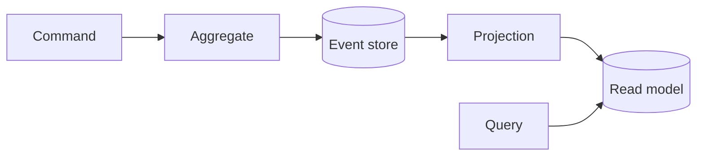

# Event sourcing and CQRS: expert

🌐 [Русский](expert.ru.md) · **English**

**Levels:** [overview](overview.en.md) · [1. Basics](basics.en.md) · [2. Advanced](advanced.en.md) · **3. Expert** · [4. Quiz](quiz.en.md)

## Under the hood

A write: load the stream, fold it into state, make a decision, append events with the expected version. On a conflict, do it all again, because the decision may change.



### Ready-made event stores

| Product | What it is | Features |
|---|---|---|
| KurrentDB | a stream database built for event sourcing | event numbering within a stream, optimistic concurrency, catch-up and persistent subscriptions |
| Marten | a .NET library on top of PostgreSQL | inline, async and live projections |

In Marten an inline projection is updated in the same transaction that records the events; an async one is built by a background process with eventual consistency; a live one is computed from events on request and is not stored. Choosing between them is choosing between write latency, freshness and read cost.

### Snapshot strategies

A snapshot is taken when many events have accumulated since the previous one. It depends on the `Apply` code, so it carries a schema version: after the code changes, the old snapshot is discarded and recomputed from events.

```csharp
Account? from = _snapshots.TryGetValue(stream, out Snapshot? s) && s.SchemaVersion == schemaVersion
    ? s.State
    : null;
```

File: [Ex04_Snapshots.cs](code/Examples/Ex04_Snapshots.cs).

### Rebuilding a projection without downtime

The new model is built beside the old one from the same stream; reads are served by the old one until the new one catches up with the end of the log, then they are swapped.

```csharp
if (_candidate is null || _candidate.Checkpoint < head) return false;

(Live, _candidate) = (_candidate, null);
```

The end of the log moves, so in practice you switch when the lag is small enough. Side effects must be disabled during a rebuild. File: [Ex05_BlueGreenProjection.cs](code/Examples/Ex05_BlueGreenProjection.cs).

### Implementing crypto-shredding

Personal fields are encrypted with a per-subject key (AES-GCM: a unique nonce, an authentication tag, the subject identifier as associated data). Deleting the key makes all copies, including backups, unreadable — if the key itself did not survive in another copy.

```csharp
public void Forget(string subject) => _keys[subject] = null;
```

File: [Ex06_CryptoShredding.cs](code/Examples/Ex06_CryptoShredding.cs). This is a teaching example: in production keys live in a KMS, and projections holding plain data have to be cleaned separately. Whether this is legally sufficient is not for programmers to decide.

## Reference

| Concept | Meaning |
|---|---|
| Stream | the events of one aggregate |
| Expected version | protection against concurrent writes |
| Global position | order for projections |
| Snapshot | a cache of state |
| Checkpoint | how far a projection has got |
| Upcaster | conversion of an old shape |
| Compensating event | a correction by a new fact |

| Read model delay | What to do |
|---|---|
| the user must see their write | return the command result or wait for a position |
| lists and reports | show "updating" |

| Keep in an event | Move out |
|---|---|
| identifiers, amounts, statuses | names, addresses, documents (or encrypt) |

| Projection | Freshness | Write cost | Read cost |
|---|---|---|---|
| inline | immediate | higher | low |
| async | delayed | low | low |
| live | immediate | none | grows with stream length |

## Gotchas

### Serializing through the base type loses fields

```csharp
abstract record Base;
record Dep(int Amount) : Base;

Base e = new Dep(5);
Console.WriteLine(JsonSerializer.Serialize(e));
Console.WriteLine(JsonSerializer.Serialize<object>(e));
```

Result: `{}`, then `{"Amount":5}`. The first variant would write an empty event to the store. Use `[JsonDerivedType]` or serialize by the runtime type and save the type name.

### Record equality does not look inside a list

```csharp
record Ev(List<int> Items);

Console.WriteLine(new Ev([1]) == new Ev([1]));
```

Result: `False`. This matters in tests of the form "expected events equal actual ones".

### Reusing a nonce in AES-GCM reveals data

`salary=1000` and `salary=9999` were encrypted with one key and one nonce. The `XOR` of the two ciphertexts and the first plaintext gave `salary=9999`. A nonce must be new for every encryption.

## Trade-offs and alternatives

| Option | Pro | Con |
|---|---|---|
| Event sourcing | history, rebuilding | versions, complexity |
| State table + audit | simpler | history may diverge from state |
| CQRS without ES | separate models | synchronization |
| Database temporal tables | history without changing the model | no intent |

## Interview questions

**1. What is event sourcing?**

<details><summary>Answer</summary>

Storing changes as immutable events; state is obtained by replaying them.

</details>

**2. Is CQRS mandatory with it?**

<details><summary>Answer</summary>

Formally no, but queries almost always need projections.

</details>

**3. How are concurrent writes prevented?**

<details><summary>Answer</summary>

An expected stream version checked atomically with the append.

</details>

**4. Why snapshots?**

<details><summary>Answer</summary>

To avoid replaying a long stream every time.

</details>

**5. How do you change an event format?**

<details><summary>Answer</summary>

Add a field compatibly, introduce a version or an upcaster; do not rewrite what is stored.

</details>

**6. How do you fix a wrong event?**

<details><summary>Answer</summary>

Append a compensating one.

</details>

**7. What about deleting personal data?**

<details><summary>Answer</summary>

Keep it out of events or delete the encryption key.

</details>

**8. How do you rebuild a projection without downtime?**

<details><summary>Answer</summary>

Build a new one alongside, catch up and switch reads.

</details>

**9. How does a domain event differ from an integration event?**

<details><summary>Answer</summary>

The first is an internal detail of the model, the second a stable contract for others.

</details>

**10. Trick question: Kafka keeps events, so is it already an event store?**

<details><summary>Answer</summary>

Event sourcing usually needs reading an aggregate's stream and checking an expected version; a broker log does not give that by itself.

</details>

**11. How do inline, async and live projections differ?**

<details><summary>Answer</summary>

In the moment of computation: in the write transaction, in the background or on request.

</details>

**12. When does a snapshot become invalid?**

<details><summary>Answer</summary>

When the logic or shape of the state changed; it is recomputed from events.

</details>

**13. How do you rebuild a read model without downtime?**

<details><summary>Answer</summary>

Build a new one beside, catch up and switch reads.

</details>

**14. What remains after deleting a key in crypto-shredding?**

<details><summary>Answer</summary>

The ciphertext and everything stored in the clear, including projections and logs.

</details>

**15. Trick question: keys live in the same database and are copied into the same backups. Does deleting a key erase the data?**

<details><summary>Answer</summary>

No: the key can be restored from an old backup too.

</details>

## Related materials

- [Advanced theory](advanced.en.md)
- [Quiz](quiz.en.md) and [exercises](exercises.en.md)

## Sources

- [Event Sourcing pattern](https://learn.microsoft.com/azure/architecture/patterns/event-sourcing)
- [CQRS pattern](https://learn.microsoft.com/azure/architecture/patterns/cqrs)
- [KurrentDB: features](https://docs.kurrent.io/getting-started/features.html)
- [Marten: event store](https://martendb.io/events/)
