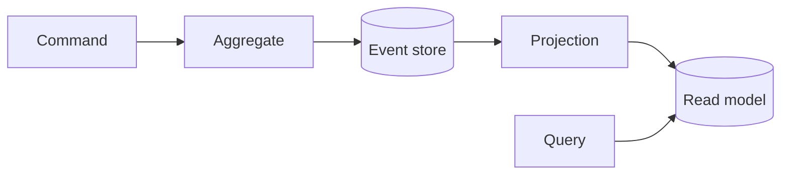

# Event sourcing and CQRS: expert

🌐 [Русский](expert.ru.md) · **English**

**Levels:** [overview](overview.en.md) · [1. Basics](basics.en.md) · [2. Advanced](advanced.en.md) · **3. Expert** · [4. Quiz](quiz.en.md)

## Under the hood

A write: load the stream, fold it into state, make a decision, append events with the expected version. On a conflict, do it all again, because the decision may change.



## Reference

| Concept | Meaning |
|---|---|
| Stream | the events of one aggregate |
| Expected version | protection against concurrent writes |
| Global position | order for projections |
| Snapshot | a cache of state |
| Checkpoint | how far a projection has got |
| Upcaster | conversion of an old shape |
| Compensating event | a correction by a new fact |

| Read model delay | What to do |
|---|---|
| the user must see their write | return the command result or wait for a position |
| lists and reports | show "updating" |

## Gotchas

### Serializing through the base type loses fields

```csharp
abstract record Base;
record Dep(int Amount) : Base;

Base e = new Dep(5);
Console.WriteLine(JsonSerializer.Serialize(e));
Console.WriteLine(JsonSerializer.Serialize<object>(e));
```

Result: `{}`, then `{"Amount":5}`. The first variant would write an empty event to the store. Use `[JsonDerivedType]` or serialize by the runtime type and save the type name.

### Record equality does not look inside a list

```csharp
record Ev(List<int> Items);

Console.WriteLine(new Ev([1]) == new Ev([1]));
```

Result: `False`. This matters in tests of the form "expected events equal actual ones".

## Trade-offs and alternatives

| Option | Pro | Con |
|---|---|---|
| Event sourcing | history, rebuilding | versions, complexity |
| State table + audit | simpler | history may diverge from state |
| CQRS without ES | separate models | synchronization |
| Database temporal tables | history without changing the model | no intent |

## Interview questions

**1. What is event sourcing?**

<details><summary>Answer</summary>

Storing changes as immutable events; state is obtained by replaying them.

</details>

**2. Is CQRS mandatory with it?**

<details><summary>Answer</summary>

Formally no, but queries almost always need projections.

</details>

**3. How are concurrent writes prevented?**

<details><summary>Answer</summary>

An expected stream version checked atomically with the append.

</details>

**4. Why snapshots?**

<details><summary>Answer</summary>

To avoid replaying a long stream every time.

</details>

**5. How do you change an event format?**

<details><summary>Answer</summary>

Add a field compatibly, introduce a version or an upcaster; do not rewrite what is stored.

</details>

**6. How do you fix a wrong event?**

<details><summary>Answer</summary>

Append a compensating one.

</details>

**7. What about deleting personal data?**

<details><summary>Answer</summary>

Keep it out of events or delete the encryption key.

</details>

**8. How do you rebuild a projection without downtime?**

<details><summary>Answer</summary>

Build a new one alongside, catch up and switch reads.

</details>

**9. How does a domain event differ from an integration event?**

<details><summary>Answer</summary>

The first is an internal detail of the model, the second a stable contract for others.

</details>

**10. Trick question: Kafka keeps events, so is it already an event store?**

<details><summary>Answer</summary>

Event sourcing usually needs reading an aggregate's stream and checking an expected version; a broker log does not give that by itself.

</details>

## Related materials

- [Advanced theory](advanced.en.md)
- [Quiz](quiz.en.md) and [exercises](exercises.en.md)

## Sources

- [Event Sourcing pattern](https://learn.microsoft.com/azure/architecture/patterns/event-sourcing)
- [CQRS pattern](https://learn.microsoft.com/azure/architecture/patterns/cqrs)
