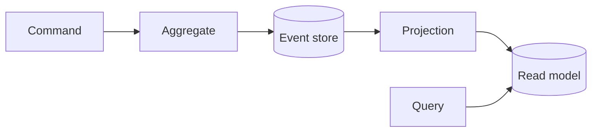

# Event sourcing и CQRS: экспертная теория

🌐 **Русский** · [English](expert.en.md)

**Уровни:** [обзор](overview.ru.md) · [1. Базовая](basics.ru.md) · [2. Продвинутая](advanced.ru.md) · **3. Экспертная** · [4. Квиз](quiz.ru.md)

## Под капотом

Запись: загрузить поток, свернуть в состояние, принять решение, добавить события с ожидаемой версией. При конфликте — всё заново, потому что решение могло измениться.



## Справочник

| Понятие | Смысл |
|---|---|
| Stream | события одного агрегата |
| Expected version | защита от конкурентной записи |
| Global position | порядок для проекций |
| Snapshot | кэш состояния |
| Checkpoint | докуда дошла проекция |
| Upcaster | преобразование старой формы |
| Compensating event | исправление новым фактом |

| Задержка модели чтения | Что делать |
|---|---|
| пользователь должен видеть свою запись | вернуть результат команды или ждать позицию |
| список и отчёты | показывать «обновляется» |

## Подвохи

### Сериализация через базовый тип теряет поля

```csharp
abstract record Base;
record Dep(int Amount) : Base;

Base e = new Dep(5);
Console.WriteLine(JsonSerializer.Serialize(e));
Console.WriteLine(JsonSerializer.Serialize<object>(e));
```

Результат: `{}`, затем `{"Amount":5}`. Первый вариант запишет в хранилище пустое событие. Используют `[JsonDerivedType]` или сериализуют по фактическому типу и сохраняют имя типа.

### Равенство record не смотрит внутрь списка

```csharp
record Ev(List<int> Items);

Console.WriteLine(new Ev([1]) == new Ev([1]));
```

Результат: `False`. Это важно в тестах вида «ожидаемые события равны фактическим».

## Компромиссы и альтернативы

| Вариант | Плюс | Минус |
|---|---|---|
| Event sourcing | история, перестроение | версии, сложность |
| Таблица состояния + аудит | проще | история может расходиться с состоянием |
| CQRS без ES | раздельные модели | синхронизация |
| Temporal-таблицы базы | история без смены модели | нет намерения |

## Вопросы с собеседований

**1. Что такое event sourcing?**

<details><summary>Ответ</summary>

Хранение изменений как неизменяемых событий; состояние получают воспроизведением.

</details>

**2. Обязательно ли CQRS с ним?**

<details><summary>Ответ</summary>

Формально нет, но для запросов почти всегда нужны проекции.

</details>

**3. Как предотвращают конкурентную запись?**

<details><summary>Ответ</summary>

Ожидаемая версия потока, проверяемая атомарно с добавлением.

</details>

**4. Зачем снимки?**

<details><summary>Ответ</summary>

Чтобы не воспроизводить длинный поток каждый раз.

</details>

**5. Как изменить формат события?**

<details><summary>Ответ</summary>

Совместимо добавить поле, ввести версию или upcaster; хранимое не переписывать.

</details>

**6. Как исправить ошибочное событие?**

<details><summary>Ответ</summary>

Добавить компенсирующее.

</details>

**7. Что делать с удалением персональных данных?**

<details><summary>Ответ</summary>

Выносить их из событий или удалять ключ шифрования.

</details>

**8. Как перестроить проекцию без простоя?**

<details><summary>Ответ</summary>

Построить новую рядом, догнать и переключить чтение.

</details>

**9. Чем отличается доменное событие от интеграционного?**

<details><summary>Ответ</summary>

Первое — внутренняя деталь модели, второе — стабильный контракт для других.

</details>

**10. Подвох: Kafka хранит события, значит это уже event store?**

<details><summary>Ответ</summary>

Для event sourcing обычно нужны чтение потока агрегата и проверка ожидаемой версии; журнал брокера этого сам по себе не даёт.

</details>

## Связанные материалы

- [Продвинутая теория](advanced.ru.md)
- [Квиз](quiz.ru.md) и [упражнения](exercises.ru.md)

## Источники

- [Паттерн Event Sourcing](https://learn.microsoft.com/azure/architecture/patterns/event-sourcing)
- [Паттерн CQRS](https://learn.microsoft.com/azure/architecture/patterns/cqrs)
