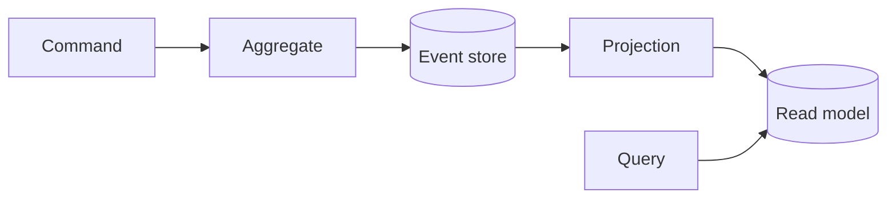

# Event sourcing и CQRS: экспертная теория

🌐 **Русский** · [English](expert.en.md)

**Уровни:** [обзор](overview.ru.md) · [1. Базовая](basics.ru.md) · [2. Продвинутая](advanced.ru.md) · **3. Экспертная** · [4. Квиз](quiz.ru.md)

## Под капотом

Запись: загрузить поток, свернуть в состояние, принять решение, добавить события с ожидаемой версией. При конфликте — всё заново, потому что решение могло измениться.



### Готовые event store

| Продукт | Что это | Особенности |
|---|---|---|
| KurrentDB | база потоков, созданная для event sourcing | нумерация событий в потоке, оптимистичная конкурентность, catch-up и persistent подписки |
| Marten | библиотека .NET поверх PostgreSQL | проекции inline, async и live |

В Marten inline-проекция обновляется в той же транзакции, что и запись событий; async строится фоновым процессом и согласуется «в конечном счёте»; live вычисляется по событиям при запросе и не сохраняется. Выбор между ними — это выбор между задержкой записи, свежестью и ценой чтения.

### Стратегии снимков

Снимок делают, когда после предыдущего накопилось много событий. Он зависит от кода `Apply`, поэтому несёт версию схемы: после изменения кода старый снимок отбрасывают и пересчитывают из событий.

```csharp
Account? from = _snapshots.TryGetValue(stream, out Snapshot? s) && s.SchemaVersion == schemaVersion
    ? s.State
    : null;
```

Файл: [Ex04_Snapshots.cs](code/Examples/Ex04_Snapshots.cs).

### Перестроение проекции без простоя

Новую модель строят рядом со старой из того же потока; чтения обслуживает старая, пока новая не догонит конец журнала, после чего их меняют местами.

```csharp
if (_candidate is null || _candidate.Checkpoint < head) return false;

(Live, _candidate) = (_candidate, null);
```

Конец журнала движется, поэтому на практике переключаются при достаточно малом отставании. Побочные эффекты при перестроении должны быть отключены. Файл: [Ex05_BlueGreenProjection.cs](code/Examples/Ex05_BlueGreenProjection.cs).

### Реализация crypto-shredding

Персональные поля шифруют ключом субъекта (AES-GCM: уникальный nonce, тег проверки, идентификатор субъекта как связанные данные). Удаление ключа делает все копии, включая резервные, нечитаемыми — если сам ключ не сохранился в другой копии.

```csharp
public void Forget(string subject) => _keys.Remove(subject);
```

Файл: [Ex06_CryptoShredding.cs](code/Examples/Ex06_CryptoShredding.cs). Это учебный пример: ключи в production хранят в KMS, а проекции с открытыми данными нужно очищать отдельно. Достаточно ли этого юридически, решают не программисты.

## Справочник

| Понятие | Смысл |
|---|---|
| Stream | события одного агрегата |
| Expected version | защита от конкурентной записи |
| Global position | порядок для проекций |
| Snapshot | кэш состояния |
| Checkpoint | докуда дошла проекция |
| Upcaster | преобразование старой формы |
| Compensating event | исправление новым фактом |

| Задержка модели чтения | Что делать |
|---|---|
| пользователь должен видеть свою запись | вернуть результат команды или ждать позицию |
| список и отчёты | показывать «обновляется» |

| Что хранить в событии | Что вынести |
|---|---|
| идентификаторы, суммы, статусы | имена, адреса, документы (или шифровать) |

| Проекция | Свежесть | Цена записи | Цена чтения |
|---|---|---|---|
| inline | сразу | выше | низкая |
| async | с задержкой | низкая | низкая |
| live | сразу | нет | растёт с длиной потока |

## Подвохи

### Сериализация через базовый тип теряет поля

```csharp
abstract record Base;
record Dep(int Amount) : Base;

Base e = new Dep(5);
Console.WriteLine(JsonSerializer.Serialize(e));
Console.WriteLine(JsonSerializer.Serialize<object>(e));
```

Результат: `{}`, затем `{"Amount":5}`. Первый вариант запишет в хранилище пустое событие. Используют `[JsonDerivedType]` или сериализуют по фактическому типу и сохраняют имя типа.

### Равенство record не смотрит внутрь списка

```csharp
record Ev(List<int> Items);

Console.WriteLine(new Ev([1]) == new Ev([1]));
```

Результат: `False`. Это важно в тестах вида «ожидаемые события равны фактическим».

### Повтор nonce в AES-GCM раскрывает данные

Зашифровали `salary=1000` и `salary=9999` с одним ключом и одним nonce. `XOR` двух шифротекстов и первого открытого текста дал `salary=9999`. Nonce должен быть новым для каждого шифрования.

## Компромиссы и альтернативы

| Вариант | Плюс | Минус |
|---|---|---|
| Event sourcing | история, перестроение | версии, сложность |
| Таблица состояния + аудит | проще | история может расходиться с состоянием |
| CQRS без ES | раздельные модели | синхронизация |
| Temporal-таблицы базы | история без смены модели | нет намерения |

## Вопросы с собеседований

**1. Что такое event sourcing?**

<details><summary>Ответ</summary>

Хранение изменений как неизменяемых событий; состояние получают воспроизведением.

</details>

**2. Обязательно ли CQRS с ним?**

<details><summary>Ответ</summary>

Формально нет, но для запросов почти всегда нужны проекции.

</details>

**3. Как предотвращают конкурентную запись?**

<details><summary>Ответ</summary>

Ожидаемая версия потока, проверяемая атомарно с добавлением.

</details>

**4. Зачем снимки?**

<details><summary>Ответ</summary>

Чтобы не воспроизводить длинный поток каждый раз.

</details>

**5. Как изменить формат события?**

<details><summary>Ответ</summary>

Совместимо добавить поле, ввести версию или upcaster; хранимое не переписывать.

</details>

**6. Как исправить ошибочное событие?**

<details><summary>Ответ</summary>

Добавить компенсирующее.

</details>

**7. Что делать с удалением персональных данных?**

<details><summary>Ответ</summary>

Выносить их из событий или удалять ключ шифрования.

</details>

**8. Как перестроить проекцию без простоя?**

<details><summary>Ответ</summary>

Построить новую рядом, догнать и переключить чтение.

</details>

**9. Чем отличается доменное событие от интеграционного?**

<details><summary>Ответ</summary>

Первое — внутренняя деталь модели, второе — стабильный контракт для других.

</details>

**10. Подвох: Kafka хранит события, значит это уже event store?**

<details><summary>Ответ</summary>

Для event sourcing обычно нужны чтение потока агрегата и проверка ожидаемой версии; журнал брокера этого сам по себе не даёт.

</details>

**11. Чем отличаются inline, async и live проекции?**

<details><summary>Ответ</summary>

Моментом вычисления: в транзакции записи, в фоне или при запросе.

</details>

**12. Когда снимок становится недействительным?**

<details><summary>Ответ</summary>

Когда изменилась логика или форма состояния; его пересчитывают из событий.

</details>

**13. Как перестроить модель чтения без простоя?**

<details><summary>Ответ</summary>

Построить новую рядом, догнать и переключить чтение.

</details>

**14. Что остаётся после удаления ключа при crypto-shredding?**

<details><summary>Ответ</summary>

Шифротекст и всё, что хранилось открытым, включая проекции и логи.

</details>

**15. Подвох: ключи лежат в той же базе и копируются в те же бэкапы. Удаление ключа стирает данные?**

<details><summary>Ответ</summary>

Нет: из старой копии восстановят и ключ.

</details>

## Связанные материалы

- [Продвинутая теория](advanced.ru.md)
- [Квиз](quiz.ru.md) и [упражнения](exercises.ru.md)

## Источники

- [Паттерн Event Sourcing](https://learn.microsoft.com/azure/architecture/patterns/event-sourcing)
- [Паттерн CQRS](https://learn.microsoft.com/azure/architecture/patterns/cqrs)
- [KurrentDB: возможности](https://docs.kurrent.io/getting-started/features.html)
- [Marten: event store](https://martendb.io/events/)
