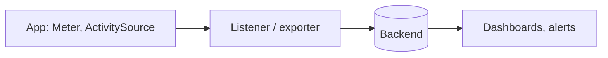
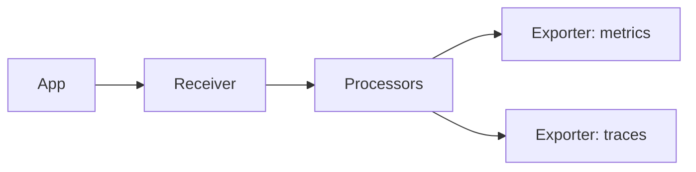

# Observability and SLOs: expert

🌐 [Русский](expert.ru.md) · **English**

**Levels:** [overview](overview.en.md) · [1. Basics](basics.en.md) · [2. Advanced](advanced.en.md) · **3. Expert** · [4. Quiz](quiz.en.md)

## Under the hood

`Meter` and `ActivitySource` are publication points. While nobody subscribes they cost almost nothing; a library can be instrumented without knowing who will export and where.



### OpenTelemetry Collector

A separate process between applications and telemetry stores. A pipeline consists of receivers (accept), processors (transform, drop, sample) and exporters (send; each gets a copy). It is deployed as an agent next to the application or as a gateway receiving data from many agents. Applications then do not know where telemetry finally goes.



### Exemplars

An exemplar is a recorded metric value together with trace context (`trace_id`, `span_id`, time, value). From "p99 went up" you can jump to a particular slow trace. OpenTelemetry .NET supports exemplars, but they are useful only if the backend understands them.

```csharp
// The current activity carries the trace id; without one there is nothing to link to.
if (Activity.Current is { } activity) _exemplars[i] = (value, activity.TraceId.ToHexString());
```

File: [Ex03_Exemplars.cs](code/Examples/Ex03_Exemplars.cs). This models the idea.

### Log sampling

The `Microsoft.Extensions.Telemetry` package adds samplers: following the trace decision, probabilistic (by category, level, event ID) and custom.

```csharp
// Only this level is sampled: warnings and errors are always kept.
builder.AddRandomProbabilisticSampler(informationProbability, LogLevel.Information);
```

The documentation advises not sampling `Error` and `Critical`, nor `Trace` and `Debug`; sampling `Information`; and `Warning` as circumstances require. File: [Ex04_LogSampling.cs](code/Examples/Ex04_LogSampling.cs).

### Profiling

Metrics say the service spends CPU, a profile says on what. `dotnet-counters` shows counters and metrics of a live process, `dotnet-trace` collects a trace through EventPipe without a native profiler (`.nettrace`, convertible to the Speedscope format). Continuous profiling collects such profiles all the time at a low rate, so there is something to compare with after an incident.

### Synthetic monitoring

A script regularly runs a user scenario from several places and notices a problem before complaints, including when there is no real traffic.

```csharp
public static bool ShouldAlert(IReadOnlyCollection<bool> succeededByLocation) =>
    succeededByLocation.Count(ok => !ok) > succeededByLocation.Count / 2;
```

## Reference

| Sampling | Idea | Con |
|---|---|---|
| Head | decide at the start of a trace | rare errors may be missed |
| Tail | decide after completion | buffering is needed |
| By trace id | all services decide the same | the share is set in advance |

| Metric set | Contents |
|---|---|
| RED (for services) | rate, errors, duration |
| USE (for resources) | utilization, saturation, errors |

| `tracestate` | |
|---|---|
| members | at most 32 |
| one key | once |

| Tool | What for |
|---|---|
| `dotnet-counters monitor` | a quick look at process metrics |
| `dotnet-counters collect` | recording to CSV or JSON |
| `dotnet-trace collect` | a profile and runtime events |
| `dotnet-trace report` | a summary of a collected trace |

| Kind of monitoring | Sees | Does not see |
|---|---|---|
| Synthetic | a scenario from outside, without traffic | the variety of real users |
| Real user | the actual experience | scenarios without visitors |
| Server metrics | internals | the network to the client |

## Gotchas

### StartActivity without a listener

```csharp
var source = new ActivitySource("x");
var a = source.StartActivity("op");
a!.SetTag("k", 1);
```

Result: `NullReferenceException`. The `!` operator only silences the compiler. The code works where an exporter is configured and fails where it is not.

### A percentile from a histogram is an estimate

In the test the slow server gets 10 values of 1.5 s, and `QuantileUpperBound(0.99)` answers `2`: that is the bucket bound. After merging with 990 fast values p99 is `0.1` and p99.9 is `2`.

### Of two samplers the last one wins

```csharp
l.AddRandomProbabilisticSampler(0.0, LogLevel.Information);
l.AddRandomProbabilisticSampler(1.0, LogLevel.Information);
```

All ten `Information` entries were kept; in the reverse order, none. The first setting is silently ignored.

## Trade-offs and alternatives

| Choice | Pro | Con |
|---|---|---|
| Metrics | cheap, long retention | no request details |
| Logs | details | volume |
| Traces | the request path | sampling |
| Auto-instrumentation | quick | no business meaning |

## Interview questions

**1. How does observability differ from monitoring?**

<details><summary>Answer</summary>

Monitoring answers questions set in advance, observability lets you ask new ones.

</details>

**2. What are a span and a trace?**

<details><summary>Answer</summary>

A span is one operation; a trace is a tree of related spans of a request.

</details>

**3. How is context passed?**

<details><summary>Answer</summary>

In the `traceparent` header; in messages, in message properties.

</details>

**4. Why not a `user_id` tag?**

<details><summary>Answer</summary>

An explosion of time series.

</details>

**5. Counter or Histogram for duration?**

<details><summary>Answer</summary>

Histogram.

</details>

**6. Why can p99 not be averaged?**

<details><summary>Answer</summary>

A percentile is not additive; you merge distributions.

</details>

**7. What is a burn rate?**

<details><summary>Answer</summary>

The speed of consuming the error budget relative to the SLO.

</details>

**8. How do head and tail sampling differ?**

<details><summary>Answer</summary>

In the moment of the decision: at the start or after completion.

</details>

**9. What does `StartActivity` return without listeners?**

<details><summary>Answer</summary>

`null`.

</details>

**10. Trick question: all dashboards are green, users complain. How?**

<details><summary>Answer</summary>

The wrong thing is measured: averages instead of percentiles, the server side without the network and client, a small segment drowned in the total.

</details>

**11. What does an OpenTelemetry Collector pipeline consist of?**

<details><summary>Answer</summary>

Receivers, processors and exporters.

</details>

**12. What is an exemplar?**

<details><summary>Answer</summary>

A metric value with a link to a trace that lets you go from a chart to a particular request.

</details>

**13. Which log levels should not be sampled?**

<details><summary>Answer</summary>

Errors and critical ones; the documentation also advises against sampling Trace and Debug.

</details>

**14. How does `dotnet-counters` differ from `dotnet-trace`?**

<details><summary>Answer</summary>

The first shows counter and metric values, the second records events and an execution profile.

</details>

**15. Trick question: a synthetic check from one location failed. Page the on-call?**

<details><summary>Answer</summary>

Confirm from other locations first: the problem may be the location itself or the path from it.

</details>

## Related materials

- [Advanced theory](advanced.en.md)
- [Quiz](quiz.en.md) and [exercises](exercises.en.md)

## Sources

- [W3C Trace Context](https://www.w3.org/TR/trace-context/)
- [.NET: tracing instrumentation](https://learn.microsoft.com/dotnet/core/diagnostics/distributed-tracing-instrumentation-walkthroughs)
- [OpenTelemetry Collector: architecture](https://opentelemetry.io/docs/collector/architecture/)
- [OpenTelemetry: exemplars](https://opentelemetry.io/docs/specs/otel/metrics/data-model/#exemplars)
- [.NET: log sampling](https://learn.microsoft.com/dotnet/core/extensions/log-sampling)
- [dotnet-trace](https://learn.microsoft.com/dotnet/core/diagnostics/dotnet-trace)
- [dotnet-counters](https://learn.microsoft.com/dotnet/core/diagnostics/dotnet-counters)
