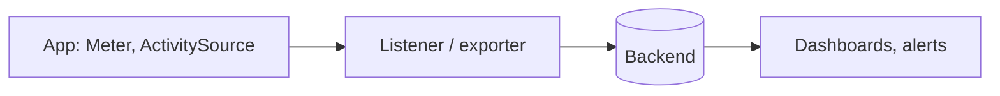

# Observability and SLOs: expert

🌐 [Русский](expert.ru.md) · **English**

**Levels:** [overview](overview.en.md) · [1. Basics](basics.en.md) · [2. Advanced](advanced.en.md) · **3. Expert** · [4. Quiz](quiz.en.md)

## Under the hood

`Meter` and `ActivitySource` are publication points. While nobody subscribes they cost almost nothing; a library can be instrumented without knowing who will export and where.



## Reference

| Sampling | Idea | Con |
|---|---|---|
| Head | decide at the start of a trace | rare errors may be missed |
| Tail | decide after completion | buffering is needed |
| By trace id | all services decide the same | the share is set in advance |

| Metric set | Contents |
|---|---|
| RED (for services) | rate, errors, duration |
| USE (for resources) | utilization, saturation, errors |

| `tracestate` | |
|---|---|
| members | at most 32 |
| one key | once |

## Gotchas

### StartActivity without a listener

```csharp
var source = new ActivitySource("x");
var a = source.StartActivity("op");
a!.SetTag("k", 1);
```

Result: `NullReferenceException`. The `!` operator only silences the compiler. The code works where an exporter is configured and fails where it is not.

### A percentile from a histogram is an estimate

In the test the slow server gets 10 values of 1.5 s, and `QuantileUpperBound(0.99)` answers `2`: that is the bucket bound. After merging with 990 fast values p99 is `0.1` and p99.9 is `2`.

## Trade-offs and alternatives

| Choice | Pro | Con |
|---|---|---|
| Metrics | cheap, long retention | no request details |
| Logs | details | volume |
| Traces | the request path | sampling |
| Auto-instrumentation | quick | no business meaning |

## Interview questions

**1. How does observability differ from monitoring?**

<details><summary>Answer</summary>

Monitoring answers questions set in advance, observability lets you ask new ones.

</details>

**2. What are a span and a trace?**

<details><summary>Answer</summary>

A span is one operation; a trace is a tree of related spans of a request.

</details>

**3. How is context passed?**

<details><summary>Answer</summary>

In the `traceparent` header; in messages, in message properties.

</details>

**4. Why not a `user_id` tag?**

<details><summary>Answer</summary>

An explosion of time series.

</details>

**5. Counter or Histogram for duration?**

<details><summary>Answer</summary>

Histogram.

</details>

**6. Why can p99 not be averaged?**

<details><summary>Answer</summary>

A percentile is not additive; you merge distributions.

</details>

**7. What is a burn rate?**

<details><summary>Answer</summary>

The speed of consuming the error budget relative to the SLO.

</details>

**8. How do head and tail sampling differ?**

<details><summary>Answer</summary>

In the moment of the decision: at the start or after completion.

</details>

**9. What does `StartActivity` return without listeners?**

<details><summary>Answer</summary>

`null`.

</details>

**10. Trick question: all dashboards are green, users complain. How?**

<details><summary>Answer</summary>

The wrong thing is measured: averages instead of percentiles, the server side without the network and client, a small segment drowned in the total.

</details>

## Related materials

- [Advanced theory](advanced.en.md)
- [Quiz](quiz.en.md) and [exercises](exercises.en.md)

## Sources

- [W3C Trace Context](https://www.w3.org/TR/trace-context/)
- [.NET: tracing instrumentation](https://learn.microsoft.com/dotnet/core/diagnostics/distributed-tracing-instrumentation-walkthroughs)
