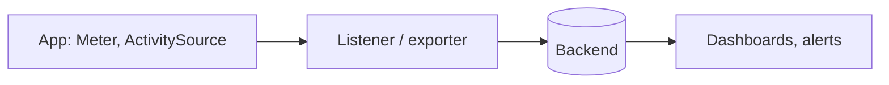
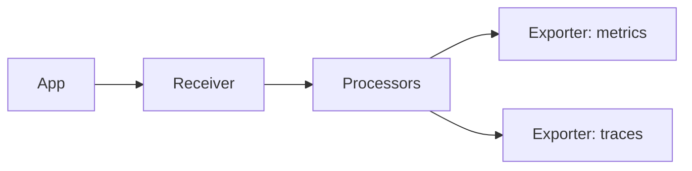

# Наблюдаемость и SLO: экспертная теория

🌐 **Русский** · [English](expert.en.md)

**Уровни:** [обзор](overview.ru.md) · [1. Базовая](basics.ru.md) · [2. Продвинутая](advanced.ru.md) · **3. Экспертная** · [4. Квиз](quiz.ru.md)

## Под капотом

`Meter` и `ActivitySource` — это точки публикации. Пока никто не подписан, они почти ничего не стоят; библиотека может инструментироваться, не зная, кто и куда будет экспортировать.



### OpenTelemetry Collector

Отдельный процесс между приложениями и хранилищами телеметрии. Конвейер состоит из receivers (принимают), processors (преобразуют, отбрасывают, сэмплируют) и exporters (отправляют; каждый получает копию). Разворачивают как агент рядом с приложением или как шлюз, принимающий данные от многих агентов. Так приложения не знают, куда в итоге уходит телеметрия.



### Exemplars

Exemplar — это записанное значение метрики вместе с контекстом трассы (`trace_id`, `span_id`, время, значение). От «p99 вырос» можно перейти к конкретной медленной трассе. OpenTelemetry .NET поддерживает exemplars, но польза есть, только если их понимает бэкенд.

```csharp
// The current activity carries the trace id; without one there is nothing to link to.
if (Activity.Current is { } activity) _exemplars[i] = (value, activity.TraceId.ToHexString());
```

Файл: [Ex03_Exemplars.cs](code/Examples/Ex03_Exemplars.cs). Это модель идеи.

### Сэмплирование логов

Пакет `Microsoft.Extensions.Telemetry` добавляет семплеры: по решению трассировки, вероятностный (по категории, уровню, event ID) и свой.

```csharp
// Only this level is sampled: warnings and errors are always kept.
builder.AddRandomProbabilisticSampler(informationProbability, LogLevel.Information);
```

Рекомендация документации: `Error` и `Critical`, а также `Trace` и `Debug` не сэмплировать, `Information` — да, `Warning` — по обстоятельствам. Файл: [Ex04_LogSampling.cs](code/Examples/Ex04_LogSampling.cs).

### Профилирование

Метрики говорят, что сервис тратит процессор, профиль — на что. `dotnet-counters` показывает счётчики и метрики живого процесса, `dotnet-trace` собирает трассу через EventPipe без нативного профилировщика (`.nettrace`, можно преобразовать в формат Speedscope). Непрерывное профилирование собирает такие профили постоянно с малой частотой, чтобы было с чем сравнить после инцидента.

### Синтетический мониторинг

Скрипт регулярно выполняет пользовательский сценарий из нескольких мест и замечает проблему до жалоб, в том числе когда реального трафика нет.

```csharp
public static bool ShouldAlert(IReadOnlyCollection<bool> succeededByLocation) =>
    succeededByLocation.Count(ok => !ok) > succeededByLocation.Count / 2;
```

## Справочник

| Сэмплирование | Идея | Минус |
|---|---|---|
| Head | решение в начале трассы | редкие ошибки могут не попасть |
| Tail | решение после завершения | нужно буферизовать |
| По trace id | все сервисы решают одинаково | доля задана заранее |

| Набор метрик | Состав |
|---|---|
| RED (для сервисов) | rate, errors, duration |
| USE (для ресурсов) | utilization, saturation, errors |

| `tracestate` | |
|---|---|
| членов | не более 32 |
| один ключ | один раз |

| Инструмент | Для чего |
|---|---|
| `dotnet-counters monitor` | быстрый взгляд на метрики процесса |
| `dotnet-counters collect` | запись в CSV или JSON |
| `dotnet-trace collect` | профиль и события runtime |
| `dotnet-trace report` | сводка по собранной трассе |

| Вид мониторинга | Видит | Не видит |
|---|---|---|
| Синтетический | сценарий снаружи, без трафика | разнообразие реальных пользователей |
| Реальных пользователей | настоящий опыт | сценарии без посетителей |
| Серверные метрики | внутренности | сеть до клиента |

## Подвохи

### StartActivity без слушателя

```csharp
var source = new ActivitySource("x");
var a = source.StartActivity("op");
a!.SetTag("k", 1);
```

Результат: `NullReferenceException`. Оператор `!` только заглушает компилятор. Код проходит там, где настроен экспортёр, и падает там, где его нет.

### Перцентиль из гистограммы — оценка

В тесте медленный сервер получает 10 значений по 1,5 с, а `QuantileUpperBound(0.99)` отвечает `2`: это граница корзины. После объединения с 990 быстрыми значениями p99 равен `0.1`, а p99,9 — `2`.

### Из двух семплеров действует последний

```csharp
l.AddRandomProbabilisticSampler(0.0, LogLevel.Information);
l.AddRandomProbabilisticSampler(1.0, LogLevel.Information);
```

Из десяти записей `Information` сохранились все десять; при обратном порядке — ни одной. Первая настройка молча игнорируется.

## Компромиссы и альтернативы

| Выбор | Плюс | Минус |
|---|---|---|
| Метрики | дёшево, долгое хранение | нет деталей запроса |
| Логи | детали | объём |
| Трассы | путь запроса | сэмплирование |
| Автоинструментирование | быстро | нет бизнес-смысла |

## Вопросы с собеседований

**1. Чем наблюдаемость отличается от мониторинга?**

<details><summary>Ответ</summary>

Мониторинг отвечает на заранее заданные вопросы, наблюдаемость позволяет задавать новые.

</details>

**2. Что такое спан и трасса?**

<details><summary>Ответ</summary>

Спан — одна операция; трасса — дерево связанных спанов запроса.

</details>

**3. Как передаётся контекст?**

<details><summary>Ответ</summary>

Заголовком `traceparent`; в сообщениях — свойствами сообщения.

</details>

**4. Почему нельзя тег `user_id`?**

<details><summary>Ответ</summary>

Взрыв числа временных рядов.

</details>

**5. Counter или Histogram для длительности?**

<details><summary>Ответ</summary>

Histogram.

</details>

**6. Почему нельзя усреднять p99?**

<details><summary>Ответ</summary>

Перцентиль не аддитивен; объединяют распределения.

</details>

**7. Что такое burn rate?**

<details><summary>Ответ</summary>

Скорость расхода бюджета ошибок относительно SLO.

</details>

**8. Чем head отличается от tail sampling?**

<details><summary>Ответ</summary>

Моментом решения: в начале или после завершения.

</details>

**9. Что вернёт `StartActivity` без слушателей?**

<details><summary>Ответ</summary>

`null`.

</details>

**10. Подвох: все дашборды зелёные, пользователи жалуются. Как так?**

<details><summary>Ответ</summary>

Измеряется не то: среднее вместо перцентилей, серверная сторона без сети и клиента, редкий сегмент тонет в общем.

</details>

**11. Из чего состоит конвейер OpenTelemetry Collector?**

<details><summary>Ответ</summary>

Receivers, processors и exporters.

</details>

**12. Что такое exemplar?**

<details><summary>Ответ</summary>

Значение метрики со ссылкой на трассу, позволяющее перейти от графика к конкретному запросу.

</details>

**13. Какие уровни логов не стоит сэмплировать?**

<details><summary>Ответ</summary>

Ошибки и критические; документация не советует сэмплировать и Trace с Debug.

</details>

**14. Чем `dotnet-counters` отличается от `dotnet-trace`?**

<details><summary>Ответ</summary>

Первый показывает значения счётчиков и метрик, второй записывает события и профиль выполнения.

</details>

**15. Подвох: синтетическая проверка из одной точки упала. Будить дежурного?**

<details><summary>Ответ</summary>

Сначала подтвердить из других точек: возможна проблема самой точки или пути от неё.

</details>

## Связанные материалы

- [Продвинутая теория](advanced.ru.md)
- [Квиз](quiz.ru.md) и [упражнения](exercises.ru.md)

## Источники

- [W3C Trace Context](https://www.w3.org/TR/trace-context/)
- [.NET: инструментирование трассировки](https://learn.microsoft.com/dotnet/core/diagnostics/distributed-tracing-instrumentation-walkthroughs)
- [OpenTelemetry Collector: архитектура](https://opentelemetry.io/docs/collector/architecture/)
- [OpenTelemetry: exemplars](https://opentelemetry.io/docs/specs/otel/metrics/data-model/#exemplars)
- [.NET: сэмплирование логов](https://learn.microsoft.com/dotnet/core/extensions/log-sampling)
- [dotnet-trace](https://learn.microsoft.com/dotnet/core/diagnostics/dotnet-trace)
- [dotnet-counters](https://learn.microsoft.com/dotnet/core/diagnostics/dotnet-counters)
